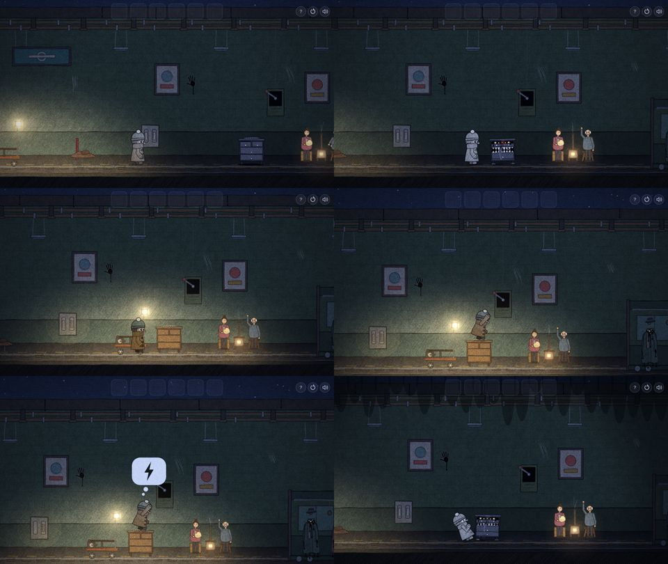

# 夜里 · 第 12 关：旧地铁（做成的样子）

> 2026-11-26（怪物的脾气）：**长椅边的人**坐不住了（站起来走几步又回到长椅边）；它、两位乘客、抱花的大衣在孩子走近的时候会转过头来盯着他（还是不追人）。抽屉嘴没动。规则没动，见 `docs/night-monster-roster.md`。

> 2026-11-25：灯崽去掉了，保险盒一直看得见，最少 10 → 9 步。见 `docs/night-followers-removed.md`。下面是去掉以前的记录。
> 2026-11-25（后来）：轨道段有了一家三口（妈妈抱着婴儿、爷爷，围着一只小炉子），手摇车从他们面前滑过的时候妈妈把襁褓护紧；规则没动。见 `docs/night-people.md`。
> 2026-11-26：信号箱底下多了一只**抽屉嘴**（一只旧五斗柜，第一只不是衣服的怪物）：手摇车的灯照倒它以后，它塌成一只矮柜，孩子要**站上去**才够得着挂高了的信号扳手。最少还是 9 步，规则多一道门 `mcb`、一块地方 `m1b`；见下面“抽屉嘴”一节和 `docs/night-monsters.md`“第十一只”。

2026-11-23。照 `docs/night-story-c.md` 第 12 关那一行做：旧地铁，8 分钟，6–8 步。新的光是**手摇车的灯**、**信号灯**；衣服是**坐着的乘客**（车一动就跟着晃）；露出来的东西是**一束花**（一件大衣抱着一束花，一直朝车门使劲，等的人一直没来）。

代码在 `games/house.html` 里。直接玩第 12 关：地址后面加 `?lv=12`（前十一关照最短的解法当作走完，孩子站在站台的左头；不读也不写存档）。

## 一张图

接着第 11 关尽头那几级台阶往右（x 39540 到 43040），地面和前面一样高，不切屏幕，仍在地下，背景是瓷砖的墙、顶上的肋拱和管子，很暗。走回左边能回到第 11 关的通道（台阶口的黑门洞）。

| 一段 | x | 有什么 |
|---|---|---|
| 站台 | 39540–40640 | 一盏一直亮着的站台灯（x 39700，裸灯泡）；一块没有字的蓝站牌；钉在墙上的一块板子，挂着扳手、锤子和摇柄（钩子 x 39900）；站台边一道钢轨；轨上停着一辆手摇车（x 40060）；右边一个站着不动的人（x 40430，坐在椅子上的那件外套醒着，站起来了）挡着路 |
| 轨道 | 40640–41740 | 两个空画框；墙上一个小箱子（x 41360，2026-11-26 起挂得高），里面一根信号扳手；**箱子左边立着一只旧五斗柜（x 41245，抽屉嘴，见下面“抽屉嘴”）**；一根线从箱子上爬到顶上，往右一路接到车厢那头的信号灯 |
| 旧车厢 | 41740–43040 | 车厢（x 41960–42780，剖开：后墙、三扇窗、吊环、扶手杆）；两位乘客（x 42060、42200）；车门口一件抱着花的大衣（x 42630）；车门（x 42735）；门外信号灯杆（x 42850）；尽头一个黑洞洞的隧道口 |

## 一步一步

最少 8 步（`node tools/check.mjs`：第 12 关 8 下、11 个局面、没有死路）。

1. **拿摇柄**：站台墙上钩子上挂着。
2. **摇柄装在手摇车的发电机（飞轮）上摇**：车头的灯亮；手摇车的闸也跟着松了。灯照着长椅边那个人，它塌下去（`mp1`），路通了。空着手点飞轮：孩子的手摸到一个空的，气泡里画摇柄。
3. **推手摇车**：松了闸以后才推得动（空着手点而灯没亮：推不动，气泡里画摇柄），手摇车滑到轨道那一段，灯跟着走。
4. **扳信号扳手**（轨道那一段的小箱子；2026-11-26 起挂高了，要站上抽屉嘴塌成的柜子才够得着）：车厢那头的信号灯亮了（黄灯，算光；红、绿两个镜片只是颜色，不算），照着车门口抱花的大衣，它塌下去，**花掉在它脚边的地上**（`mw`）。
5. **再推一把手摇车**：手摇车滑过去，撞上车厢的头，**车一动，吊环和乘客跟着晃**（晃一阵，慢慢停），灯照着两位乘客，他们也塌下去，坐在座位上（`mp2`、`mp3`）。
6. **拿花**：走到车门口，花躺在大衣塌下去的那一摊上。
7. **拿花垫在车门的轨道里**：车门自己要合上（空着手推开又合上，气泡里画花），拿花垫在门轨里，门就不再合上。
8. **走出车门**：这一关过了，走到 x 43000。

规则一关一段（`START12`、`ITEMS12`、`VALUES12`、`GATES12`、`LINKS12`、`SPOT_ZONE12`、`act12`）。名字都用 `m` 开头（规则里的是 `mHandle`、`mLamp`、`mAt`、`mSig`、`mBq`、`mDoor`、`mOut`，点是 `mHandleH`、`mCrank`、`mPush`、`mLever`、`mShove`、`mBqH`、`mDoor`、`mExit`，衣服是 `mp1`、`mp2`、`mp3`、`mw`；画和每帧更新的名字也是 `m` 开头：`paintMetro`、`drawMt…`、`mtUpdate`、`MT`、`MCART`……），全游戏不重（`tools/check.mjs` 查规则里的名字，代码里的名字我用 grep 对过）。走出这一关身上不带东西：摇柄装在手摇车上，花垫在门里。

被衣服吓回来的地方（`GATES12`，页面里的位置在 `GATEPOS`）：站台长椅边的人（x 40250 停）、车厢里的两位乘客（x 41800、42130 停）、车门口抱花的大衣（x 42440 停），共 4 处，0 次被抓。

## 新的规则、旧的规则

- 旧的：衣服在暗处醒着，光照到头就塌。这一关四件衣服都一直醒着不动（站着，不追人）：孩子走到跟前就不敢再往前（气泡里画能让它塌的东西）。塌了以后一直塌着（`keepDown`，和第 10 关一样），所以灯换了位置它也不会再站起来。
- 新的（第三条，衣服照着它的人在做的事动）：**车一动，吊环和站着的乘客跟着晃**（`mtSway`：手摇车撞上车厢的那一下，车厢整个晃一下，晃一阵慢慢停；吊环、乘客跟着摆；塌下去以后坐着的也跟着晃）。这一关里它是一个看得见的动作，不是门：晃不晃并不改变能不能走过去。门是灯：手摇车的灯顶到车厢跟前，才照得到乘客的头。
- 没用到的：第一条新规则（被碰到抱走一只光）**没做**，这一关里衣服不会碰到孩子；第二条新规则（把光递给衣服）**没做**，也没有进门时的小光数量。需要“光的数量”的地方没有，所以没有动全局引擎。
- 手摇车的灯是一盏会走的灯：`LIGHTS` 里 `mlc`，位置跟着 `V.mcx`（手摇车滑到哪儿，灯跟着到哪儿）。三盏灯：站台灯（`mla`，一直亮，保证开场有地方可回）、手摇车的灯、信号灯（`mls`）。三盏的范围（R）调到：手摇车在站台时照得到长椅边那个人，在车厢跟前时照得到两位乘客、照不到车门口那件；信号灯照得到车门口那件、照不到乘客（量过每个头上的亮度，见下面）。
- 塌下去了没有记在页面里（`V.mSeen1`、`mSeen2`、`mSeenW`）：灯照着，那件塌下去了，孩子才敢走过去。保底：灯亮了 4.5 秒还没塌下去，也算塌了，不会因为照不准卡死（自动试玩里每一处都是自己塌的，保底没有用上）。

## 不出字怎么告诉玩家

- 走到衣服跟前就停（吓回来）：长椅边的人和两位乘客，气泡里画摇柄（还没摇）或扳手（手摇车已经推了）；抱花的大衣，气泡里画扳手。
- 空着手点飞轮：气泡里画摇柄。手摇车的闸没松就推：气泡里画摇柄。空着手推车门：气泡里画花。
- 点不到的：花（抱花的大衣塌了才看得见）。
- 右上角 `?`：照最短的解法，下一步的地方亮一个圈；推手摇车、扳手、摇柄那几步画箭头和对应的东西。
- 卡住两分钟以后才慢慢闪的小星星：钩子上的摇柄、飞轮、手摇车、扳手、地上的花、车门。

## 抽屉嘴（2026-11-26）

主人说：“怪物也不一定得是衣服，还可以是柜子，可以站上去的。”做在这一关，是因为轨道那一段的信号箱本来就在墙上，往高一挂、底下放一只柜子，“站上去”就有了用处；手摇车的灯又正好会扫过去照倒它。

- **布局**：信号箱挂高了（`MLEV.y` 830 → 706，箱子中心离地 294，扳手 686）；信号箱左边，**柜子正中 x 41245**（`CAB`：宽 116，柜面高 121，占 41187–41303），画在手摇车后面（手摇车滑过去的时候从柜子前面过）。怪物是 `GARB.cab`（`kind: 'cab'`，`ai: 'bump'`，`partner: 'mcb'`，`keepDown`，睡着的时候孩子走到 480 以内才醒）；画是 `mzCab`、`mzCabHome`、`mzCabHeap`（图鉴 `?monsters=cab`）。
- **规则**：`GATES12.mcb = s => s.mAt >= 1`（手摇车推到了轨道这一段），`LINKS12` 是 m0 →（mp1）→ m1 →（**mcb**）→ **m1b** →（mp2）→ m2 →（mp3）→ m3 →（mw）→ m4；`SPOT_ZONE12.mLever` 从 `m1` 挪到 `m1b`。解法还是那 9 步（`mHandleH mHandle→mCrank mPush mShove mFzH mLever mBqH mBq→mDoor mExit`）：爬柜子不是单独的一步，是 `mLever` 这一步里孩子怎么够到扳手。局面 14 → 13 个（扳手不能比推手摇车早了），岔开 1.4 → 1.3，没有死路，`check.mjs` 里别的关一字不差。`?lv=13`–`21` 回放第 12 关的解法时多认 `m1b` 这一块。
- **页面里**：`GATEPOS.mcb`（x 41150，孩子停在 41110；`mtZoneAt` 在 41150 分出 m1 和 m1b）；热点 `mLever` 的站位挪到柜子左边（41157），`startAct` 里 `mLever`：跳上柜面（`hopTo(CAB.x, CAB.h)`，和第 3 关的小板凳一个路子）、伸手扳、往右跳下来；`mShove` 热点要等 `V.mSeenC`（柜子塌了）才有；没合保险（`dk12`）也先跳上柜子，伸手一扳没反应，气泡里画闪电，往左跳下来；`mtUpdate` 里 `V.mSeenC`（和 `mSeen1` 等同一个写法，4.5 秒保底）；`gateHint('mcb')`：灯没亮画摇柄、亮了画箭头；`snapTo`、`V` 初始、`respawn` 对应补上；`drawMtDyn` 先画柜子再画手摇车（`GARB.cab.back`，`drawDynamic` 的通用循环跳过它）。
- **没动**：别的衣服（长椅边的人、两位乘客、抱花的大衣）、一家三口、手摇车和信号灯一点没动；存档不用多记东西（柜子塌没塌是 `mAt` 推出来的）。

## 抽屉嘴查过的

- `node tools/check.mjs`：第 12 关 9 下、13 个局面、没有死路；别的关一字不差（和 main 的输出对过）。
- 无头 Chromium：`?lv=12&auto=1` 约 78 秒走到车门外（原来约 75 秒），10 下，0 次被抓，没有报错；`?lv=11&auto=1` 一路走过第 12 关；`?lv=10`、`?lv=11`、`?lv=13`–`?lv=21`、默认页打开没有报错。
- 逐样试过（`__house` 里摆局面、暂停一帧一帧走）：睡着（暗处是一只普通的柜子）→ 走到 480 以内醒 → 孩子站在 41100 不动：0.5 秒后开始预兆，2.2 秒后蹦，落地砸住（被抓）→ 回到站台灯底下；手摇车推过来，灯扫过去，车滑到 x 40700 左右它塌下去；点信号箱：走过去、跳上柜面、伸手、扳下去、跳下来；没合保险：气泡里画闪电；点信号箱的时候柜子还醒着：走到柜子前面 40 被吓退，柜子开始预兆。
- 乱来：每组 90 步随机点第 12 关的点（带着或不带东西）、随机点地图上的地方、随机点提示，每步查没有 NaN、孩子没有在手摇车没推过来的时候越过柜子、柜子离原处不超过 120、站高不是半截；乱来完照提示接着走。40 组种子都走出了车门（共爬上柜子 28 次、柜子蹦了 79 次、被柜子抓住 4 次），0 条违例，没有报错。
- 手机竖屏 390×844 的图鉴页看过；没有在手机上点第 12 关。

## 抽屉嘴没做 / 有疑点的

- 没亲手玩，没在真手机上试；声音全是已有的（拉开抽屉用 `snd.clack`，蹦用 `boing`，落地 `thump` + `snap`）。
- 蹦的距离 84、抓的范围 74、预兆 2.2 / 1.25 秒是拍的；“被吓退以后站着不动才会被咬到”靠的是落点差 15，手机上手指拖着走的容错没有量。
- 手摇车的灯范围很大，柜子在灯滑到 480 以外就塌了，“灯照到它”那一下更像灯光慢慢扫过去；要它更晚塌（车滑到跟前才塌），得改灯的范围，那会动第 12 关别的衣服。
- 柜子醒着的时候头顶是安全的、能驮人，这一层没做（`docs/night-monsters.md` 要主人定的第 6 条）。
- 站在柜面上够扳手的那一下，手臂往右上伸出去：近看有点够不着的样子，手机上看不看得清要玩。

## 存档

接着 `house.save.v3`：`SAVE_KEYS` 多了第 12 关那几项，读旧存档照开局补上；走出车门就清掉。第 11 关走下台阶不再结束游戏（新加 `V.ucDone`）。存档的读写没有单独试过（`?lv=12`、`?auto=1` 不读不写存档），`SAVE_KEYS` 等照第 11 关的样子加了，没验证。

## 查过的

- `node tools/check.mjs` 通过：第 12 关 8 下、11 个局面、没有死路、少点哪一处都走不出去、走出去时身上不带东西；前十一关那几行没变。
- 无头 Chrome（deviceScaleFactor 1）里：`?lv=12&auto=1` 从站台自动玩到车门外（游戏里约 50 秒，0 次被抓，没有报错；每一件衣服都是被灯自己照塌的，没有用到保底）；`?lv=11&auto=1` 从第 11 关一路走进第 12 关、走到车门外（0 次被抓，没有报错）。`?lv=10&auto=1`、`?lv=9&auto=1` 这回没有重跑（第 12 关没有动第 10、9 关的东西）。
- 屏幕上看过（1280×720）：站台（开场、摇柄装上以后灯亮、长椅边的人塌下去）、轨道（手摇车推过来、扳手）、车厢（乘客醒着、手摇车顶到跟前、塌下去、信号灯亮、车门垫住、走出去）、手机横屏 844×390 一套（自动玩，每做成一步截一张）。
- 随机点：`?lv=12` 起点，只点第 12 关的东西（加几下乱点画面），4 组种子、每组最多 260 步，四组都自己走到了车门外，0 次被抓，没有报错；另外 5 组种子、每组 500 步完全随机乱点，没有报错（随机走会跑回前面的关去，没有走到这一关的尽头）。

## 没做 / 有疑点的

- 第一条新规则（抱走一只小光）、第二条（递光）、出口小光飞去钟楼：都没做。
- **花垫在车门里**是这一关最牵强的一步：一束花当门挡，现实里不太靠得住（花会被压坏）。骨架里露出来的东西是花，所以让它帮一把；要是主人觉得不对，可以换成花上的纸包、花瓶，或者让花是放在座位上不用拿。
- “坐着的乘客”画成**站着拉着吊环**的人（醒着的时候站起来，和第 10 关观众一样：没醒的时候坐在座位上，灯一照塌在座位上）。车一动跟着晃，是整个车厢和乘客在暗的那一层里平移、吊环摆，不是逐帧算的人体。
- 车厢是剖开的：孩子走在车厢里的“地”上，其实是走在站台那条线上，车厢的后墙在他后面；没有分前后层（和观众厅一样）。
- 光的亮度是量出来的：手摇车的灯 R 1200、信号灯 R 900，每个该被照到的头在 0.65 以上（`coverage` 阈值 0.55），不该照到的头在 0.06 以下；灯的范围大，暗的那一层是一大片柔光。站台左头（x 39540，和第 11 关的交界）站台灯的范围到这儿有一条竖着的硬边，没处理。
- 手摇车滑过去的速度、撞上车厢的晃法是凭眼睛调的，没有亲手玩过，没有测过手感；撞车厢那一下用了已有的 `snd.thump`，没有新的声音。
- 没亲手玩，没在真手机上试，没截手机竖屏的图。

（2026-11-24）这一关加了要灯崽的谜题：信号线的保险盒在墙上的黑里，灯崽照着才合得上：最少 10 步，见 `docs/night-orb-puzzles.md`。
