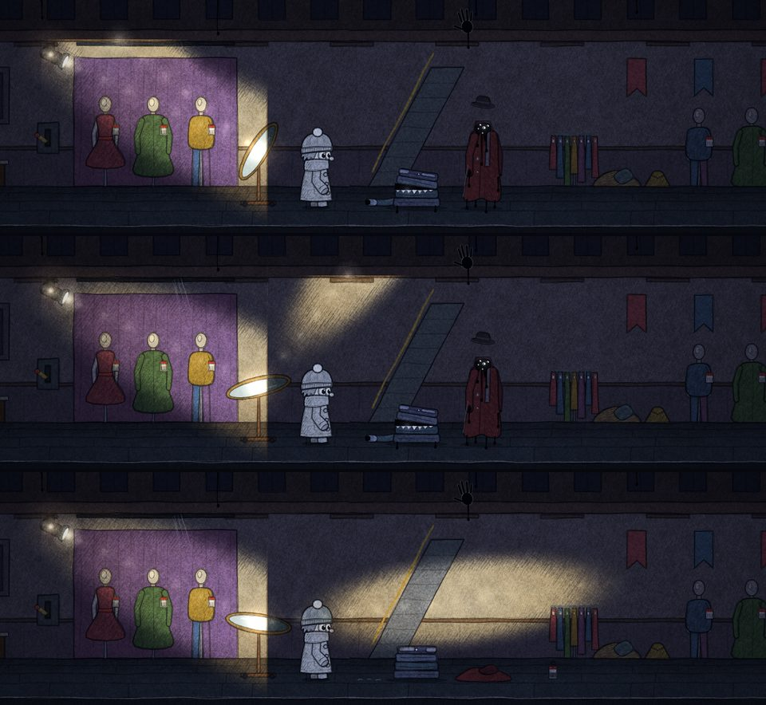
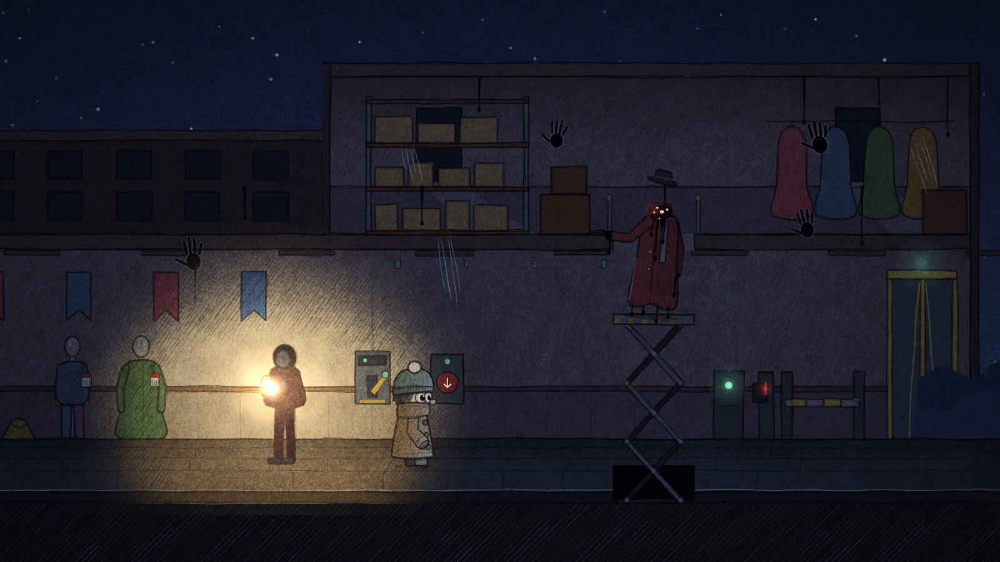

# 夜里 · 第 17 关：百货大楼（做成的样子）

> 2026-11-25（货梯间）：主人说“可以设计一个那种需要升降机的关卡：怪物在一楼巡逻挡住路，按一个按钮把它用升降机升到二楼去，人物就能通过”，又说“别弄试玩关卡，直接在现有关卡找地方加”。加在这一关的收银通道前面：一件夜班大衣在货梯间来回巡逻，要合闸、等它站到平台上、按按钮把它升上二楼、等它走远再把平台放下来。最少 **10 步**（原来 7 步）。**不靠光**。见下面“货梯间”一节。

> 2026-11-26（会转的镜子）：主人说“可以用镜子折射光线来驱赶怪物，你可以试试”。试衣镜原来只有三个写死的位置、光怎么反射也是手摆的；现在**镜子能一格一格转，光路按反射定律算**，转错了光会落到天花板、地上、陈列台那边，只有转到正好把射灯的光送到夜班店员头上才行。最少 **12 步**（原来 10 步：转镜子由 1 下变成 3 下）。设计、几何、每一格的落点见下面“试衣镜：光按反射定律算”一节。

> 2026-11-25（新怪物）：多了一只**叠好的衣服**（过道上、夜班店员前面，挂在那道门上：孩子看着它它就不动，一背过身它就往这边挪）。**规则一个字没动**（最少 7 步不变）；见 `docs/night-monsters.md`“做进游戏的十只”。

2026-11-23。照 `docs/night-story-c.md` 第 17 关那一行做：骨架 8 分钟、6–8 步。新的光：**镜子、橱窗射灯**；衣服：**人台上的衣服**（没人穿，不要光，递光给它没用）和**夜班店员**（人的衣服）；露出来的东西：**一个价签**。做出来最少 **7 步**（2026-11-25 加了货梯间，10 步；2026-11-26 试衣镜改成会转的，现在最少 **12 步**；自动试玩约四十秒，真人玩估计四五分钟，没有亲手玩）。

代码在 `games/house.html` 里。直接玩第 17 关：地址后面加 `?lv=17`（前十六关照最短的解法当作走完，孩子站在路障再往右一点的街面上；不读也不写存档）。

## 一张图

接着第 16 关的尽头（路障外，x 56300）往右，进百货大楼：**室内**，脚踩在街面的高度（`FL.sfc`，y = 700），楼的剖面（上面几层黑着的窗、屋檐、楼板，里面是一层大厅），三段：

| 一段 | x | 有什么 |
|---|---|---|
| 大厅 | 56390–57520 | 门口的旋转门；服务台（台面上一盏台灯）；墙上一块开关板（一根扳手）；陈列台：紫色的幕布前站着三个人台（红裙子、绿大衣、黄夹克，领口各挂一个价签），顶上的轨道上吊着射灯；陈列台右边靠墙立着一面试衣镜（侧着，只看得见一条边） |
| 过道 | 57520–58650 | 停着的扶梯；过道上守着第一位夜班店员（暗红的马甲，x 57800）；一个圆衣架；失物招领（一只木箱，里面一堆没人穿的衣服，旁边一只麻袋）；两个人台（蓝上衣、绿大衣）；人台后面站着第二位夜班店员（x 58590），旁边还有两个人台 |
| 货梯间 | 58650–59360 | 2026-11-25 新加的：墙上的闸刀盒（x 58730）、按钮盒（58850）；巡逻的夜班大衣（x 59030–59330 来回）；货梯（平台 59115–59245，和地面一样平；二楼地板在它正上方有个口）；平台边上的控制柜（59300）。原来在这儿的两个人台、两只收银柜台拿掉了。上面是**加高的二楼**：一个黑着的仓库（左边货架、箱子，右边衣架杆上挂着几件旧大衣，大衣升上来以后在这儿来回） |
| 收银通道 | 59360–59780 | 扫码器（红灯，原来在 59270，往后挪了 90）和一道横着的闸杆；出口的旋转门（头上一块绿色的牌子）；门外是街（x 59690 以后） |

不出字。走回左边能回到第 16 关（路障抬起来以后不再挡着）。

## 人和人台（这一关的一条新东西）

这一关不加新规则，只是让玩家**分得出哪件是人、哪件是人台**，递光、照光都要挑对：

- **人台上的衣服**：画出来的架子，一根杆子立在圆底座上，没有脸的头，领口挂一个价签；不动、不醒、没有眼睛，**没人穿，不要光**。用台灯去递给它（拿着台灯点人台，或点失物招领那一堆没人穿的衣服）：手伸出去，台灯的光从手里掉到地上，摊开、灭掉，孩子摇头。台灯还在手里，什么也没变。
- **夜班店员**：是人的衣服，暗处是一团墨，帽兜里有眼睛（眼睛闪着），马甲暗红、胸前一块名牌。第一位在过道上会追人，光照到头就塌；第二位站在人台中间，醒着但不动、不追人，只是挡着路：孩子走到它跟前（`bs2`，x 58480）就吓得退回来。
- 第 1 关楼梯口那堆脏衣服和厨房的麻袋这一关在失物招领里照应了一下：一只木箱里一堆衣服、旁边一只麻袋，都是没人穿的衣服，旁边什么也不放。点它们只能得到“光掉在地上”。

## 光

- **橱窗射灯**：陈列台顶上轨道上的一只射灯。大厅墙上的开关板扳一下才亮；亮了以后朝右下斜着照，照亮陈列台上的人台（亮了也不塌，也没有别的反应），一直照到陈列台右边的地上（`LIGHTS` 里的 `bsp`，光到镜子的位置就切断）。
- **试衣镜**（2026-11-26 起会转，见下面一节）：椭圆的镜子，装在立杆顶上的转轴上，立杆底下是木底座和两只小轮子。靠墙的时候差不多是竖着的；点一下，推到射灯的光里，立在射灯正对着的地方（光反射到天花板上）；再点，每点一下顺时针转 22.5°，光跟着扫过去，转到第 0 格正好照在过道上第一位夜班店员的头上（反射出去的一长条，`bmr`，和第 2、16 关车灯、探照灯同一种画法）。
- **台灯**：服务台上的台灯，拿起来是一件东西（不是靠电，是递出去的“光”）。递给第二位夜班店员：它接过去，抱着灯站在人台中间（`bgl`，一团暖光跟着它），不再挡路。

## 一步一步

最少 12 步（`node tools/check.mjs`：第 17 关 12 下、138 个局面、没有死路、少点哪一处都走不出去、走出去时身上不带东西、“自己变的”40 处都走得出去；加货梯间以前是 7 下、17 个局面，试衣镜改成会转以前是 10 下、23 个局面）。下面的编号还是 10 个“事”，其中**第 3 件（转镜子）要点 3 下**（第 5 格 → 6 → 7 → 0），所以是 12 下。

1. **扳开关**：大厅墙上的开关板，射灯亮了，照着陈列台。
2. **推试衣镜**：把试衣镜推到射灯的光里（立在射灯正对着的地方，从这一刻起光路里多了一面镜子）。
3. **转试衣镜**：每点一下顺时针转 22.5°，光跟着扫：推进去时在第 5 格（光打在天花板左边），点 3 下到第 0 格，光正好落在过道上第一位夜班店员的头上，它塌下去（1–3 件事里，扳开关和推镜子先后无所谓，转镜子要在推进去之后；转过头了就继续转，转满一圈 8 格回到起点）。
4. **拿台灯**：服务台上的（也可以更早拿，没有顺序）。
5. **拿价签**：第一位夜班店员塌了以后，价签掉在它脚边。
6. **台灯递给第二位夜班店员**：它抱着灯站在人台中间，不挡路了。递给人台没用（不用去试，也不会惩罚）。
7. **合闸**：货梯间墙上的闸刀盒，扳下去，货梯才有电（按钮盒的小灯、控制柜上的信号灯亮起来）。没合闸就按按钮：孩子摇头，气泡里画闪电。
8. **等大衣站到平台上，按按钮**：货梯间里一件夜班大衣来回巡逻，挡着去扫码器的路（孩子走到它跟前的闸位 x 58970 就不敢再往前）。按下去那一刻它站在平台上，喇叭响、绿灯闪 0.8 秒，平台连着它一起升到二楼。
9. **等它在二楼走远，再按一下**：平台升走了，地上是个坑，走廊是断的；大衣在二楼的仓库里来回，再也不靠近平台的口。它走远了再按，平台放回地上。
10. **价签扫码**：到收银通道的扫码器前，拿着价签点扫码器，“滴”一声，闸杆抬起来，走出去。（第 18 关做了以后，走出旋转门接着往右走进广场。）

规则一关一段（`START17`、`ITEMS17`、`VALUES17`、`GATES17`、`LINKS17`、`SPOT_ZONE17`、`act17`）。名字都用 `b` 开头：状态 `bLamp`、`bTag`、`bSw`、`bMir`（0 靠墙 / 1 推进光里；2026-11-26 以前还有 2 转过来，现在是 `bAng`）、`bAng`（转到第几格，0–7，开局 5）、`bHit`（光照到过店员的头了没有，锁住）、`bGive`、`bPow`（闸刀合了没有）、`bUp`（平台在二楼没有）、`bMon`（大衣在二楼没有）、`bOut`；点是 `bSwH`、`bMirH`、`bLampH`、`bManA`（陈列台上的人台）、`bManB`（过道里的人台）、`bHeapH`（失物招领）、`bTagH`、`bStaffH`、`bScanH`；衣服两件 `bs1`、`bs2`；画和每帧更新的名字：`paintBp`、`bpShell`、`bpMan`、`bpRack`、`bpDoor`、`bpClerk`、`drawBp…`、`bpUpdate`、`BP`、`BPP`、`BPY`（先 grep 过：全游戏原来没有 `b` 加大写字母开头的名字，也没有 `BP`、`BPP`；`tools/check.mjs` 查规则里的名字不重，通过）。

被衣服吓回来的地方（`GATES17`，页面里的位置在 `GATEPOS`，都在 10 号路上）：过道上第一位夜班店员前面（x 57600）、人台中间第二位夜班店员前面（x 58480）、货梯间里巡逻的大衣前面（x 58970，2026-11-25）。

## 引擎里动了哪几处

- 街面那条路（10→11 号点）的尽头 `YARD_END` 往右挪到 59680（原来是 56300）；三间屋子 `bpA`、`bpB`、`bpC`；镜头右边的界（两处）改成这一关的尽头。
- **第 16 关走出路障不再结束游戏**（和第 15 关做第 16 关时一样）：走出路障记一下“第 16 关过了”，接着往右走进百货大楼；“走完了”那一项换成了第 17 关的 `bOut`（`writeSave`、`readSave`、`tick`）。
- 闸杆没抬起来的时候，走到它跟前就停（`walkTo` 和拖着走 `driveBlock` 各一句，只看 10 号路、`S.fOut && !S.bOut`；2026-11-25 扫码器往后挪了 90，`BPP.scan` 跟着变）。
- 衣服、光的引擎没有动：第 16 关的 `garbUpdate` 里“站着不动的衣服”`idle` 和“拿了光站着的衣服”`holds` 这回直接用（第二位夜班店员）；`drawGarb` 多了一句让第二位店员抱着台灯站着的画法。

## 试衣镜：光按反射定律算（2026-11-26）

主人说“可以用镜子折射光线来驱赶怪物，你可以试试”。游戏里“光让衣服塌下去”本来就是怪物怕光的那一条，所以“驱赶”还是照这一条做：把光送到怪物的头上，它就塌。新的是**光怎么送过去**：以前试衣镜只有三个写死的位置、光束是手摆的（`BP_RAY2`），这回镜子是真的镜子。放在这一关，是因为射灯、试衣镜、夜班店员本来就在这儿，是全游戏唯一一处“光要靠镜子才照得到”的地方，改起来最小；别的关一个字没动。

**玩法**：射灯亮了以后，把试衣镜推进光里。镜子立在射灯正对着的地方，**每点一下顺时针转一格（22.5°，一共 8 格）**，光束跟着镜子扫过去，落在哪儿看得清清楚楚：

| 格 | 镜面的角 | 反射出去朝 | 光落在 |
|---|---|---|---|
| 5（推进去时） | 121.8° | 左上 | 天花板，陈列台上面 |
| 6 | 144.3° | 差不多正上方 | 天花板，镜子正上方 |
| 7 | 166.8° | 右上 | 天花板，过道上方（只差一格） |
| **0** | **9.3°** | **右，微微往上** | **夜班店员的头 → 它塌下去** |
| 1 | 31.8° | 右下 | 地上（x 57475），镜子右边一点 |
| 2 | 54.3° | 几乎朝下 | 地上，镜子脚边 |
| 3 | 76.8° | 左下 | 地上（x 57237），陈列台前面 |
| 4 | 99.3° | 朝左 | 扫过陈列台上的人台，落在左边的墙上（人台亮了，不塌） |

（角度从 +x 朝下转为正；上表是 `node tools/check.mjs` 里“试衣镜每一格的光”那一段列出来的。）推进去的时候在第 5 格，转 3 下到第 0 格；转过头了接着转，8 格一圈。店员塌了以后镜子还能转（光穿过去，落在过道上），它不会再站起来。

**怎么算的**（规则和页面共用一份几何，在核心那一段，`traceBeam`）：
- 一束光从 (x, y) 朝某个角射出去，碰到镜子（一条线段，半长 62，两面都反光）就按反射定律拐弯：**出射角 = 2 × 镜面的角 − 入射角**；碰到屋子的边（天花板 y 350、地 y 700、两头）就停；碰到目标（一个矩形）也停，记下命中。可以连着拐好几次弯（现在只有一面镜子，用到一次）。
- 这一关的数（`BPO`）：射灯头 (56896, 382)，镜子转轴 (57330, 584)，射灯正对着转轴照，所以不管镜子转到哪一格，射灯的光都打在镜面中心上；夜班店员的头够得着的一片 `[57690, 500, 57910, 565]`（它在 57720–57880 之间来回，头在 y 500–565）。**第 0 格的镜面角不是写死的，是算出来的**：`a0 = (入射角 + 朝店员头正中的出射角) / 2`，所以改射灯或店员的位置，第 0 格自己跟着变。
- 命中的那一片够宽（朝店员头正中射，整片头都罩得到），相邻两格的光差 45°，落在一两百像素以外，不会两格同时命中；`check.mjs` 里验了：只有第 0 格命中。

**规则怎么记**：
- `bMir`：0 靠墙 / 1 推进光里（以前还有 2，现在拿掉了）；`bAng`：转到第几格（0–7，开局 5）；`bHit`：光照到过店员的头了没有，**锁住**。`act17` 外面包了一层：每一步做完用 `bpHit17(s)` 量一下（射灯亮着、镜子在光里、这一格的光路穿过了店员的头），量到了就 `bHit = 1`。这样扳开关、推镜子、转镜子哪个先哪个后都行；也让“店员塌了就塌了”和“镜子再转开”不打架。
- `GATES17.bs1 = s => s.bHit === 1`（以前是 `bSw === 1 && bMir === 2`）。
- 状态编成一个数的时候，每一项原来最多 3 个值；`bAng` 有 8 个，所以 `mkLevel` 里改成每一项按自己的进制（最少 3）。别的关每项都不到 4 个值，进制还是 3，编出来的数一个字没变。`check.mjs` 里“最多 33 项、每项最多 3 个值”那一句改成“编出来的数不超过 2^53”。
- `check.mjs` 多两行：光路函数自己的例子（水平的镜子、竖着的镜子、擦着镜子边过去、命中矩形）；试衣镜每一格的落点表（只有第 0 格命中、起点不是命中、镜子没推进去 / 开关没扳都没有命中、命中的是整片头）。

**页面**（都在 `games/house.html`）：
- 每一帧 `bpUpdate` 里用**转动中的角度**（`V.bmkA`，往目标格追，约 0.3 秒；`V.bmkU` 是一直往上数、不回绕的格数，所以镜子只顺时针转，不会从第 7 格倒着转回第 0 格）重新算一遍 `traceBeam`，得到 `V.bBeam`（画光束，店员的头还在就打在头上）和 `V.bBeamL`（照亮用，不管头在不在）。光束是一段一段画的：射灯那一段、镜子反射出去的那一段，落点（镜面上、天花板上、地上、店员头上）各一团亮。
- 光锥 `bsp`（射灯那一段，到镜子或地上为止）和 `bmr`（反射出去的一段，朝哪儿就是当帧算出来的角，`rot = π/2 − 方向角`，剪裁框是整间屋子，顶到天花板）都是动的。店员塌不塌还是游戏原来的规矩：**光锥真的盖到它头上（`coverage` > 0.55）它才塌**，所以光束扫到头上的那一刻它开始塌、画面和判定同步（量过：镜子转到 7.59 格时光还在过道上方，7.93 格时落在头上、店员塌到一半）。塌了以后 `V.bSeen1`（原来的“孩子才敢走过去”那一项）让它保持塌着；万一光扫过去太快没塌透，`bHit` 之后 1.8 秒 `keepDown` 兜底。
- `drawBpMirror` 按角度画：椭圆的长轴就是镜面（光在这条线上反射），一个转轴旋钮，一根立杆；靠墙时站在 99°（差不多竖着，第 4 格），推进光里以后滑到转轴上、转到第 5 格。`drawBpGlow` 画光束；热点 `bMirH` 在镜子推进去以后一直点得动（点一下转一格，孩子站在镜子右边、手够得着转轴旋钮）。
- 存档、`?lv=17` 摆局面（`snapTo`）、小星星、提示都接上了；声音没动（推进去是 `thump`、`rattle`，转一格是 `clank`、`rung`）。

## 货梯间（2026-11-25）

主人要的是“怪物巡逻挡路，按钮 + 升降机把它升到二楼，人就能过”。放在这一关，是因为楼的剖面本来就有上面几层，收银通道又正好是去出口前的最后一段。

**一件夜班大衣（`GARB.bs3`，和 bs1、bs2 同一套颜色）在货梯间一楼来回巡逻**：59030（停 1.2 秒）→ 平台正中 59180（停 2.6 秒）→ 59330（停 1.2 秒）→ 59180（停 2.6 秒）→ 回来，一圈约 14.3 秒（走 6.7、停 7.6），**约一半的时间大衣的中心在平台上**（用游戏自己的模拟量出来的，0.52）。它不追人、不怕光（那儿没有灯能照到它，最近的一盏灯是服务台的台灯，递给第二位店员以后照到 58970）。孩子走近了它盯着看：眼睛变红、袖子伸出来一点；孩子在 x 58970 就被拦住（`GATEPOS.bs3`），走到那儿发抖退回来。

**货梯**：剪叉式的升降平台，平台板黄黑斜纹，和一楼地面一样平；平台下面三节交叉的臂折在地面下的坑里（坑 58 深）。平台升到二楼（y 330，和二楼地板一样平），二楼地板在平台正上方有个口，口的两边各一根黄黑的立柱；楼在这一段往上加高（`ROOMS.bpC.boxTop`，`bpWing`），露出二楼的仓库。闸刀盒（58730）、按钮盒（58850）、平台边上的控制柜（59300）用一根管线连着，沿着天花板走。控制柜上和按钮盒上的小灯是**绿的**（冷光，不算光，和别的关的绿灯一样只是好看）。

**怎么按**：
- 按钮在平台下面时是朝上的箭头，平台在二楼时是朝下的。按下去，喇叭先响、绿灯闪 `BPL.PRE`（0.8 秒），平台才动，升到顶要 `BPL.RISE`（3.4 秒）；平台在路上的时候按钮不理。
- **按下去那一刻**，大衣的中心在平台上（`bpOnPlat`），就跟着平台走（它抬起手臂，被带上去）；不在，平台空着升上去。平台一动，没被带走的大衣就留在它原来那一边（不往平台上走）。
- 升上去以后大衣在二楼停 1 秒，再走开，在仓库里 59340–59600 来回；它不再靠近平台的口。平台放下来的时候，它要是还站在平台上，又跟着回到一楼。

**规则怎么记这件事**：页面里“大衣站没站在平台上”是时间，不在规则里（和别的巡逻的衣服一样）。规则只记三项：`bPow`、`bUp`、`bMon`；按钮那一下规则先当大衣被带上去了（`bMon = 1`），页面里量过了再改成真的（`bpLiftGo`）：没站在平台上就改回 0（`liftMiss17`）、放下来的时候它还在平台上就改回 0（`liftBack17`）。这两种“改回去”写在 `L17.TIMED` 里，`tools/check.mjs` 查的就是：改回去以后，也都还走得出去。门 `bs3`（`bMon === 1 && bUp === 0`）：大衣在二楼、平台放回地上，走廊才通；页面里还要等平台真的落到地上才算开（`GATE_ALL.bs3`）。

**按错了的代价小，没有死路**：
- 大衣不在平台上就按：平台空着升上去，坑出现，孩子往坑边走会摇头（气泡里画货梯）；再按一下放下来，重来。
- 大衣在二楼的平台上就按下去（它还没走开）：它跟着回到一楼，接着巡逻。
- 往大衣那边走：在闸位发抖、退回来（和别的衣服的“不敢过去”一样，不会被抓）。

**没通电**：没合闸就按按钮，孩子摇头，气泡里画闪电（`needPow17`，和第 3、12 关的“闸要先合上”一个图）。卡住两分钟以后慢慢闪：闸刀盒；按钮（现在按得成的时候：大衣站在平台上 / 平台空着升上去了 / 大衣在二楼走远了）。右上角 `?` 照最短的解法：点闸刀盒气泡里画闸刀，点按钮气泡里画货梯（新图标 `bLift`：平台板、剪叉的臂、一个往上的箭头）。

**引擎里动了哪几处**（全在 `games/house.html`）：
- 规则（核心那一段）：第 17 关自己的一组，多了 `b3` 一块、`bs3` 一道门、`bPowH`、`bBtnH` 两个点，扫码器 `bScanH` 挪到 `b3`；`?lv=18`–`21` 回放前面各关解法的那几行 `Set` 多了 `'b3'`。其余各关的规则没动，`node tools/check.mjs` 的输出只有第 17 关两行不一样。
- 怪物：`GARB.bs3`（`lift: 1`，`fyOf`：脚下的 y 自己带着，升到二楼就是二楼的地）；`garbUpdate` 里 `G.lift` 一条分支（`bpMonUpdate`）；`garbFy` 换掉了五处 `FL[G.fl].gy`（别的衣服行为不变）；`GARB_HOME.bs3`、`HEAP_COLS.bs3`。
- 画：`roomBox` 认 `boxTop`（收银通道这一间的画布从 y 40 起）；`paintBp` 多了 `bpWing`（加高的二楼）、`bpLiftRoom`（控制柜、管线）、`bpPit`（地上的坑）；会动的 `drawBpLiftParts`（平台和剪叉、闸刀的拨杆、按钮、绿灯）；`bpUpdate` 里平台的升降；`drawBpGlow` 里绿灯的光晕。
- 接线：热点 `bPowH`、`bBtnH`；事件 `pow17`、`liftUp17`、`liftDown17`；`meetGate` 里坑；`gateHint`；`DK_FAILS`；`snd.bpHorn`；`ACT` 里平台在路上时按钮不理；读档、`?lv` 摆局面 `bpMonSnap`；`?auto=1` 的 `autoLift`（按钮要看时候按，试玩用）。
- 画布最大的变化：收银通道这间的房间画布变高了（`boxTop`）。原来在收银通道的两个人台、两只柜台拿掉了。

**查过的（货梯间）**：
- `node tools/check.mjs`：第 17 关 10 下、23 个局面、没有死路、少点哪一处都走不出去、“自己变的”5 处变了以后也走得出去；和 main 的输出对：只有第 17 关两行（最少点 7 → 10、岔开）不一样，别的关一字不差。
- 无头 Chromium 里（游戏自己的 `nextStep`，货梯的按钮看时候按）从 `?lv=17` 一路自动玩：第 17 关走完约 47 秒（加货梯间以前约 32 秒），接着走第 18 关到走出广场栏杆（约 77 秒），没有报错；`?lv=18`–`21` 各入口打开没有报错。
- 点错的各种情况一个个试过：没合闸就按按钮（气泡里画闪电）、往大衣那边走（闸位发抖退回）、大衣不在平台上就按（空平台升上去，S.bMon 被改回 0）、平台升走了往坑边走（摇头，气泡里画货梯）、放下来、大衣还站在二楼平台上就放下来（它被带回一楼）、等它走远再放下来（门开了）、扫码走出去；摆局面（`__house.set`，读档、`?lv` 走的是同一条路）四种：平台在二楼大衣也在、平台在二楼是空的、平台在地上大衣在二楼、开局。
- 乱来：40 组种子各 3 分钟（约 15 万步）随机点闸刀、按钮、扫码器、随机走，每一步查：平台位置在范围内、没有 NaN、没被带走的大衣不悬在坑上、孩子不进坑、孩子不在关着的门后面、孩子不贴着大衣、规则里的 `bMon` 和 `bUp` 和画面上的一致、被带着的大衣和平台一起动，0 条违例；乱来完用同一套解法接着走，40 组都走得出去，没有卡死的。练到的情况：带着大衣升 54 次、空平台升 257 次、放下来时把大衣带回一楼 15 次、空着放下来 277 次、被吓退 392 次、往坑边摇头 651 次。
- 大衣站在平台上的时间（模拟 120 秒）占 0.52。
- 手机横屏 844×390 看了画面（二楼、平台、按钮盒都看得清）；没有在手机上点。

**没做的（货梯间）**：没亲手玩，没在真手机上试；声音只多了一个喇叭（`snd.bpHorn`），平台升降用的是游戏里现有的棘轮声、解锁声，没听过；动的样子只看了截图，没逐帧看顺不顺；孩子不会被大衣抓住（只是不敢靠近）；读档没单独试过（摆局面试了，读档、`?lv` 走的是同一条路）。

## 不出字怎么告诉玩家

- 被衣服吓回来：过道上的那位，射灯还没开，气泡里画闸刀（`lever`）；开了还没转镜子，气泡里画试衣镜；人台中间的那位，气泡里画台灯。
- 点人台中间的店员没拿灯：气泡里画台灯；点扫码器没拿价签：气泡里画价签。
- 右上角 `?`：照最短的解法，下一步的地方亮一个圈；拿着东西的话，气泡里画那样东西和箭头；点开关板时气泡里画闸刀，点试衣镜时气泡里画试衣镜。
- 卡住两分钟以后才慢慢闪的小星星：台灯、开关板、试衣镜、掉在地上的价签、人台中间的店员、扫码器。

## 存档

接着 `house.save.v3`：`SAVE_KEYS` 多了第 17 关那几项，读旧存档照开局补上；走出旋转门就清掉。2026-11-26 多了 `bAng`、`bHit` 两项；以前的存档里 `bMir` 是 2（转过来了）的，读的时候换成 `bMir 1、bAng 0、bHit 1`（店员塌着），`bMir` 是 1 的读成起点第 5 格（`readSave` 里一句）。**存档的读写没有单独试过**（`?lv=17`、`?auto=1` 不读不写存档），照前几关的样子加了，没验证。

## 查过的

见本文件最后一节“验证”。

## 没做 / 有疑点的

- 第一条新规则（被碰到抱走光）这一关不用；出口小光飞去钟楼：没做。
- 递光的画法：孩子把台灯伸出去，第二位店员那边直接变成捧着灯的样子，中间没有画灯飞过去（别的关是一点小光飞过去）。台灯走的是物品栏里的“台灯”，不是跟着孩子的小光。
- 试衣镜的光路 2026-11-26 起是按反射定律算的（见下面一节）；以前“光怎么反射是写好的，转歪了也不会照到别处”那一条已经不是这样了。
- 射灯照到的那一块在镜子的位置（x 57346 + 16）被切断，镜子不在那儿的时候是落在地上（x 57579）的一团；光锥的边是矩形的剪裁，镜子这头看得出一条竖边，被镜子挡着，看不太出来。
- 第二位夜班店员醒着，但不追人：它的“怕”只有孩子走到它跟前就退回来，没有真的扑过来。玩家要看出它是人而不是人台，靠的是它是一团墨、眼睛闪着，人台是有杆子、底座、价签的架子；没有别的办法去验证“玩家分得出来”（没有找人玩过）。
- 失物招领的衣服和麻袋画得小，跟第 1 关楼梯口、厨房里那两件不是同一个画；点它们也只会得到“光掉在地上”，不是照应得很满。
- 上面几层的窗、扶梯、旗子、柜台都画得简单；出口外面的街只画了一小段远景。
- 没亲手玩，没在真手机上试，没截手机竖屏的图；存档的读写没单独试过。

## 验证

- `node tools/check.mjs` 通过：第 17 关 7 下、17 个局面、没有死路、少点哪一处都走不出去、走出去时身上不带东西；其余各行和改之前一字不差（用改之前的 `house.html` 跑了一遍对过：只多第 17 关这一行）。
- 无头 Chrome（deviceScaleFactor 1）里：`?lv=17&auto=1` 桌面 1280×720 自动玩到走出旋转门（约 48 秒，0 次被抓，没有报错）；手机横屏 844×390 同样（约 37 秒，0 次被抓，没有报错）；`?lv=16&auto=1` 桌面 1280×720 从第 16 关开头一路玩到第 17 关走出旋转门（约 95 秒，0 次被抓，没有报错；第 16 关抬路障、走出去、接着走进百货大楼，都走通了）。更早的关这回没有重跑（这一关只动了街面那条路的尽头、镜头右边的界、第 16 关走出路障后不再结束游戏）。
- 屏幕上看过（桌面 1280×720）：大厅（开关板、陈列台上的人台、试衣镜靠墙）、射灯亮着试衣镜推进光里、镜子转过来光照在过道上（价签掉在地上）、过道（衣架、失物招领、人台、人台中间的第二位店员）、第二位店员抱着台灯、收银通道（柜台、扫码器、闸杆）、闸杆抬起来后的出口旋转门；手机横屏 844×390 看了大厅和过道两张。光束的粗细调过一次，只看了调过以后的几帧；接缝处缺的窗也修过，修过以后只重看了大厅一张。
- 台灯递给人台：用 `__house.tap('bManB', 'bLamp')` 试了，孩子伸手、光掉在地上、摇头，台灯还在物品栏里，局面没变（看了伸手那一帧，光掉下去那一帧没有单独截）。
- 乱点：`?lv=17&ctl=tap`，2 组种子、每组 300 步（随机点这一关的点、随机点街面、偶尔点 `?`，有时拿着物品栏里的东西点，隔 0.06–0.46 秒），没有报错、没有被抓；但这两组只走到推镜子、转镜子，没有走到递灯、扫码那几步，所以**乱点没有真的练到后面那些路径**（递灯、扫码那几步只在自动试玩里走过）。

第 18 关做了以后：走出旋转门不再结束游戏，孩子接着往右走进第 18 关的广场（见 `docs/night-level-18.md`）；上面“后面的关还没做，到这儿为止”现在是第 18 关的尽头。

**验证（会转的镜子，2026-11-26）**：
- `node tools/check.mjs` 通过：第 17 关 12 下、138 个局面、没有死路、少点哪一处都走不出去、走出去时身上不带东西、“自己变的”40 处都走得出去；和改之前的输出对：只有第 17 关一行（10 → 12 下、局面 23 → 138）和深浅里这一关的“岔开”（2.1 → 10.6）不一样，别的关一字不差。多出来的两段：光路函数的例子（水平的镜子、竖着的镜子、擦着镜子边、命中矩形）；试衣镜每一格的落点（只有第 0 格命中、起点不命中、镜子没推进去或开关没扳都没有命中、第 0 格整片头都罩得到）。
- 无头 Chromium（桌面 1280×720，deviceScaleFactor 1）里 `?lv=17&auto=1` 从头自己玩到走出旋转门：约 90 秒，0 次被抓，没有报错；解法是扳开关 → 推镜子 → 转 3 下（第 5 → 6 → 7 → 0 格，第 3 下命中、店员塌）→ 拿台灯 → 拿价签 → 递台灯 → 合闸 → 按两下货梯 → 扫码。`?lv=18`、`?lv=21` 打开没有报错，回放出来第 17 关是 `bAng 0、bHit 1、bOut 1`。
- 真实点击（`__house.tap('bMirH')`，孩子走到镜子右边伸手）：从第 5 格连点 5 下，格数 6、7、0、1、2，第 3 下 `bHit` 变 1、店员塌下去（`rise` 0），再转开它一直躺着；画出来的角度 5 → 10 一路单调往上（不倒转）；镜子没推进去时点它：推进去、站到第 5 格。
- **逐格查店员塌不塌**：每一格各摆三个位置（店员在原位 x 57800、巡逻左端 57720、右端 57880），放 3 秒：只有第 0 格塌（`rise` 0），其余 7 格三个位置都是 1。
- 连拍（每 0.2 秒一帧，转第 7 → 0 格那一下）：镜子转到 7.59 格时光束在过道上方，7.93 格时落在店员头上、店员塌到一半（`rise` 0.52），8 格时塌完——光束扫到头上和它塌是同一时刻。
- 存档：新状态（`bAng 3`、命中以后 `bAng 1`）读回来一致；旧存档 `bMir 2` 读成 `bMir 1、bAng 0、bHit 1`、店员塌着；旧存档 `bMir 1` 读成第 5 格、店员站着。
- 乱点（自己写的脚本，没有放进仓库）：① `?lv=17&ctl=tap`，4 组种子各 300 步（随机点这一关的点、随机点街面、有时拿着东西、有时按游戏自己的下一步），每一步查：格数在 0–7、`bHit` 和几何一致（几何命中了就锁住了）、没有 NaN、没命中过的店员没有塌；乱完用游戏自己的下一步（货梯的按钮按 `autoLift` 的时机）接着走：补了时机以后的两组都走到了出口，0 条违例，各被抓 1 次（乱走撞上店员）。但这四组里镜子只有一组在乱点的阶段被推进去过，**所以另写了镜子专项**：② 镜子推进去以后随机连点（有时马上再点一下）、随机间隔 0.05–1.3 秒、中途随机摆局面（开关、推没推、转到第几格），3 组种子各 120 步（8 个格都转到过，命中状态 66–114 步），每一步还核对页面里画的光路和规则里算的光路：没有一条真正的违例；列出来 7 条“终点差 2–7 像素”都是转动动画还没完全收敛（角度离目标格差 0.005–0.011 格）、光落在 940–2000 像素远的地方放大出来的。
- 画面（桌面 1280×720）：每一格各一张（第 5、7、0、2、4 格拍了看过：天花板左边、天花板右边、店员头上、镜子脚边、陈列台和左边的墙）；镜子没推进去时射灯的光落在地上；手机横屏 844×390、竖屏 390×844 看了（竖屏下半一片黑是游戏原来的窄屏布局，不是这次改的）。图 `docs/images/mirror17-01.jpg`（第 5、7、0 格）。

**没做的（会转的镜子）**：
- 没亲手玩，没在真手机上试；声音没动（转一格的 `clank`、`rung` 是原来的，光扫到头上、落在天花板上没有单独的声音）；动的样子只看了几帧连拍，没逐帧看顺不顺。
- **只有一面镜子**：`traceBeam` 写成了能连着拐好几次弯（`maxBounce`，镜子是个列表），但这一关只有一面镜子、只用到一次，`check.mjs` 里的例子也都是一面镜子的，多次拐弯没有测过；两面镜子（折两次，比如绕过扶梯）要主人定了再做。
- **只能顺时针转**：点一下转一格，转过头要转一圈回来（最多 7 下）；推进去的时候在第 5 格，正解 3 下，不容易转过头。要不要左右两个方向（点镜子的左半 / 右半）、要不要长按连转，要主人定。
- 镜子的两面都反光（和 prism.html 里的镜子一样）；真的试衣镜只有一面，背面是木头。要不要做成单面（光打在背面就停），要主人定。
- 落点只在天花板、地、屋子两头的墙和店员的头上；人台、衣架这些东西不挡光（光从它们上面穿过去）。
- 店员的头是一个固定的矩形（`BPO.head`），不是跟着它真的在动的头；它只在 57720–57880 之间来回，矩形取得比这宽一点，所以它站在哪儿都照得到，但也意味着矩形的边缘处光擦过头顶也算命中（第 0 格的光是朝头正中射的，不会擦边）。
- “驱赶”做成了“塌下去”（游戏里怕光的那一条）。如果主人要的是“怪物被光逼得往后退、不塌”，是另一种做法：光照着它的时候它倒着走、光走了它又追上来——这个没做，要主人定。
