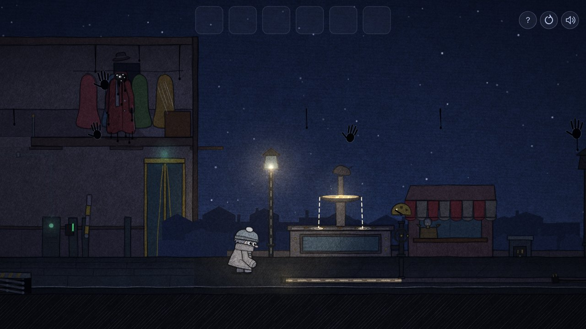
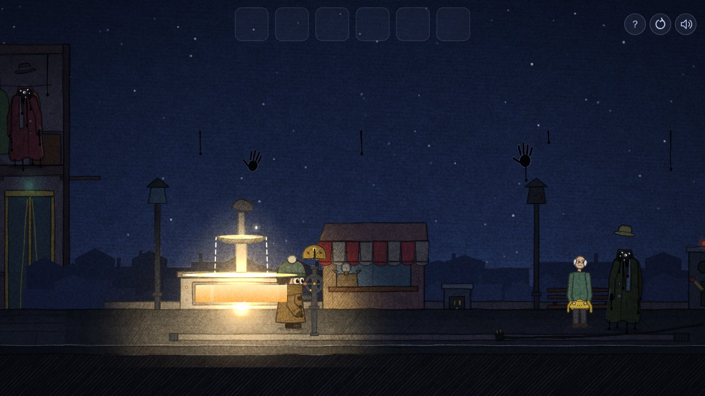
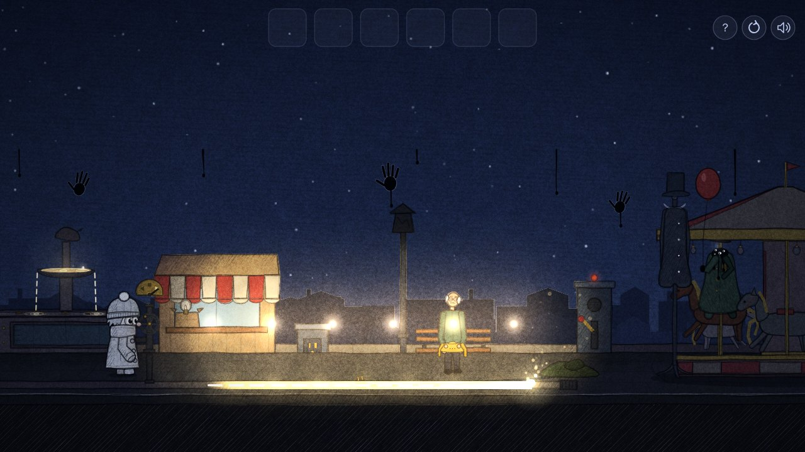
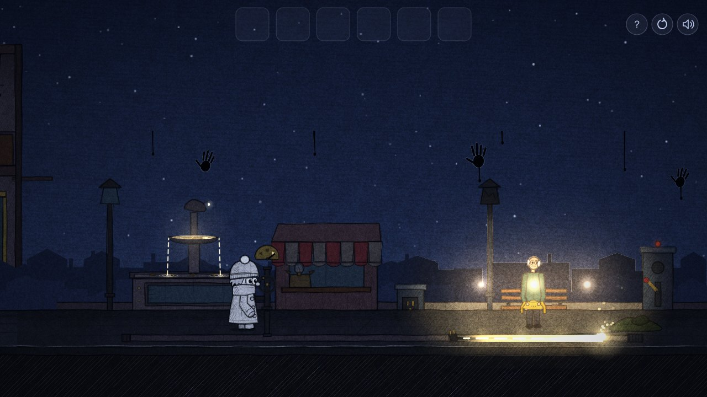

# 夜里 · 第 18 关：广场上的旋转木马（做成的样子）

> 2026-11-26（光水喷泉）：主人想到一个新玩法——“灯光可以像水一样往下滴，玩家通过控制阀门之类的，让灯光聚集在一起，或者让光的水流改变方向、驱赶怪物，做出来我试试看效果”。加在这一关入口那座**没有水的喷泉**上：鸟嘴滴光、盆里聚光、三档阀门、石渠、一件拦路的雨披。最少 **11 步**（原来 7 步）。见下面“光水喷泉”一节。

> 2026-11-25（新怪物）：多了一只**长衣人**（木马这头，挂在木马上的大人那道门上：站着不动，广场的灯每 4.6 秒闪一下，它趁黑近一步）。**规则一个字没动**（最少 7 步不变）；见 `docs/night-monsters.md`“做进游戏的十只”。

> 2026-11-25（后来）：入口的长椅上有了一个膝上放着小孩黄雨衣的老人，木马转起来他笑着挥手；规则没动。见 `docs/night-people.md`。

2026-11-23。照 `docs/night-story-c.md` 第 18 关那一行做：骨架 7 分钟、5–7 步。新的光：**木马上的灯泡串**（摇着转）；衣服：**陪孩子坐木马的大人**（跟着木马一圈圈转，停了朝孩子这边看）；露出来的东西：**一只气球**。做出来最少 **7 步**（自动试玩一遍约一分钟，真人玩估计四五分钟，比骨架短，没有亲手玩）。

代码在 `games/house.html` 里。直接玩第 18 关：地址后面加 `?lv=18`（前十七关照最短的解法当作走完，孩子站在百货大楼旋转门再往右一点的广场上；不读也不写存档）。

## 一张图

接着第 17 关的尽头（旋转门外，x 59680）往右，**室外**，脚踩在街面的高度（`FL.sfc`，y = 700），夜里的广场，三段：

| 一段 | x | 有什么 |
|---|---|---|
| 入口 | 59780–60900 | 一盏路灯；喷泉（没有水，盆底一层落叶）；票亭（售票窗口，柜台上一只纸盒，里面插着备用的灯泡）；插座柱（前面一个插座）；一盏打碎了灯罩的路灯；一张长椅。地上拖着一条电线，插头躺在地上 |
| 木马 | 60900–62020 | 控制柱（指示灯、空着的灯泡座、一根杆）；旋转木马（中心 x 61520，六匹马、中间镶镜子的圆柱、红白的顶棚，帘子底下一圈灯泡）。木马上，大人骑着一匹棕色的大马，手里牵着一只红气球；紧挨着它有一匹小白马（是给孩子的，空着） |
| 出口 | 62020–63140 | 路灯、长椅、广告柱（海报是空白的）、绿篱；远处黑着的镇子和一座大钟楼（第 19 关要走到它脚下）；尽头一道红白条纹的伸缩栏杆（杆头搁在一根小叉子上） |

不出字。走回左边能回到第 17 关的百货大楼。

## 木马和大人（这一关的新东西）

- **灯泡串是串联的**：控制柱上的灯泡座空着，拧上一只灯泡（票亭柜台上的纸盒里有备用的），整串才通；木马的电线插头掉在地上，插到插座柱上才有电。两样都做了，灯泡串才亮。
- **灯泡转到右边才亮，转到左边就灭**（滑环只在右边接着）：所以光落在木马的右半边、再往右一点（`LIGHTS` 里的 `cbl`，一团圆的光，不是一长条）。大人的头转到那一片里，光照到头，它就塌下去（还是原来那条规则：衣服的头照到光就塌，不照就醒）。
- **木马转起来的时候**：拉控制柱上的杆，木马慢慢转起来（一圈 5.5 秒），大人跟着转：转到右边的光里它塌在马背上（帽子掉在马脖子上），转到左边的暗处又醒过来，一圈一圈这样一沉一起；转到圆柱后面看不见。转着的时候它下不来，也不追人。
- **要在它停在光里的时候拉刹车**（时机）：再拉一下杆是刹车，匀减速一秒，转过去大约 0.58 弧度（33°）。大人停在光里：它就那样塌着，**一直塌着**（`keepDown`），手里的气球松开，拴在马背上。停在暗处：它醒着，木马停着，它朝孩子这边看、眼睛发红、一只手朝孩子伸过来，孩子站在木马外面，它够不着；再拉一下杆，木马再转起来，没有任何东西会因为停错了而丢掉（电线、灯泡都还在）。光里的范围是 φ 在 ±45° 左右（大人那匹马在木马右边尽头前后各 45°）；拉杆那一下按手伸到杆上的时候木马转到哪儿算（手伸出去要 0.35 秒），不按点下去那一下，页面里写的是 `crStopAng`、`crLitAt`。
- **没有灯泡串的光，停在哪儿都塌不了**：电线没插、灯泡没拧，木马照样能转、能刹，只是大人不会塌。
- **气球**：大人塌了（停稳了，孩子才敢走过木马）以后，从木马前面走到马边上，把气球从马背上解下来。

## 一步一步

最少 **11 步**（2026-11-26 加了光水喷泉，原来 7 步；`node tools/check.mjs`：第 18 关 11 下、32 个局面、没有死路、少点哪一处都走不出去、走出去时身上不带东西）。下面编号是原来 7 步；光水喷泉那 4 步（阀门转到关住 → 等盆聚满 → 阀门转到放出去 → 等光水冲塌雨披，其中两个“等”是页面自己记上的）排在去控制柱以前，见“光水喷泉”一节。

1. **拿灯泡**：票亭柜台上的纸盒里。
2. **插插头**：插座柱前面，电线的插头插进插座，控制柱的指示灯从红变黄。
3. **灯泡拧到控制柱上**：拿着灯泡点控制柱的灯泡座，灯泡串亮了（1–3 步里，拿灯泡一定在拧灯泡之前，插插头和拧灯泡先后无所谓）。
4. **拉杆，木马转起来**：站在控制柱前面（还在木马外面，大人够不着）。
5. **再拉杆，刹车**：看着大人沉到右边的光里，在它还没到的时候拉（拉晚了、拉早了都是停在暗处，重来一遍：杆再拉一下，木马再转）。
6. **拿气球**：大人塌了，木马停稳了，孩子才敢走过去；气球拴在马背上。
7. **气球拴到出口栏杆的杆头上**：气球往上飘，把栏杆带起来，走出去。第 18 关过了（2026-11-23 后来第 19 关接着做好了：走出栏杆不再出现“再来一遍”，接着往右走进老街，见 `docs/night-level-19.md`）。

规则一关一段（`START18`、`ITEMS18`、`VALUES18`、`GATES18`、`LINKS18`、`SPOT_ZONE18`、`act18`）。名字都用 `c` 开头：状态 `cBulb`（灯泡：box / inv / used）、`cPlug`、`cSpin`、`cDown`、`cBal`（气球：hand / inv / used）、`cOut`；点是 `cBulbH`（纸盒）、`cPlugH`（插头）、`cSockH`（灯泡座）、`cLeverH`（杆，停着的时候是开，转着的时候是刹车）、`cBalH`（气球）、`cBarH`（栏杆）；门一道 `cs1`（木马上的大人，在 x 61230）；衣服一件 `cr1`；画和每帧更新的名字：`paintCp`、`cpCarousel`、`cpHorse`、`crCoat`、`crArms`、`drawCp…`、`cpUpdate`、`cpBulbs`、`CP`、`CPP`、`CPY`（先 grep 过：全游戏原来没有 `cp`、`cr` 加大写字母开头的名字，也没有 `CP`、`CPP`；`tools/check.mjs` 查规则里的名字不重，通过）。

被衣服吓回来的地方（`GATES18`，页面里的位置在 `GATEPOS`，在 10 号路上）：木马前面（x 61230）；大人没塌，孩子走到那儿就吓得退回来，气泡里按差什么画东西：没插电画插头，没拧灯泡画灯泡，其余画杆。

## 光水喷泉（2026-11-26）

**玩法一句话**：光是水一样的东西，会往下滴、会聚在盆里、会顺着槽流；玩家只有一个**三档阀门**，管它去哪儿。

**东西（入口一段，x 59900–61100）**
- **喷泉**（x 60090，重画：下面的大盆高了一截，盆前面一扇玻璃窗看得见里面光水的水位）。鸟嘴一直往下滴光（`CFD.drops`，落进上面的小碗，叮一声），小碗满了从两边淌进大盆（两道细流 + 涟漪）。
- **阀门**（x 60256，盆右边的铁管通到一根立柱，立柱上一只铁轮子、上面一块半圆的小刻度盘：◀ ■ ▶ 三个记号，一根指针偏向当前这一档）。点一下转一档（转 120°），`cWheel`：
  - **0 放到左边（◀）**：光水（滴下来的 + 盆里还有的）顺着左边的石渠漏进入口那盏打碎灯罩的路灯，光沿着灯杆往上爬，灯罩亮起来（盆里有水的时候淌得急、灯亮得多，空了只剩细细一股、灯很暗）。**白白漏掉**，不照任何东西。开场就是这一档。
  - **1 关住（■）**：光聚在盆里，约 6 秒满（`CF.fillT`）；玻璃窗里的水位涨、盆里的光越来越亮（盆里的光是一盏真的灯，`cfb`：水位越高越亮越远，满了把喷泉一圈都照亮）。
  - **2 放出去（▶）**：盆里的光从右边的石渠冲出去，水头每秒 330，满盆的能一直冲到石渠尽头（744 远），没聚满的只漏出去一小段（最远 300，冲不到雨披）。
- **石渠**：地上一道浅槽，从阀门脚下往左通到路灯脚下的格栅、往右通到雨披那边的格栅。冲过去的光水是一串小光（`cfl` × 7）跟着水头走，照亮路过的票亭、长椅上的老人。
- **雨披**（`cm1`，湿漉漉的深绿色雨披，消防站熏黑的雨衣那一套颜色）：站在长椅右边（x 60960，退最多到 61090），拦着去控制柱和木马的路。**不追人**（孩子走到 x 60720 就被拦住，吓得退回来，气泡里画阀门）。光水冲过来，离它不到 400 它就往后退（倒着走，一只袖子举着），退到头被逼在光里，头照到光就塌，塌了就一直塌着；光水退了（没聚满、或者中途转走了）它慢慢走回原处。

**规则**（`act18`，一关一段；新的四项：`cWheel`、`cFull`、`cSurge`、`cWash`；一道新门 `cf1`；点 `cWheelH`、`cFullH`、`cFloodH`）：
- `cWheelH`：`cWheel = (cWheel + 1) % 3`。转到 0：`cFull`、`cSurge` 清零；转到 2：盆里聚满了（`cFull`）就变成一股满盆的光水（`cSurge = 1`，`cFull = 0`），没聚满就只是漏一点。
- `cFullH`：阀门在 1、盆里的水位到了 0.985，页面自己记上（`cfCommit`，和第 2 关的 `yLure` 一样，**不是玩家点出来的**，不在 `spots()` 里）。
- `cFloodH`：`cSurge` 在、雨披被光水逼到头塌了（`m.rise < 0.4`），页面自己记上：`cSurge = 0`、`cWash = 1`。
- 门 `cf1`：`cWash === 1`（页面里再加一句 `V.cfSeen`：真的塌下去了孩子才敢走过去，和别的关一样）。`LINKS18` 多一块：`c0 → c0b`（过雨披）`→ c1`（过大人）；`cSockH`、`cLeverH`（控制柱）挪到 `c0b`。
- 求解器里：`cWheelH`（→关住）、`cFullH`、`cWheelH`（→放出去）、`cFloodH`，再接原来的 7 步；最少 **11 步**，32 个局面，没有死路（阀门可以一直转，转错了不丢东西），少点哪一处都走不出去，走出去身上不带东西。`tools/check.mjs` 的输出只有第 18 关两行变了（7 下 → 11 下、12 个局面 → 32 个），其余一字不差。
- 规则和画面是一回事：**满盆放出去的一定冲得到、塌得了雨披；没聚满的一定冲不到**（水头最远 `CF.reach` / `CF.trickle × 水位`，是页面里写死的，不靠碰巧）。

**光的算法**（`lightAlphaG`）：灯的 `off` 把最亮的地方往下挪、`up` 让往上的光变淡，所以石渠的光点放在离地 100 高、`off`、`up` 都是 0、半径 240：雨披的头（离地 171）离水头一侧 215 以内才照得到（`coverage` 大于 0.55）。第一版放在离地 54、`off` 0.2：量出来雨披头上只有 0.07，一直塌不下去——这是调光的时候最容易错的一处，改半径、高度以后要重新量（`__house.coverage(x, y, __house.LT)`）。

**不出字怎么告诉玩家**
- 刻度盘上三个记号（◀ ■ ▶）和指针；孩子走到雨披跟前被拦住，气泡里画阀门（`cWheel` 图标）；右上角 `?`：下一步是阀门（点阀门），等盆聚满、等光水冲到的时候指一下阀门；卡住两分钟以后阀门上慢慢闪小星星。
- 没聚满就放出去：光水只冲出一小段就没了、雨披纹丝不动（它不会白退）——玩家自己看得出“聚得不够”。

**代码**：`games/house.html`，名字都是 `cf` / `cW` / `CF` 开头：`CF`、`CFY`、`CFD`、`cfUpdate`（水位、阀门、石渠里的光水、鸟嘴滴光）、`cfMonUpdate`（雨披）、`cfSnap`（读档 / `?lv` 摆局面）、`cfCommit`、`cfRelease`、`cfBasinLight`、`cfLightAt`、`drawCfChannel`、`drawCfValve`、`cfGlow`（水位、水头、碗里的光、左边漏进路灯的光，画在最上面）、`cpFountain`（重画）；怪物 `GARB.cm1`（`flow`）；声音 `snd.cfDrip`、`cfWheel`、`cfRush`；气泡图标 `cWheel`。全游戏不重（先 grep 过，`tools/check.mjs` 查规则里的名字）。读旧存档：没有 `cWash` 那一项的，走过雨披那儿的（站在它右边、灯泡拧上了、木马转过了、大人塌了）当作冲塌了。`?lv=19`、`20`、`21` 里重放第 18 关的地方多了 `c0b` 那一块。

**查过的**
- `node tools/check.mjs` 通过，只有第 18 关两行变了。
- 无头 Chromium（1280×720、手机横屏 844×390）里：开场 → 关住 → 聚满 → 放出去 → 雨披后退 → 塌 → 规则记上 `cWash`，一帧帧看过；没聚满放出去（只冲 200 多远，雨披没动）；冲到一半转回去（水尾追上来，雨披走回原处）；塌了以后阀门不再转；孩子走到 x 60720 被拦住，气泡里是阀门，塌了以后走得过去；`?lv=18` 从头自动玩到走出栏杆（游戏里 40 秒，0 次被抓）、`?lv=17&auto=1` 真实时间一路玩过第 18 关（约 155 秒，没有报错）；`?lv=19`–`21`、`?lv=13`、`?lv=16`、默认页、`?monsters=1`、`?imps=1` 没有报错；`__house.set` 摆局面（关住、聚满、放出去、塌了、四种）读回来对。
- 乱来：4 组种子、每组 160 步（随机转阀门、随机点这一关的点、随机走、随机等 0.2–7 秒），每 0.2 秒查水位在 0–1 之间、水头不比水尾靠前、雨披不出它的范围、规则里的状态互相对得上（放出去的时候阀门在 2、聚满的时候阀门在 1），没有一条违例；乱来完 4 组都还走得出去（跟着求解器自己玩到栏杆）。（原来要 8 组，跑到第 5 组撞上我自己设的 500 秒超时，没有重跑。）

**没做 / 有疑点的**
- **没亲手玩**：手感（聚 6 秒会不会太久、水头 330 / 雨披退 150 的快慢、阀门的轮子好不好点）都是量出来的数，没有真人玩过；声音（滴光的叮、轮子的咯噔、冲出去的哗）没听过。
- 阀门只能往一个方向转（0 → 1 → 2 → 0）：想把聚满的光放到左边，得先经过“放出去”。要不要左右各有一个轮子 / 点轮子左半边反转，等主人看了手感再定。
- 光水还没有别的用处：只有一件雨披、一条往右的路；左边只是白白漏掉（路灯亮一下）。想接着做的话：左边也放一件怪物、右边放不同难度的两件（一件要满盆、一件要两盆合在一起）、让光水推着东西走（不只是照塌）。
- 画：光水是金黄色（和灯一个颜色），水头是一个亮的鼓包，没有画“水”的透明和折射；盆里没画漩涡；阀门的刻度盘小，手机上不太容易看清哪一档（指针 + 记号亮一点，没有别的提示）。
- 雨披用的是消防站雨衣的画法和颜色，没有单独设计；它被光水冲过去是“后退、举着袖子”，没有被水冲倒的动画。
- 读档（`SAVE_KEYS`、`readSave` 里的补丁）按前几关的样子加了，**没有单独用真存档试过**（`?lv=18` 不读不写存档）；`__house.set` 摆局面试了。

## 引擎里动了哪几处

- 街面那条路（10→11 号点）的尽头 `YARD_END` 往右挪到 63040（原来是 59680）；三间屋子 `cpA`、`cpB`、`cpC`；镜头右边的界（两处）改成这一关的尽头；`MOONS` 多一段（广场是室外，孩子在月光里亮一点）。
- **第 17 关走出旋转门不再结束游戏**（和前几关一样）：走出旋转门记一下“第 17 关过了”（`V.bpDone`，并且把最近的灯放在广场入口），接着往右走进广场；“走完了”那一项换成了第 18 关的 `cOut`（`writeSave`、`readSave`、`tick`）。
- 栏杆没抬起来的时候，走到它跟前就停（`walkTo` 和拖着走 `driveBlock` 各一句，只看 10 号路、`S.bOut && !S.cOut`）。
- **衣服的引擎只多了一个分支**：`GARB` 里 `cr1` 有 `ride: true`，`garbUpdate` 里这一件的位置不自己走，按木马转到哪儿算（`CPP.cx + CPP.ro * cos(V.ca)`），追人、被抓都不做（转着的时候），停着醒着的时候只是看、伸手，孩子站进木马里（门拦着，一般不会）才抓；“光照到头就塌 / 照不到就醒 / 被抓回最近一盏灯下”那几条一字没动，塌下去、站起来用的还是同一段（`want`、`rise`、`keepDown`）。
- `drawGarb` 里 `cr1` 直接跳过（大人和木马一起画，在 `drawCpCar`）；`garbEyes` 多一句 `ride` 的眼睛的位置。

## 木马的画法（结局还要用）

`cpCarousel(b, P, lit, o)` 单独成一个函数，只管木马本身：`o.x` 中心、`o.gy` 地面、`o.ang` 转到哪儿、`o.spin` 转得多快（灯泡往外甩多远）、`o.bulb` 灯泡通了电几成、`o.rider(k, x, saddleY, face, bob, front)` 在第 k 匹马上画点什么（可以不给）、`o.small` 哪几匹是小马。结局“旋转木马上大人搂着孩子”：调用的时候给 `rider`，在第 0、1 匹马上画大人和孩子（`crCoat` 是坐在马上的大衣，往下可以再画一个小的孩子）；这一关的大人和气球是在 `drawCpCar` 里给的 `rider`，可以照着改。木马的画是暗的、亮的两层各画一遍（和别的关一样）。

## 不出字怎么告诉玩家

- 被衣服吓回来：见上面（插头 / 灯泡 / 杆）。
- 点灯泡座没拿灯泡：气泡里画灯泡；拉杆没通电：气泡里画插头；点栏杆没拿气球：气泡里画气球。
- 右上角 `?`：照最短的解法，下一步的地方亮一个圈；拿着东西的话，气泡里画那样东西和箭头；点杆、插头时气泡里画杆、插头。（`?` 只指“拉杆”，不说什么时候拉，时机要自己看。）
- 卡住两分钟以后才慢慢闪的小星星：纸盒里的灯泡、插座、控制柱的灯泡座、杆、塌了的大人手边的气球、栏杆。

## 存档

接着 `house.save.v3`：`SAVE_KEYS` 多了第 18 关那几项，读旧存档照开局补上；走出广场的栏杆就清掉。木马转着的时候存的档，读回来木马还转着（从一个固定的角度开始转），大人在哪儿不记；塌了的就当塌了、木马停在光里。

## 查过的

见本文件最后一节“验证”。

## 没做 / 有疑点的

- 第一条新规则（被碰到抱走光）这一关不用；出口小光飞去钟楼：没做。
- **时机**：真人玩要看着大人沉到右边的光里，在手伸出去那 0.35 秒以前一点点拉杆；光里的那一段大约有 1.4 秒宽（人手伸出去之前要看清的那一段）。没找人玩，不知道准不准、会不会太容易；也可以把 `CPP.LR`（光的半径）调小、`CPP.W`（转速）调快。自动试玩是点一下就拉，不看大人在哪儿，所以一次刹对要试一到三遍（见“验证”）。
- 木马一圈 5.5 秒；转着的时候“摇着转”只做了灯泡甩一下（甩的方向没有分前后）、马一上一下。
- 木马转到圆柱后面，大人和气球都被圆柱和前面的马挡住了；塌着的大衣、帽子画得简单（一团绿色的大衣，一顶帽子）。
- 气球和大人的手：只画了手的位置，线从手出去，没有画攥着的手指。
- 这一关的亮的一层里，光落在右边的马、顶棚上，亮的颜色看得出来（红马、红白顶棚），但光的外圈（排线）画得淡；暗的一层里顶棚只是灰色的。
- 没亲手玩，没在真手机上试；存档只试了读回来这一半（把存档写进去、再打开页面看读回来对不对），没试“自己写进去”那一半（`writeSave` 在自动试玩、`?lv=` 里不写）。

## 验证

- `node tools/check.mjs` 通过：第 18 关 7 下、12 个局面、没有死路、少点哪一处都走不出去、走出去时身上不带东西；其余各行和改之前一字不差（用改之前的 `house.html` 跑了一遍对过：只多第 18 关这一行）。
- 无头 Chrome（deviceScaleFactor 1）里：`?lv=18&auto=1` 桌面 1280×720 自动玩到走出栏杆（约 55 秒，0 次被抓，没有报错；刹车试了三次才停在光里）；手机横屏 844×390 同样（约 37 秒，0 次被抓，没有报错，刹车重试了一遍）；`?lv=17&auto=1` 桌面 1280×720 从第 17 关开头一路玩到第 18 关走出栏杆（约 96 秒，0 次被抓，没有报错）。第 17 关以前的关这回没有重跑（这一关只动了街面那条路的尽头、镜头右边的界、第 17 关走出旋转门后不再结束游戏）。
- 屏幕上看过（桌面 1280×720）：入口（路灯、喷泉、票亭、插座柱和躺着的插头）、木马一段（控制柱、木马、大人醒着）、灯泡亮着木马转着、停在光里大人塌着气球拴在马背上、停在暗处大人醒着、出口（长椅、广告柱、绿篱、钟楼、栏杆）、气球把栏杆带起来；手机横屏 844×390 看了木马一张。
- 乱走：`?lv=18&ctl=tap`，3 组种子、每组 320 步（随机点这一关的点、随机走到广场上的一处、偶尔点 `?`，有时拿着物品栏里的东西点，每步隔 0.1–1.5 秒），没有报错、没有被抓；其中两组自己走完了这一关。这几组是页面里一帧一帧跑出来的（`__house.run`），不是真实时间。
- 存档：把第 18 关的局面（灯泡拧上了、大人塌了、气球在身上）按页面自己的存档格式写进去，再打开页面：读回来的位置、物品栏、局面、大人塌着都对。
