# 夜里 · 第 22 关：染坊（三个地形机关，做成的样子）

2026-11-26 起。主人问“地形有关的机关有什么？……梯子的盖子可以挡住怪物……地板上的机关按钮”，接着说“你把你建议的这些都做一下看看效果，就加到现有关卡，或者新增一个关卡也行，先别管剧情了”。

所以这一关**不管剧情，只为看三个机关的效果**：一座染坊，三间屋子各一个机关、各用各的怪物、各管各的规则，互不依赖（哪一段好，以后单独搬进别的关）：

- **A 称布间**：地板按钮——拉铃让阁楼上的怪物去踩台秤，楼下的铁栅闸门被提起来几秒。**还没做。**
- **B 染缸间**：会塌的烂地板——它比你重，抽掉跳板它掉下去，再把木板搭在洞上。**还没做。**
- **C 库房**：梯口盖板——从地窖追上来的怪物，合上盖板、推木箱压住。**做完了**（2026-11-28），下面“C 段”一节。

代码都在 `games/house.html` 里；规则里的名字用 `e` 开头，页面里的常量、函数用 `DY` / `dy` 开头。每处接线都有三行单独成行的标记 `// --- 22A ---`、`// --- 22B ---`、`// --- 22C ---`，各段只在自己的标记底下加行。


## 怎么进

- 地址后面加 **`?lv=22`**：前 20 关照最短的解法当作走完，第 21 关原样留着（还是夜里——做完第 21 关天就亮了，染坊里的怪物就说不通了），孩子站在染坊门里那盏壁灯底下（x 72130）。不读也不写存档；按“再来一遍”也回到这儿（`dyEnter`）。
- **正常从头玩走不到这一关**：第 21 关做完照旧通关（`won`）。页面里“现在这一关”（`curLevel`）只在 `?lv=22` 的时候认它；`LEVELS` 里有它，是为了 `node tools/check.mjs` 一样查它。
- `?lv=22` 的时候，走出库房的后门才算通关。`?lv=22&auto=1` 自己玩一遍。
- 现在 A、B 两间是空屋子：进门以后要先往右走过两间（约 2100），才到库房。


## 一张图

接在世界最右边空着的地方（钟楼顶到 71300 为止）：x 72000–75300，三间屋子各 1100 宽，地面是楼下那一层（y = 1000，`FL.down`）；库房底下有一层地窖（y = 1400，`FL.dyc`，梯子 400 长），染缸间底下留了一个坑（`FL.dyb`）。

```
          A 称布间                    B 染缸间                      C 库房
 72000 ─────────────── 73100 ─────────────── 74200 ─────────────────────────────── 75300
 地面   门·壁灯   ┆闸门┆              ┆烂地板┆           壁灯   [盖板+木箱]  木箱推开   ┆线┆    后门  门外
 1000   72100     72760             73520–73740        74290     74620      74806    74950   75210 75290
 地底下                            （坑 73400–73880）            地窖 74260–75260：小缸 · 梯子 74620 · 架子 · 钥匙 75080 · 钩子 75206
 1400
```

| 东西 | x | 说明 |
|---|---|---|
| 进门站的地方 | 72130 | `DY.in`；门口的壁灯 72100（`dya`，一直亮） |
| A 的闸门（留的位置） | 72760 | `DYA.gate`：左边是 `e0`，右边是 `e1`。还没做，现在通着 |
| B 的烂地板（留的位置） | 73520–73740 | `DYB.rot0`–`rot1`：左边 `e1`，过了是 `e2`；底下的坑 73400–73880。还没做，现在通着 |
| 库房的壁灯 | 74290（y 770） | `DYC.lamp`，一直亮；光圈到 74505 左右（照不到盖板）。被抓回到这儿 |
| 梯口盖板、梯子 | 74620 | `DYC.hx`，盖板 120 宽（74560–74680）；掀、合的时候站在洞的右边 74724 |
| 木箱 | 74620 ⇄ 74806 | 压在盖板上（`crOn`）/ 推开以后（`crOff`）；箱子 104 宽 |
| 盖板右边那条线 | 74950 | `DYC.line`（门 `ec3`）：钥匙拿了、它没被关住，就不敢往后门走 |
| 后门 | 75210 | 门前停在 75166（`stop`），门外 75290（`DY.end`） |
| 地窖 | 74260–75260 | 墙里；孩子走得到 74460–75130（`celL`–`celR`） |
| 钥匙 | 75080 | 地窖最里头墙上的钉子 |
| 围裙的钩子 | 75206 | 地窖墙角；它没醒的时候挂在这儿 |

路（接在原来的后面，别改号）：33–38 号点（进门、梯口、后门外、梯子脚、地窖两头），31–35 号路（`DYE`：进门到梯口、梯口到后门外、梯子、地窖往左、地窖往右）。A、B 要加点、加路的话接着往后 `push`。


## A 段：拉铃、台秤、闸门

还没做。


## B 段：烂地板、抽木板

做完了（2026-11-28）。

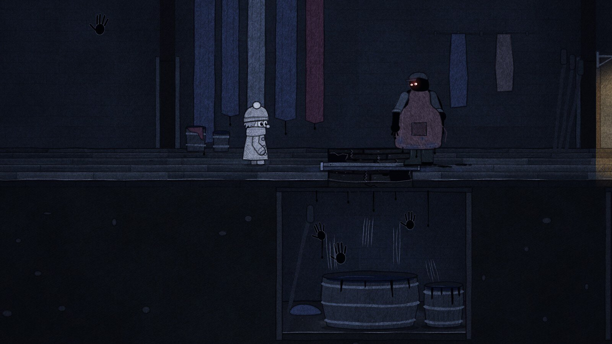

### 看上去

染缸间的地是旧木地板，中间一段（x 73520–73740）**烂了**：五排板子发黑、往下塌着（前沿那道亮边往下弯），板子上横着裂开几道口子（裂口的木茬发白），长着霉斑，靠两头各缺一块（露出底下的黑），和好地板接着的两头是一道黑缝。上面顺着铺了一块**厚跳板**（73500–73760，260 长，左头伸出来一截在好地板上）。左半间晾着几条染好的布（下摆还在滴）、墙脚两只木桶；右头墙上一排木钉挂着湿布，墙脚靠着几根搅缸的木桨。

地板底下是**染缸的坑**（墙里 73400–73880，地面 y 1400，剖开来看得见；两边是砖墙，没有出口）：正对着烂地板一只**大染缸**（木板箍的大桶，三道铁箍，中心 73630，缸口 y 1292），缸里是墨一样的靛蓝；右边一只小一点的（73822）；靠左墙斜靠着一根搅缸的长木桨，地上一摊湿布、几摊洒出来的靛蓝。坑顶（烂地板的底面）耷拉着几根木刺。

暗处的恐怖照规矩加了：坑的墙上一道道**往上爬的抓痕**、两只墨手印（越往上越淡，没有一只够到顶），坑顶往下淌墨，烂地板的缝里往上渗墨；楼上地板上一串**深深的胶靴墨脚印**，从它站的地方一直走到烂地板跟前（它天天这么走）。

**它**（`GARB.dyb`）：一条又厚又宽的**皮围裙**，底下一双**高筒胶靴**（翻着靴口），围裙里灌满了墨，撑得鼓鼓的，两边往外挤着墨；粗布衬衫的袖子卷到胳膊肘，两只手是墨（三根粗手指），一直往下滴；头是一团墨，扣着一顶布帽子，帽檐底下两只眼睛。比孩子高一大截（236 对 150）、宽一倍多。

“它比孩子沉”是这样让人看出来的：身子圆鼓鼓的、步子小、一步一沉；每走一步“咚”一声低的（`dyStomp`），身后留下一个深深的墨靴印（慢慢淡下去）；踩在跳板上，跳板在它脚下往下弯（最多 7 像素）、吱呀响；孩子走在搭好的木板上，木板只弯一点（最多 4）。

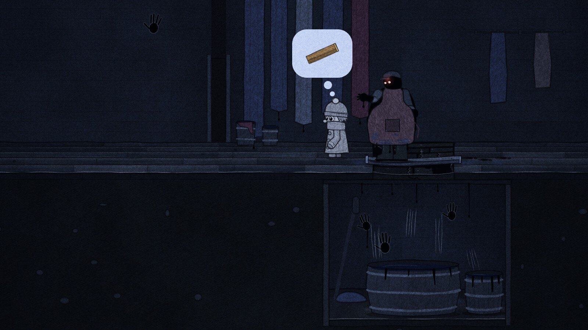

### 一步一步

规则里 **2 步**，都非点不可（`node tools/check.mjs`：第 22 关从 6 下变成 8 下：`ePlankH ePlank→eHoleH`，再接 C 段的 6 下）。

1. 孩子走进染缸间，它就从右头（73920）朝孩子挪过来（每秒 72），踩着跳板走到烂地板上头站住（73574），朝孩子伸着一只手。孩子走到烂地板跟前（73460）**不敢过**：吓得退两步，气泡里画**跳板**（它站在跳板上的时候，全游戏的“不敢走到醒着的怪物跟前”也正好在这儿拦住孩子，见下面）。
2. **点跳板伸出来的那一头**：孩子蹲下去抓住，往回一抽（跳板往孩子这边滑出去，一下就到物品栏里）。
   - 它这时候**正站在跳板上**（烂地板上头）：脚下一空（0.14 秒，两只手一张），烂地板“咔嚓”断了，它掉下去。
   - 它**不在跳板上**（还在右头、正往这边走）：下一回它朝孩子挪过来，一脚踩上烂板子（进去 36），烂板子在它脚下**往下弯、掉灰、嘎——吱**（预兆 0.9 秒，它两只手往两边张着站不稳），再断，掉下去。
3. 它掉进底下的**大染缸**：“扑通”，溅起一大片墨（墨点打到坑墙上顺着往下淌，不出坑），缸面上一圈墨冠；在缸里缓一缓（0.75 秒），抬起头来，**站在缸里仰着头，眼睛发红，两只手往上够**，一下一下地抓——**上不来**。地板上留下一个大洞（两头参差的断板茬，前头两根往下耷拉着）。
4. 孩子走到洞边**停下摇头**，气泡里画**木板**。**举着木板点洞**：孩子把木板竖起来，从自己这头往洞上一放，木板倒下去平平地搭在洞上（两头搭在好的地板上），“咚”。
5. 走过去：木板在孩子脚下往下弯一点，孩子跟着往下沉一点；底下那双手朝上够，追着孩子在缸里挪（缸里最多挪到中心左右 62），**够不着**——只是吓人，不算被抓。木板留在洞上，走出这一关的时候物品栏是空的。

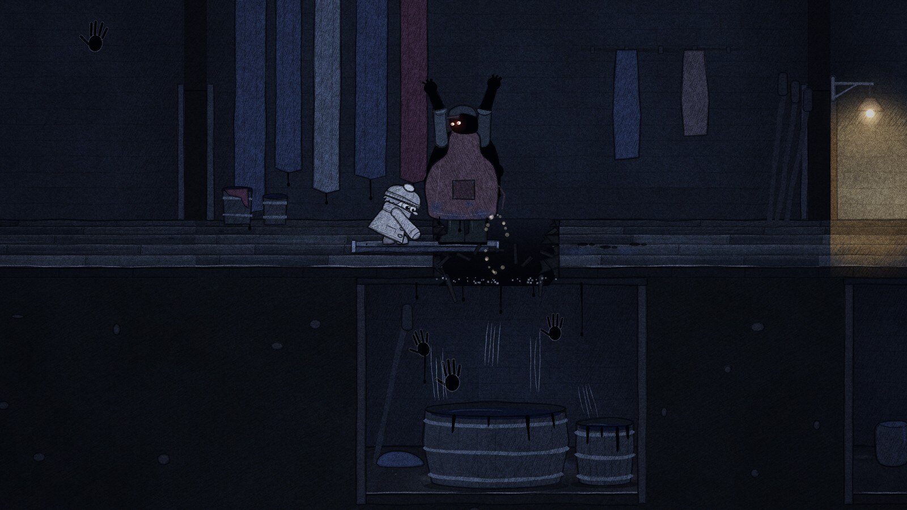
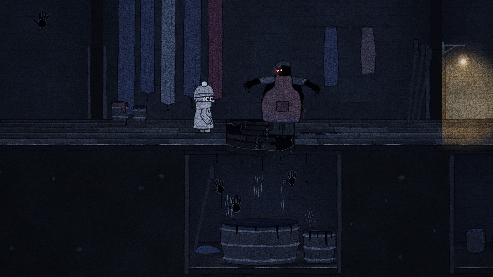
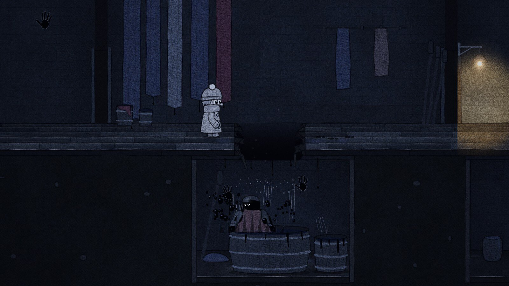
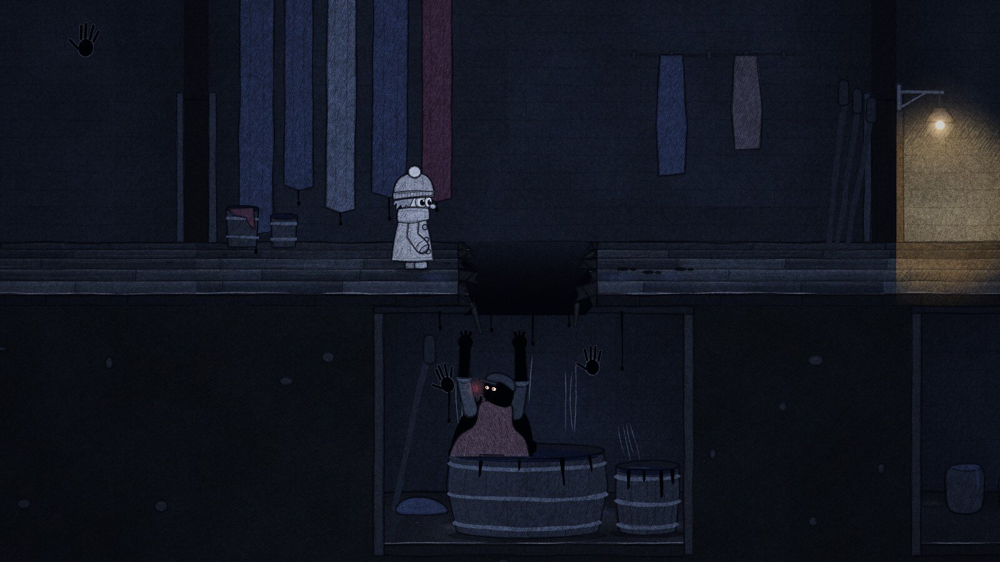
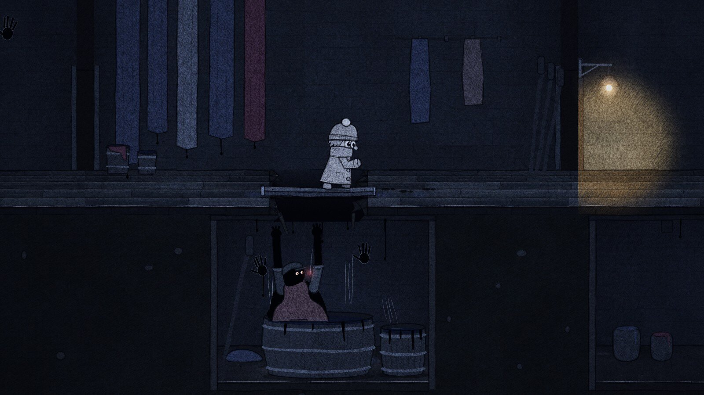

### 规则

- 局面：`ePlank`（`floor` 铺在烂地板上 / `inv` 身上 / `put` 搭在洞上）。
- 门：`ec2`（烂地板跟前，`DYB.gate` = 73500，钉在 31 号路上）：`ePlank === 'put'`。一道门就够：页面里分清两种拦法——木板还铺着，是它拦着（照平常的“不敢过去”，`gateHint` 画跳板）；抽了没搭、地板已经塌了，是洞拦着（`meetGate` 里停在洞边摇头，气泡里画木板）；抽了、它还没掉下去：也是它拦着，退回来，没有气泡（不用再做什么，等它走过来）。
- 点：`ePlankH`（铺着才抽得动：`take:ePlank` + `pull22`）、`eHoleH`（举着木板：`put22`；空着手：`hole22`，气泡里画木板）。分块都在 `e1`（烂地板的中间以左）。
- 页面里才知道的：`dyGuard`——它真的掉进缸里站稳了（`dyDownB`）才搭得上木板，不然 `up22`（伸手、烂板子晃一下、摇头）；`GATE_ALL.ec2`——木板真的倒平了（`V.dy.b.lay >= 1`，倒下去要 0.42 秒）才走得上去。
- 它掉不掉、什么时候掉，都在页面里（`dyMonB`），规则里没有：规则只记木板在哪儿。

### 它（`GARB.dyb`，走法在 `dyMonB`，样子在 `dyHeavyFig`）

样子（`V.dy.b.st`）：`home` 站在右头 → `come` 孩子进了这一间（x 73060–73530，地上）就朝他挪 → `stand` 踩着跳板站在烂地板上头（73574），盯着孩子、一只手伸着 → `back` 孩子走开了（`come` 看不见他 1.2 秒、`stand` 1.5 秒）回右头；跳板一抽：在烂地板上头 → `drop`（0.14 秒）→ `fall`；不在 → 下一回 `come` 踩进烂地板 36 → `bend`（0.9 秒）→ `fall` → 掉进缸里 `land`（0.75 秒）→ `pit`。

和全游戏通用的那几样（`docs/night-monster-roster.md`）：

- **孩子不敢走到醒着的怪物跟前**（`fear`）：有，110。它站在跳板上（73574）的时候，孩子朝它走到 73464 就退回来——和门 `ec2` 拦住孩子的地方（73460）只差 4，两样合得上（量过：方向键、点着走、乱玩里孩子离它最近 114）。它掉下去、正往下掉的时候不算（`braced`，脚也不在同一层）。
- **被拽住能挣开 / 碰到就抓**：都用不上。它**不抓人**：孩子始终在它那一片（73530–74100）外面——木板铺着的时候门在 73500，抽了以后它站不住，掉下去以后在坑里够不着。所以 `CATCH` 里没有它，也没写 `touch`。
- **灯下看得见它塌**：用不上，染缸间没有灯。
- **照它的灯按规则亮了就不再出手**：用不上（`GARB.dyb.gate = 'ec2'` 只是让“被它吓回来”的气泡照 `gateHint('ec2')` 画跳板）。
- 怪物名册里**还没加这一只**；它的样子（皮围裙、胶靴、布帽子）是新画的，没有单独给主人看过设计。

### 页面里的时间和数字（`DYB`、`DYMB`，都是量着、拍着定的）

| 数 | 值 | 是什么 |
|---|---|---|
| 烂地板 | x 73520–73740 | `DYB.rot0`–`rot1`；不会动的那一层塌着 6，它踩上去再往下弯 16 |
| 门 `ec2` | 73500 | 孩子走到 73460 停住 |
| 跳板 | 73500–73760 | 260 长；抽的时候站在 73446、手够 73504；搭的时候站在 73452 |
| 它 | 右头 73920 → 跳板上 73574 | 它那一片 73530–74100；孩子在 73060–73530（这一间、烂地板这头）它就过来 |
| `speed` | 72 / 秒 | 它走（回去 ×0.8）；从右头走到跳板上 4.8 秒 |
| 跳板弯 | 它 9、孩子 4 | 乘上 4q(1−q)（q 是踩在跳板的哪儿）：它站在跳板上弯 7 左右，孩子最多 4 |
| `drop` | 0.14 秒 | 跳板被抽走到它往下掉 |
| `tell` | 0.9 秒 | 烂板子在它脚下往下弯多久才断（设计稿 0.5，规矩是至少 0.8）；它要踩进去 36 才开始弯 |
| `g` | 1700 | 往下掉多快（进了墨 ×0.35）；从地板掉到缸底 0.6 秒左右 |
| `land` | 0.75 秒 | 掉进缸里以后缓多久才抬头够 |
| `wade` | 70 / 秒 | 在缸里跟着孩子挪多快（缸里中心左右 62） |
| 大染缸 | 中心 73630，外沿半宽 124，缸口 1292，墨面 1300 | 它脚踩在缸底 1410（`vatF`），手最高够到 1094 左右（坑顶 1066） |
| 抽 / 搭 | 0.32 + 0.3 / 0.4 + 0.5 秒 | 手伸过去 / 收回来；跳板滑出去 0.3 秒，木板倒下去 0.42 秒 |
| 镜头 | 孩子从 72960 走到 73240 慢慢往下看一截 | 走到库房那头（73920 起）再慢慢回来（`dyCamB`）；镜头顶到 `min(1470 − 画面高, 640)`，坑、缸都在画面里 |

### 不出字怎么告诉玩家

- 木板铺着往前走：吓得退回来，气泡里画**跳板**。
- 地板塌了、木板在身上没拿在手里，往前走：停在洞边摇头，气泡里画**木板**；空着手点洞：气泡里画**木板**。
- 抽了木板、它还没掉下去：往前走退回来，没有气泡；举着木板点烂地板：伸手、烂板子晃一下、吱呀、摇头。
- 右上角 `?`：抽跳板的时候圈着跳板伸出来的那一头，气泡里画跳板和箭头；搭木板的时候圈着洞，气泡里画木板和箭头。
- 卡住以后闪的小星星：跳板伸出来的那一头（铺着的时候）、洞（木板在身上、它掉下去了的时候）（`dyGlints`）。
- 自动试玩（`dyAutoOk`）：先走到跳板跟前站着，等它踩着跳板走过来站住了再抽（等 6 秒还没来就先抽）；等它掉进缸里站稳了再搭。

### 引擎里动了哪几处（都在 `// --- 22B ---` 底下）

- 规则：`ITEMS22` / `START22` / `VALUES22` 里 `ePlank`，`GATES22.ec2`，`LINKS22` 的 `['e1', 'e2', 'ec2']`，`SPOT_ZONE22`，`act22` 里 `ePlankH`、`eHoleH`。
- 地方：`DYB`（加了跳板、它、缸的位置）；`ROOMS.dyBp` 往左多画一大截土（从 72200 起：镜头在染缸间往下看的时候，称布间底下也要有土；坑里面照旧从 `DYB.pit0` 算起，`ix0`/`ix1` 另一行改）；`GATEPOS.ec2`、`GATE_ALL.ec2`。
- 画：`dyPaintB`、`dyRotFloor`、`dyBootPrint`、`dyPaintPitB`、`dyVatB`（不会动的）；`dyDrawB`、`dyHoleB`、`dyPlankB`、`dyPlankTilt`、`dyDrawMonB`、`dyHeavyFig`（会动的，暗的一层、亮的一层各一遍，它只画在暗的一层）；`dyPlankIcon`（物品栏、气泡里的跳板，`ICON_SIZE.ePlank = 104`）；颜色 `LIT` / `DARK` 里 `dyRot`、`dyPlank`、`dyLeather`、`dyBoot`、`dyShirt`、`dyCap`、`dyVatB`、`dyInk` 这些。
- 状态：`V.dy.b`（`dyInitB`）、`dySnapB`、`dyRestB`、`dyUpdateB`、`dyCamB`、`dySpotsB`、`dyDownB`。
- 怪物：`GARB.dyb`（`garbUpdate` 里交给 `dyMonB`）、`GARB_HOME.dyb`、`HEAP_COLS.dyb`、`dyEyeB`（眼睛的那一点冷光）。
- 点东西：`perform`（`ePlankH`、`eHoleH`，`hole22`、`up22` 两种点错）、`commit`（`pull22` → `dyOnPullB`，`put22`）、`meetGate`、`gateHint`、`hint`、`dyGuard`、`dyAutoOk`、`dyGlints`。
- 声音五个：`dyStomp`（它走一步）、`dyGroan`（烂板子往下弯）、`dyCrack`（断了）、`dySplash`（掉进缸里）、`dyScrape`（抽跳板）。别的用已有的（吱呀、咚、摇头）。

### 和设计稿不一样的地方

| 设计稿 | 做成的 | 为什么 |
|---|---|---|
| 烂板子往下弯的预兆 0.5 秒 | 0.9 秒 | 规矩是会伤人的至少 0.8 秒；这一下不伤孩子，可是 0.5 秒短得看不清“先弯再断” |
| 它“站在坑里” | 站在坑里那只大染缸里（墨淹到腰），在缸里跟着孩子挪 | 正对着烂地板放了一只大缸，它掉下去就掉进缸里，“溅起一大片墨”才说得通；人在缸里，手最高够到坑顶下面 30 左右，看得出“够不着” |
| （没写） | 它要踩进烂地板 36 才开始弯 | 一沾边就弯，看着像是好地板也撑不住它 |
| （没写） | 孩子进了染缸间，镜头往下多看一截 | 不然坑、缸、掉下去的它都在画面外面 |
| （没写） | 孩子走开 1.2–1.5 秒它就回右头 | 孩子回称布间转一圈再回来，它照样从右头走过来（“下一回”） |
| （没写） | 抽了跳板、它还没掉下去的时候往前走：退回来，不出气泡 | 这时候不用再做什么，等它走过来就行 |

### 查过的（B 段）

2026-11-28，这个分支上（`l22-seg-b`，从骨架 + C 段的 `6219181` 开出来）。

- `node tools/check.mjs`：全绿；第 1–21 关那几行和 `origin/main` 的输出一字不差；第 22 关 `ok`，最少点 8 下、局面 9 个、死路 0 个：`ePlankH ePlank→eHoleH eCrateH eHatchH eKeyH eHatchH eCrateH eKey→eDoorH`，自己变的 1 处（C 段的）；少点哪一处都走不出去，走出去时身上不带东西。
- 无头 Chrome（停住主循环一帧帧走）：`?lv=22` 照自动试玩从进门玩到通关，游戏里 40.8 秒，0 次被抓，没有报错（B 段：进门 3.3 秒它开始走过来，8.1 秒它站上跳板、抽，0.7 秒后它在缸里，10 秒搭好木板）。真实时间 `?lv=22&auto=1` 41 秒通关，0 次被抓。
- B 段各种情况 11 组 30 条，都对（每一帧查：没被抓、孩子从不站在烂地板/洞上头除非木板搭好、它在地板上的时候孩子从不进它那一片、它掉下去以后一直在缸里）：木板铺着往前走（点着走、方向键都被拦住，气泡里画跳板，离它最近 119）；它站在跳板上的时候抽（0.13 秒就往下掉）；它不在跳板上的时候抽（它走过来，先弯 0.93 秒再断）；抽了、它还没掉下去就点洞（伸手、烂板子晃、摇头，木板还在身上；掉下去以后再点就搭上了）；拿着木板回称布间再回来（它回右头，孩子回来它照样走过来踩断）；掉下去以后在洞边来回走 4 趟（每回停在洞边摇头、气泡里画木板；它挪到缸里离孩子近的那一边）；空着手点洞（气泡里画木板）；方向键往洞里走（停在洞边）；搭好以后点着走、方向键来回 3 趟（一直在 y 1000，木板最多弯 4，下了木板复原，它在底下伸手够）；站在门口 20 秒（它停在跳板上，不过来）；snapTo 三种局面；在库房被抓以后它还在缸里。每组最后自动试玩接手，都走出了后门。
- 随机乱点乱走 8 组种子（每组 200 下，点、走、拖混着来，各乱玩 160–180 秒）+ 调完最后一版再跑 6 组：每帧查同上，加孩子出地图、NaN、standY；乱完自动试玩接手，都走出后门；在染缸间 0 次被抓，孩子离站在地板上的它最近 114。
- 手机横屏 844×390：真的触摸事件拖着走到烂地板跟前（被吓回来）、点跳板伸出来的那一头（在屏幕里、没被按钮和物品栏盖住）、点物品栏里的木板、点洞、拖着走过木板，0 次被抓。
- 右上角 `?`：抽之前圈着跳板，掉下去以后圈着洞，搭好以后指到库房的木箱；闪的小星星对。
- C 段那一整套在这个文件上照样全过：C 的 17 组 71 条、乱玩 24 组、手机两套、`?lv=21` 和默认开局逐半秒和 `main` 一模一样（279、601 个时刻）、18 个页面打开没有报错（`GARB` 现在 70 条）。
- 画面：`docs/images/level22-b-01.jpg` 到 `07.jpg` 是无头 Chrome 里一步步真玩到那一刻截的（1600×900），每张都看过。染缸间没有灯，亮的那一层平常看不见，没单独看过。

### 没验证的 / 要主人定的（B 段）

1. **没亲手玩，没在真手机上试**；它多快、预兆多长、要不要等它站上跳板再抽，都是量着、拍着定的。
2. **声音没听过**（咚、嘎吱、咔嚓、扑通、拖拽五个是新合成的）。
3. 设计稿第 1 条的“它朝孩子挪过来”：孩子走得比它快，一进门就冲到烂地板跟前，会先被吓回来一次（那时候它还在路上，离得很远）——这是“不敢过”的门，照全游戏的规矩；要不要等它走近了才吓？
4. 它掉下去以后在缸里够不着，孩子在洞边、木板上来回走都安全——这一段**完全没有危险**，只是吓人。够不够？要不要比如“孩子在木板上停太久，木板一头滑下去”之类？
5. 右上角 `?` 在“抽了木板、它还没掉下去”的时候还是圈着洞（那时候该做的是等）；没有合适的小图，没做。
6. 怪物名册里没加这一只；它的样子没单独给主人看过。
7. 文首的那几行（“B 染缸间……还没做”、一张图的表里“B 的烂地板（留的位置）……还没做，现在通着”、“现在 A、B 两间是空屋子”）照分工没改（只改这一节），合并的时候要跟着改。


## C 段：梯口盖板

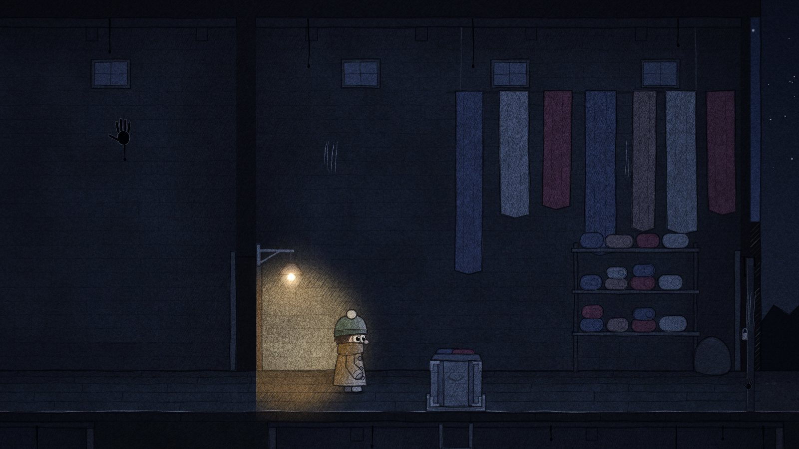

### 看上去

库房左墙一盏壁灯（一直亮）。地上一块木头盖板（两道铁箍、一只铁环，后沿两只合页），**上面压着一只装布匹的大木箱**（铁皮包角，箱口露着两卷布）；头顶晾着一条条染过的布，靠墙一架布卷，右头一扇挂着锁的后门，门外是夜。

地窖：梯子在盖板正下方；左边两只小染缸，右边一架布卷；最里头的钉子上挂着**一把大钥匙**（环上拴着一小条红布），墙角的钩子上挂着**一件长长的胶皮围裙**（口袋里插着一双长胶皮手套）——挂着的时候只是一件衣服，底下一摊墨。

暗处的恐怖照规矩加了：墙上的墨手印、抓痕、往下淌的墨；亮处（壁灯底下）正常。

### 一步一步

规则里最少 **6 步**，都非点不可（下面第 1、2、3、5、6、7 条各点一下；第 4 条是跑，不是点。`node tools/check.mjs`：第 22 关 6 下、7 个局面、没有死路、少点哪一处都走不出去、走出去时身上不带东西、自己变的那一处变过去以后也走得出去）。

1. **推开木箱**（往右推到 74806）。箱子压着的时候点盖板：掀不动（盖板吱呀动一下），摇头，气泡里画木箱。
2. **掀开盖板**：立在洞的后面，底下一个洞、一架梯子，梯子顶和地面齐平（照第 1 关地窖口的画法）。
3. 点洞里（或者往下拖）爬下去，走到最里头**拿钥匙**。一拿，墙角那件围裙**醒了**：钩子吱呀一声，领口里涌出一汪墨、睁开三只眼睛，身子抖 1.4 秒（预兆），再从钩子上下来，朝孩子追（每秒 150；孩子小跑 360、拖着跑 480）。
4. 孩子跑回梯子、爬上来；它走到梯子脚，两只手一上一下**跟着爬**（每秒 95，孩子爬每秒 150）。
5. 孩子在上面**合上盖板**（一巴掌拍下去，从点到合上 0.3 秒；它正往外探头的话被磕回梯子上，愣 0.7 秒）。它爬到盖板底下**一下一下往上顶**：盖板的前沿跳起来一条缝，缝里是眼睛，溅出墨点、扬灰，“咚”；第二下比第一下重。
6. **把木箱推回盖板上**。压住了：底下闷闷地再顶三下（一下比一下弱，箱子跟着跳），它爬下去，安静了，盖板缝里渗出一圈墨。
7. **举着钥匙点后门**：开锁，走出去，这一关过了。

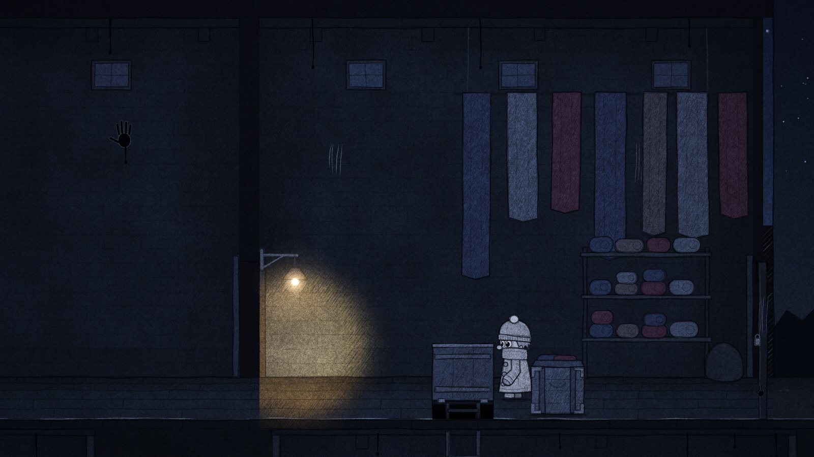
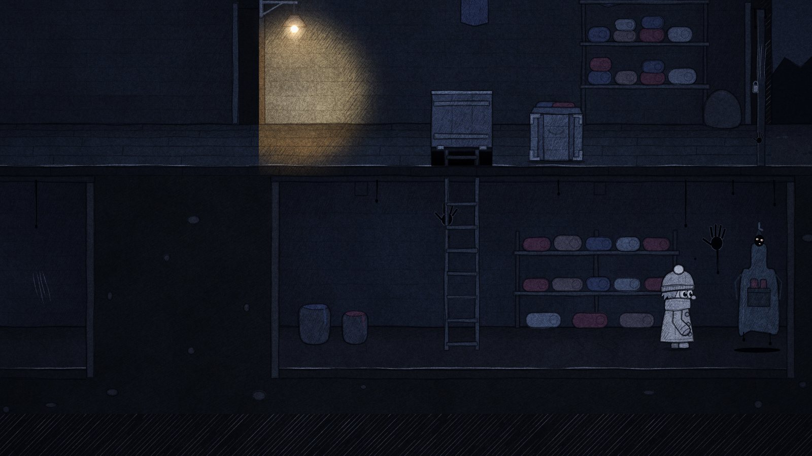
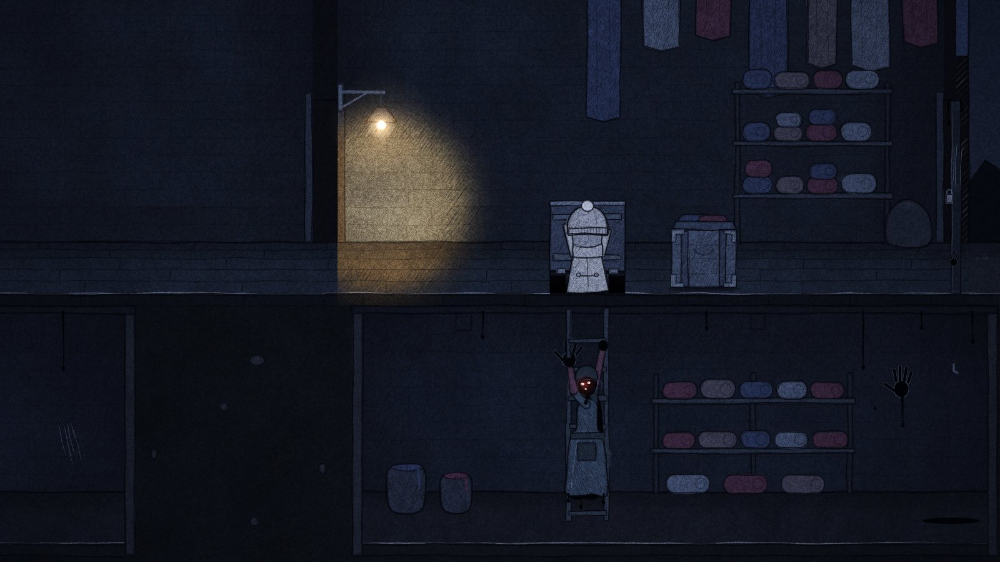
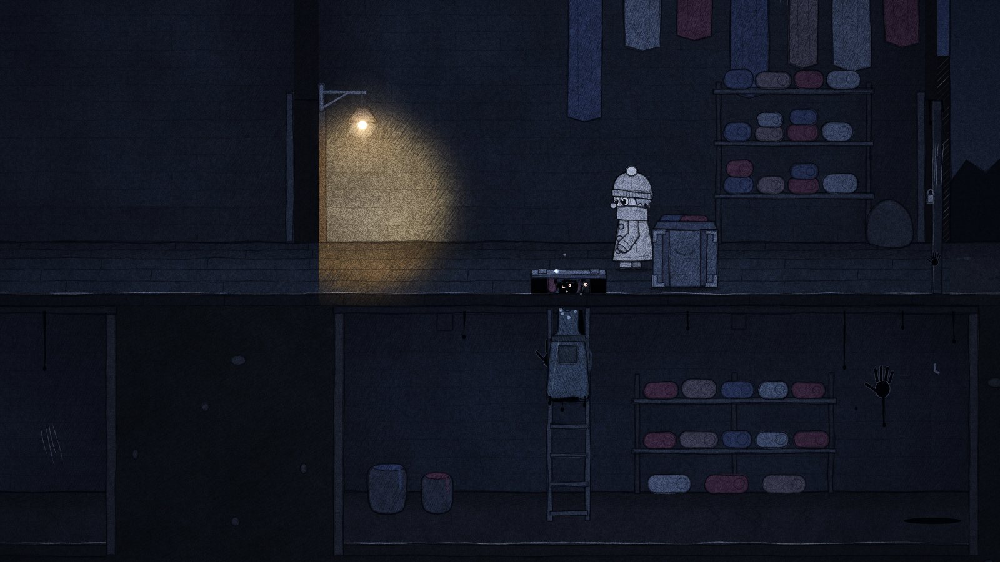
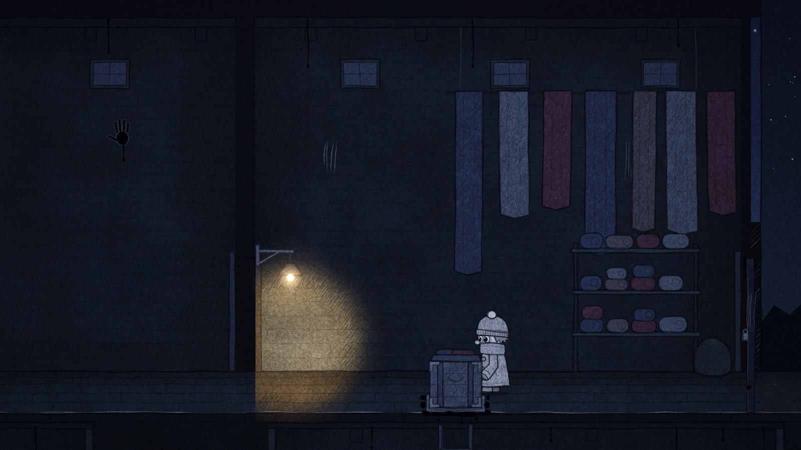

**没压住**（合了盖板不推木箱）：第三下把盖板顶飞（规则里 `eHatch` 变回 1），它两只手撑着洞沿爬出来，在库房里追孩子。孩子逃进壁灯的光圈，它就停在光圈外面盯着（不进光里）；碰到就是被抓：回到壁灯底下，做过的事（钥匙、木箱、盖板）都还在。它够不着孩子 3.2 秒以后走回洞口爬下去，守在梯子脚（醒着）。

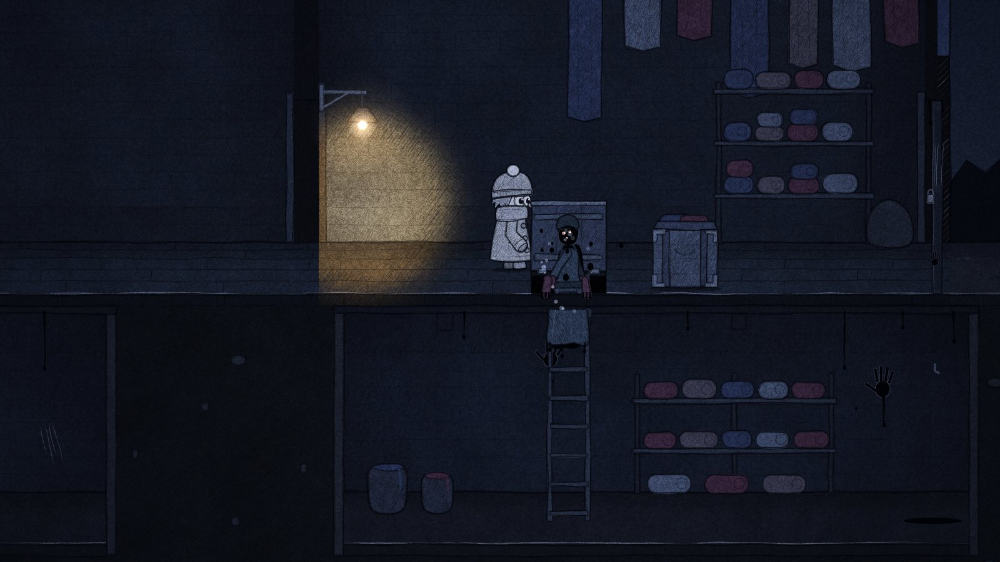
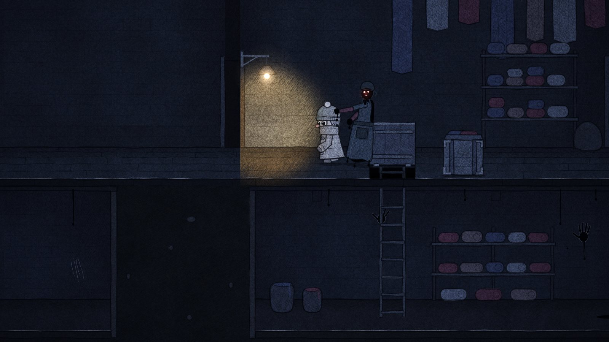
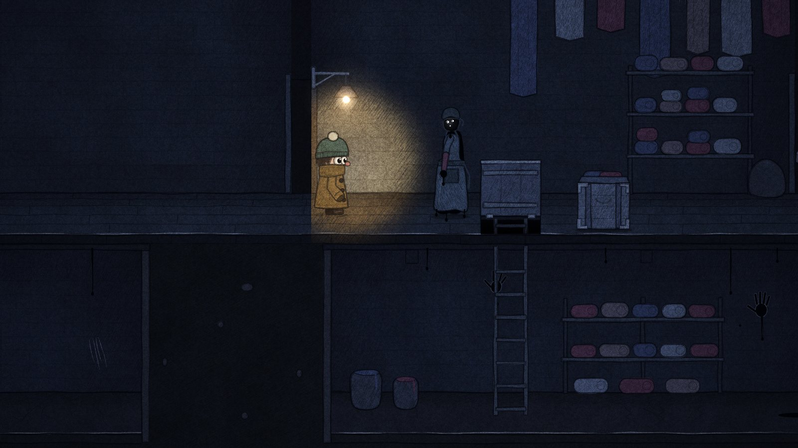

**再来**：孩子走近开着的洞口（200 以内）它就往上爬，手先搭上洞沿（预兆 0.8 秒）再爬出来；孩子抢在它出来以前合上盖板，再推木箱。它在上面（爬出来了、探出大半个身子、正往回爬还没下去）的时候，盖板和木箱都碰不得——不会出现“把它关在外面”的局面。

钥匙拿了以后镜头往下多看一截，站在上面也看得见地窖：它走到梯子脚、往上爬、在盖板底下顶、顶不动了爬下去，都在眼前；它被关住、安静了，镜头回到平常的高度。

### 规则

一关一段：`START22`、`ITEMS22`、`VALUES22`、`GATES22`、`LINKS22`、`SPOT_ZONE22`、`act22`、`TIMED22`、`L22`（A、B、C 各占自己的行）。

- 局面（C 段）：`eCrate`（0 压在盖板上 / 1 推开了）、`eHatch`（0 合着 / 1 掀开了）、`eKey`（`nail` / `inv` / `used`）、`eOut`。
- 分块：`e0` 进门 |A 的闸门| `e1` |B 的烂地板| `e2` 库房 |那条线| `e3` 后门；`ek` 地窖。A、B 的两道门还没做，`e0`–`e1`–`e2` 现在直接通着。
- 门：`ehd`（梯口：`eHatch === 1` 才下得去）；`ec3`（那条线：`eKey === 'nail'`，或者 `eHatch === 0 && eCrate === 0`）。
- 点：`eCrateH`（推开；推回去要盖板先合着，不然 `holeOpen22`）、`eHatchH`（掀开要木箱先推开，不然 `pinned22`；合上）、`eKeyH`（拿，同时 `wake22`）、`eDoorH`（举着钥匙：开门、走出去；空着手 `locked22`）。后门开了以后木箱、盖板不再动（不然走到门口又回头把它放出来，提示就没话可说了）。
- 不是点出来的：`lidBursts22`（钥匙拿了、盖板合着、木箱没压上 → `eHatch = 1`）。页面里到第三下的时候才变；`check.mjs` 查过变了以后也走得出去。
- 页面里才知道的：`GATE_ALL.ec3` 多一条——它真的安静了（`V.dy.c.quiet`）孩子才敢过那条线；`dyGuard`——它在上面的时候盖板、木箱点不动。追人、爬梯子、顶盖板、被抓都在页面里（`dyMonC`），规则里没有。

### 它（`GARB.dyc`，走法在 `dyMonC`）

照 `docs/night-monster-roster.md` 的四样：

- **平时**：挂在钩子上睡着（一件普通的胶皮围裙）；醒了以后守在梯子脚。立起来是一件灌满墨的长围裙，包着头巾，领口里三只眼睛，两条胳膊套着长胶皮手套。
- **怎么出手**：在地窖里追；跟着爬梯子；在盖板底下顶（三下顶开）；爬出来在库房里追。每一样前面都有预兆：醒 1.4 秒，手搭上洞沿 0.8 秒，顶开以前先顶两下（2.8 秒）。
- **碰到了**：一下抓住（`touch: 'catch'`，追着跑的那一类，不是拽住）。同一层的地上离得不到 40；梯子上要它自己也到了梯子上、头顶够得着孩子的脚才算。抓住的那一秒多它停在原处不动。
- **见了光**：不进光圈，走到光圈外面站住盯着（整个身子在暗处）；孩子站在光圈里（照到半成就算）它不追。它不会塌——这一只不是靠灯解决的，是靠盖板和木箱关住的。

样子（`V.dy.c.st`）：`hung` 挂着 → `wake` 预兆 → `drop` 下来 → `chase` 在地窖里追 → `climb` 爬 →（盖板开着）`rim` 手搭洞沿 → `heave` 爬出来 → `out` 在库房里 → `back` 回洞口 → `descend` 爬下去 → `wait` 守在梯子脚；（盖板合着）`under` 往上顶 → 没压住：顶开，回到 `rim`；压住了：`sink` 下去 → `quiet` 安静。`knock`：正往外爬被盖板磕下去。

### 和全游戏通用的那几样怎么合（并进来的 `main`，2026-11-26）

- **孩子不敢走到醒着的怪物跟前**（`fear`）：有，110。它站在光圈外面盯着、正走回洞口的时候，孩子朝它走到 110 以内就退两步（不会一头撞上去）。它正追着孩子的时候不算：那是跑不过它，朝它撞过去就是被抓。
- **被拽住能挣开**：不用。它是追着跑的，碰到就是抓住（和狗、跑圈的运动服一样）。
- **灯下看得见它塌**：用不上，它从来不进光里。
- **照它的灯按规则亮了就不再出手**（`ruleOpen`）：用不上，没有照它的灯；它出不出手只看盖板、木箱和孩子在哪儿。
- 怪物名册（`docs/night-monster-roster.md`）里**还没加这一只**（`GARB` 现在 69 条）。

### 页面里的时间和数字（`DYM`，都是量着、拍着定的）

| 数 | 值 | 是什么 |
|---|---|---|
| `tell` | 1.4 秒 | 钥匙一拿到它动起来以前的预兆；之后 0.45 秒从钩子上下来 |
| `speed` | 150 / 秒 | 它在地上追（走回洞口 ×0.75，挪到光圈边上 ×0.6） |
| `climb` / `down` | 95 / 170 每秒 | 它爬梯子上去 / 下来（梯子它要爬 186：1.96 秒） |
| `rim` / `heave` | 0.8 / 0.7 秒 | 手搭上洞沿（预兆）/ 爬出洞口；探出不到 55% 以前合盖板都来得及 |
| `first` / `thump` | 0.8 / 1.4 秒 | 爬到盖板底下以后多久顶第一下 / 一下隔多久；第三下顶开（之后 0.15 + 0.5 秒就出来了） |
| `pinned` / `muf` / `settle` | 0.45 / 0.9 / 0.6 秒 | 木箱压上以后多久闷闷地顶第一下 / 隔多久 / 第三下以后多久算安静：从压上到敢往后门走约 3 秒 |
| `near` | 200 | 孩子离开着的洞口多近，守在梯子脚的它就往上爬 |
| `linger` | 3.2 秒 | 它在上面够不着孩子多久就回去 |
| `stun` | 0.7 秒 | 被盖板磕下去愣多久 |
| 推木箱 | 约 1.9 秒 | 站到跟前以后从点到推到头（推开、推回去都是，186 远）；推回去推过一半（约 1 秒）它就顶不开了 |
| 合盖板 | 0.12 + 0.08 秒 | 手伸过去 / 收回来，站在跟前从点到合上 0.33 秒（掀开是 0.25 + 0.25） |
| 光圈 | 到 x 74505 左右 | 孩子在 74462 以内算在光圈里；它停在 74503 左右 |

量过的松紧（拖着走 / 方向键）：钥匙到手以后，最多再愣 1.4 秒就得往回跑（跑过头再折回梯子也算在里面）；愣到 1.6 秒，在梯子上被抓。合上盖板以后（它从梯子脚爬起）到被顶开大约 5.5 秒，够走到木箱跟前把它推过一半。

### 不出字怎么告诉玩家

- 木箱压着点盖板、往梯子下面走：摇头，气泡里画**木箱**。盖板开着推木箱：气泡里画**盖板**。空着手点后门：气泡里画**钥匙**。
- 钥匙拿了、它没被关住的时候往后门走：在那条线跟前吓得退回来，气泡里画**盖板**（还开着）或者**木箱**（合着没压）；压住了、它还在闷闷地顶：退回来，没有气泡（等它安静）。
- 右上角 `?`：下一步的地方亮一个圈，气泡里画木箱 / 盖板 / 钥匙和箭头。
- 卡住两分钟以后才慢慢闪的小星星：木箱、盖板、钥匙、后门（`dyGlints`）；地窖里的钥匙隔一会儿自己亮一下（不算提示）。
- 抢时间的两下不冤枉人：合盖板的手还没收回来、或者人还在往盖板跟前走的时候点了木箱，记着这一下，盖板一合上就去推（`dyTapLater`、`dyTapHold`）。

### 引擎里动了哪几处

- 地方：`FL.dyc`、`FL.dyb`；`DY` / `DYA` / `DYB` / `DYC`；`ROOMS` 里 `dyA`、`dyB`、`dyBp`、`dyC`、`dyCc`；`NODES` / `EDGES` 末尾加点加路（`DYE`）；`GATEPOS` 里 `ehd`、`ec3`；`STOPS`（后门）；`ladderEnd`。
- 画：`paintDy`（`dyShell`、`dyWallLamp`、`dyPit`、`dyRoll`、`dyPaintA` / `B` / `C`、`dyPaintCellarC`：不会动的）；`drawDyDyn` / `drawDyFront`（`dyDrawC`、`dyDrawFrontC`、`dyHatchGroup`、`dyLid`、`dyCrate`、`dyHungApron`、`dyApronFig`、`dyDrawMonC`：会动的，暗的一层、亮的一层各一遍）；颜色 `LIT` / `DARK` 里 `dy*`；钥匙、木箱的小图（`sceneItem` 里 `eKey`、`eCrate`）；两盏壁灯（`LIGHTS` 里 `dya`、`dyc`）。
- 状态：`V.dy`（`dyInit`，不往 `newView` 的长行里加）；`dySnap`、`dyRespawn`、`dyUpdate`、`dyCamY`（`camTarget` 里）、`dyZoneAt`、`dyGuard`（`ACT` 里）、`dyAutoOk`、`dySpots`、`dyGlints`、`drawDyGlow`、`dyEnter`、`curLevel` / `LEVELS_MAIN`。
- 怪物：`GARB.dyc`（`garbUpdate` 里交给 `dyMonC`）、`CATCH.dyc`、`GARB_HOME.dyc`。
- 点东西：`perform`（推木箱 `dyPushCrate`、掀 / 合盖板 `dyHatchHit`、拿钥匙、开后门 `exitSeq22`，三种点错的气泡）、`commit`（`wake22` 等）、`meetGate`、`gateHint`、`hint`、`tapWorld`（点洞里下去 `dyHoleTap`、记着的那一下）。
- 声音三个：`dyThud`（顶，压住了是闷的）、`dyBurst`（顶飞）、`dySlam`（合上）。别的用已有的（吱呀、梯子、推东西、开锁）。

### 和设计稿不一样的地方

| 设计稿 | 做成的 | 为什么 |
|---|---|---|
| 盖板中心离库房左墙 300 | 420（x 74620） | 壁灯的光圈到 305 左右，盖板要在光外面，中间还要留它“停在光的边上”站的地方 |
| 木箱推开到 450 | 606（x 74806） | 让出掀、合盖板站的地方（洞的右边 524） |
| 后门 980 | 1010（x 75210） | 跟着往右挪 |
| 灯光照到 0–240 | 光圈到 305 左右；孩子在 262 以内算在光圈里 | 全游戏的“在光里”要照到四成五，光圈外沿不算——那样孩子逃到看着是亮的地方照样被够着 |
| 地窖地面 80–1040 | 墙里 60–1060，孩子走得到 260–930 | 孩子永远在围裙左边，被扑倒往左摔，不会摔进墙里 |
| 每 1.2 秒顶一下 | 第一下 0.8 秒，以后隔 1.4 秒 | 留出走到木箱跟前、推过一半的时间 |
| 走近洞口 260 以内它往上爬 | 200 | 260 的话站在光圈边上它就一直往上爬 |
| 压住以后“闷闷地再顶三下” | 0.45 秒后第一下，隔 0.9 秒，一共约 3 秒 | 照没压住的间隔要等 4 秒多，站着干等太久 |
| （没写） | 后门开了以后木箱、盖板不再动 | 见“规则” |
| （没写） | 它醒着、没被关住的时候镜头往下多看一截 | 不然只听见梯子响、盖板跳，看不见是什么在底下 |
| （没写） | 梯子上被抓要它也在梯子上；抓住的那一秒多它不动 | 原来它还站在梯子旁边的地上、手朝前伸着，头顶上的孩子就被抓了，看着冤 |
| （没写） | 连着点盖板、木箱两下，第二下记着 | 原来第二下把第一下顶掉：盖板没合上，木箱也推不过去 |


## 查过的

2026-11-28，这个分支上（并过 2026-11-27 上午的 `main`，见下面“没验证的”第 1 条）。

- `node tools/check.mjs`：全绿；第 1–21 关那几行和并进来的 `main` 一字不差（整份输出只多了第 22 关一行，和最后“深浅”里跟着多出来的第 22 关）；第 22 关 `ok`，最少点 6 下、局面 7 个、死路 0 个，`eCrateH eHatchH eKeyH eHatchH eCrateH eKey→eDoorH`，自己变的 1 处。
- 无头 Chrome（停住主循环一帧帧走）：`?lv=22` 照自动试玩玩到通关，游戏里 33.4 秒，0 次被抓，没有报错。真实时间 `?lv=22&auto=1` 34 秒通关，0 次被抓，没有报错。
- 别的关照旧：`?lv=21` 照自动试玩走到通关、默认从头玩 300 秒（到第 6 关），每半秒比一次孩子的位置、局面、点了几下，和 `main` 一模一样（319 个、601 个时刻）；`?lv=21` 通关以后 `curLevel` 是空的，没有走进第 22 关。默认页、`?lv=2`、`3`、`4`、`8`、`12`、`17`、`18`、`20`、`21`、`?monsters=1`、`?monsters=cab`、`?imps=1`、`?lv=22`（电脑、手机竖屏、手机横屏、`ctl=tap`）共 18 页打开没有报错。
- C 段的各种情况 17 组 71 条，都对：箱子压着点盖板；盖板开着推箱子；钥匙没拿走到后门；拿了钥匙站着不动（地窖里被抓，回到壁灯底下，钥匙还在，它回梯子脚，接着玩走得出去）；合了盖板不推箱子（三下顶开、爬出来、逃到灯下它停在光圈外面、过一阵回去、再来一次成功）；压住以后再把箱子推开（它又顶开，再压一次照样走得出去）；它正往外爬的时候合盖板（磕下去）；它在上面的时候盖板、箱子点不动（规则上、真的去点都试了）；它站在光圈外面盯着的时候朝它走（退回来，不被抓）；爬到梯子半中间停住（在梯子上被抓，它到了梯子上才算，抓住以后它不动）；它堵在梯口的时候往下钻；伸手合盖板的当口它已经出来大半（手缩回来）；后门开了以后回头点木箱、盖板（不动）；压住了还在闷闷地顶的时候往后门走；连着点盖板、木箱两下（手伸着的时候、人还在路上的时候）；站在光圈的最外沿。
- 随机乱点乱走 24 组种子（每组 260 下，点、走、拖混着来，一共乱玩三千一百多秒、被抓 358 次，其中梯子上 103 次）：每一帧查没有 NaN、孩子不出地图、不在地底下、不卡在洞里、不从堵着梯口的它身上钻过去、它在上面的时候盖板没有合着、那条线没有错开、后门开了以后局面不再动、梯子上被抓的时候它在梯子上、抓住的那一阵它不动；乱完照“下一步”接着走，24 组都走出了后门。
- 手机横屏 844×390：用真的触摸事件（按下、拖、抬起）从推木箱一路玩到走出后门，0 次被抓；木箱、盖板（合着、立着）、洞口、钥匙、物品栏里的钥匙、后门都在屏幕里、没被按钮和物品栏盖住、点得到。
- 画面：`docs/images/level22-c-01.jpg` 到 `08.jpg`、`07a.jpg` 是无头 Chrome 里一步步真玩到那一刻截的（1600×900），每张都看过；另外一帧帧看过醒过来、爬出来、被磕下去、顶开、压住、回洞口、三种被抓（地窖里、梯子上、库房里）。库房和地窖亮的那一层平常照不到（壁灯的光到不了盖板），临时加了一盏灯看过：木箱、盖板、洞口、布卷、钥匙、挂着的围裙都画了。


## 没验证的 / 要主人定的

1. **`main` 又往前走了**：这个分支并的是 2026-11-27 上午的 `main`（到 #179）。之后到 11-28 凌晨 `main` 上又进了 #180–#183 和两条直接并进去的分支（删掉第 21 关的全家福合影、开场、地面起伏、站着不动的动作、道具页；8 个提交，`house.html` 改了八百多行），**还没并进来**；上面“和 `main` 一字不差”比的是并进来的那一版。试着并过（`git merge-tree`，不动工作区）：只有 `games/house.html` 有三处要手工并，都是两边各加了挨着的行——规则末尾 `L21` / `LEVELS` 那两行（`main` 把第 21 关的终点改成了 `xHome`，这边在它后面加了第 22 关整段和 `L22`）、`restart` 里 `dyEnter` 那一行和 `main` 的 `introStart` 那一行、`tick` 里 `dyUpdate` 那一行。并完第 21 关那一行会跟着 `main` 变。
2. **没亲手玩，没在真手机上试**。松紧（它多快、预兆多长、顶几下、愣多久来得及）都是量出来、拍的数。
3. **声音没听过**（咚、嘭、哐三个是新合成的）。
4. A、B 两段没做：进门要先走过两间空屋子。
5. 头一回拿钥匙，站着看它醒过来的人多半会被抓一次（回到灯下，钥匙还在，它守在梯子脚）——这样教“要合盖板”行不行，还是该再松一点？
6. 没压住、盖板被顶开的时候，孩子要是还站在洞口右边（合盖板、推木箱都站在那一边），右边是死路，基本逃不掉（顶开以前有两下预兆，一共 2.8 秒）。要不要把木箱推开的方向换到靠灯的一边？
7. 它在上面的时候按 `?`，圈还是指着盖板（那时候该做的是回灯下等它回去）；没有合适的小图，没做。
8. 方向键起步慢（头 0.45 秒只是走）：它贴到 64 以内再跑，来不及。这是全游戏的手感，没动。它伸手的样子（够 78）比抓得着的距离（40）长：追到跟前那零点几秒，手已经搭在孩子帽子上了还没算抓住（`level22-c-07.jpg` 就是这样的一帧）。
9. 怪物名册里没加这一只；它的样子（长围裙、头巾、长手套）是新画的，没有单独给主人看过设计。
10. 读档、存档：`?lv=22` 不读不写，没有试过。
