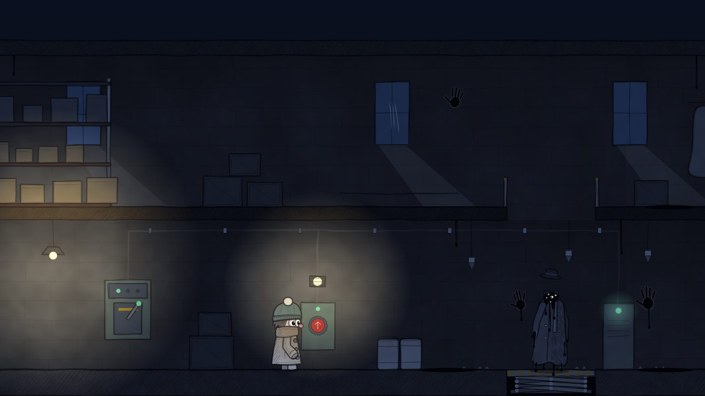
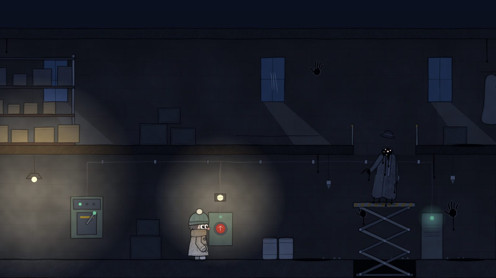
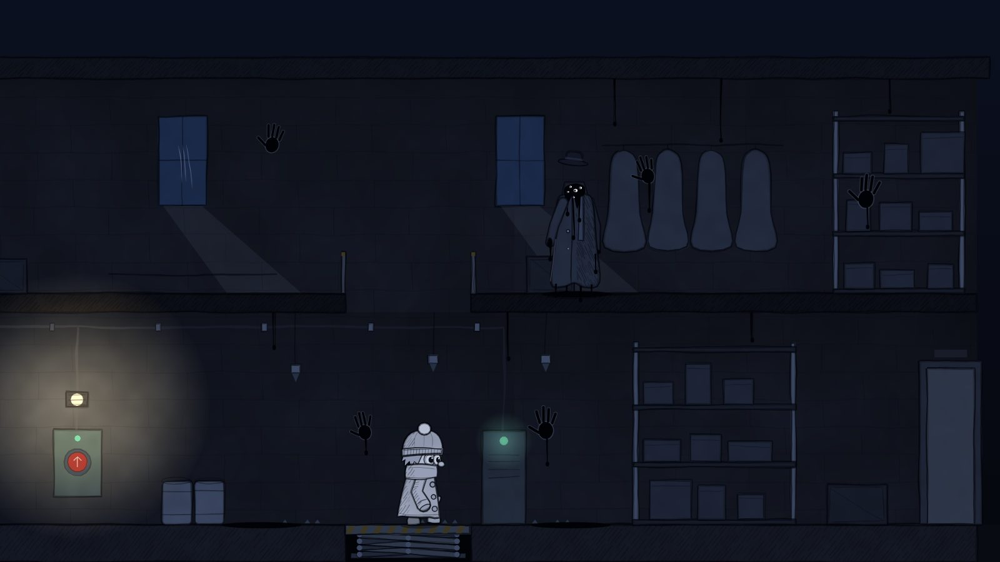

# 夜里 · 货梯（试玩关）

2026-11-25。主人说：“可以设计一个那种需要升降机的关卡，比如说那个怪物在一楼巡逻挡住路了，然后通过一个按钮，然后把它用升降机升到二楼去，然后人物就可以通过那座关卡。”

做出来一个**能玩的试玩关**：`games/house.html?lift=1`。**没有接进 21 关的主线**（为什么、怎么接，见下面“接进主线”）。孩子、墨里的大衣、铅笔的画法都是游戏自己的（`drawKid`、`inkCoat`、`ink` / `part` / `hatch`），所以画面和游戏里一样。

## 怎么玩

- 点一下走过去；点闸刀盒、按钮盒、右边的门就去用它。电脑上也可以 ← → / A D 走，空格 / 回车 / E 去用最近的一处，R 重来。通关以后点一下（或按任意键）再来一遍。
- 不出字。点错了用动作和气泡里的小图告诉你差什么；卡住 45 秒以后，现在能用的那一处才慢慢闪。

## 一步一步

最少点 **4 下**（闸刀、按钮、按钮、门），中间要等大衣走到位置上，整条解法自动走一遍约 35 秒。

1. **合闸**：左边墙上的闸刀盒，扳下去。货梯的电机才有电：按钮盒的小灯和平台边控制柜上的信号灯亮起来。没合闸就按按钮，孩子摇头，气泡里画一个闸刀。
2. **等大衣走到平台上，按按钮**：走廊正中是一台剪叉式的货梯，平台和地面一样平；一件灌了墨的大衣在走廊里来回巡逻，每一趟都从平台上走过、在平台正中停下来。孩子走不过去（离它 225 以内就不敢再往前，它朝这边走过来他就往后退）。按钮盒在它巡逻的范围外面（x 900，大衣最靠近的一头在 1195）：按下去那一刻大衣站在平台上，喇叭响、信号灯闪 0.8 秒，然后平台连着它一起升到二楼，它被带着抬起袖子。
3. **等它走远，再按一下**：平台升走了，一楼地上是个坑，走廊断成两半，孩子还是过不去。大衣在二楼走出平台，进仓库里来回（x 1700–2020，再也不靠近平台的口）。它走远了再按，平台放回地上。
4. **走过去，出门**：走过平台、大衣的巡逻已经空了的走廊，右边的铁门开了，门里透出光，孩子走进去，黑下去。

按错了的代价都很小，**没有死路**：
- 大衣不在平台上就按：平台空着升上去，坑出现，再按一下放下来，重来。
- 大衣还站在二楼的平台上就按下去：它跟着平台一起回到一楼，接着巡逻。
- 往大衣那边走：在它跟前发抖、退回来（和游戏里“不敢过去”一样，不会被抓）。往坑边走：摇头，气泡里画平台。

## 为什么这样设计

- **挡路的东西不一定要用光照倒**。游戏里唯一不讲道理的是“光照到头它就塌”（`docs/night-rules.md`）；这一关换成生活里说得通的东西：货梯载着站在平台上的东西一起上下。主人在 11-25 删了“递光”，说剧情还要再改；这一关不靠光、不靠递光，是另一种解法。
- **为什么这一关的光照不到它**：走廊的灯泡碎了（三盏），亮着的两盏（起点、按钮盒上面）够不着大衣巡逻的地方（它最靠左的一头 1195，最右的一盏灯照到 1115）。信号灯、出口的灯是绿的：规则里绿色的冷光只是好看，不算光。
- **为什么是两下按钮，不是一下**：平台升走了，地上就是坑，走廊是断的。只送走怪物不够，还得把平台取回来，孩子才过得去。这也是“最少点 4 下”里有两下按钮的原因：先送走，再取回；取回的那一下要看大衣走远没有（它还站在平台上，就又被带回来）。
- **先教再用**：平台、按钮、箭头都在孩子眼前。按钮上的箭头平台在下面是朝上的，在上面是朝下的；大衣被带上去的过程看得见（剪叉的臂一节节撑开、大衣的袖子抬起来）；一楼二楼是剖开来的，上面发生的事一直看得见。
- **预兆**：按下去到平台动起来有 0.8 秒（喇叭响、绿灯闪），不是“一按就动”，平台动起来以前大衣不会再往平台上走。
- **时间窗口很宽**：大衣一圈 18.6 秒（走 11.0、停 7.6），其中约 9.6 秒中心在平台上（两回，每回 4.8 秒，在平台正中停 2.6 秒）。按钮盒离平台约 430，一眼看得全。想紧一点就缩短 `LIFT.MON1` 里平台正中那一停。

## 一张图

x 0–2400，一楼脚下 y 840，二楼 y 470（剖开来看，两层一直都看得见；镜头跟着孩子横着走）。

| 一楼 x | 有什么 |
|---|---|
| 50–200 | 入口，孩子站在这儿开始（190）；灯一盏（300，照到 640） |
| 470 | 闸刀盒（拨杆朝上断开，扳下去合上） |
| 610–710 | 两只箱子（布景） |
| 900 | 按钮盒（上面一盏防爆灯，照到 1115）；管线从闸刀盒、按钮盒的顶上沿着天花板走到控制柜 |
| 1060–1112 | 两只铁桶（布景） |
| 1195–1690 | **大衣巡逻**：1195（停 1.2 秒）→ 平台正中 1430（停 2.6 秒）→ 1690（停 1.2 秒）→ 1430（停 2.6 秒）；三盏碎了的灯、地上的墨 |
| 1330–1530 | **货梯**：剪叉式，平台板黄黑斜纹，平台在下面的时候三节臂折在地面下的坑里 |
| 1548–1618 | 控制柜（里面是电机，上面一盏绿的信号灯） |
| 1790–2050 | 货架、纸箱（布景） |
| 2258–2338 | 出口：一扇铁门，门楣上一盏绿灯，开了以后透出光 |

二楼：左边货架、箱子、月光从窗里斜着落下来；平台的口（x 1330–1530，两边是黄黑立柱）；右边是大衣升上来以后待的仓库：衣架杆上挂着四件旧大衣、货架、箱子，大衣在 1700–2020 之间来回。

## 引擎里动了哪几处

全在 `games/house.html` 最后“货梯”那一段（`LIFT`、`lf`、`lift*`、`lf*`），再加两行：`if (qs.has('lift')) liftStart();` 和一段配色（`lfHazY` 等，登记进 `LIT`、`DARK`）。

- 借游戏自己的：画法（`ink`、`part`、`hatch`、`tube`、`texture`）、`drawKid`、`inkCoat`、`creepMarks`、`inkDrips`、`moveKid`、声音（`snd.*`，只多加了一个喇叭 `snd.liftHorn`）、两张图的画法（暗的一张、亮的一张，亮的那张只在灯照到的圈里露出来）。
- 和图鉴页（`?monsters=1`）一样：`paused = true`，游戏本身的点击、按键都接住不让过去，用自己的循环。
- **没动**：`<script id="core">` 那一段规则、`tools/check.mjs`、21 关。`node tools/check.mjs` 输出和改之前一字不差。
- 给测试用：`window.__lift`（只有 `?lift=1` 才有）。

## 接进主线

21 关是一条横轴连着的图（第 1 关到第 21 关一张图，不切屏幕），每一关的画、光、路、存档、`?lv=N`（前面几关“当作走完了”）都用绝对的 x。中间插一关要把后面所有关的 x 都挪一遍，风险和工作量都大。可以这样接：

- **A. 并进现有的一关，做成岔线**（和第 2–6 关的“岔线”一样，推荐）：
  - **第 17 关百货大楼**：楼的剖面本来就有上面几层黑着的窗，收银通道前面加一段货梯间，第二位夜班店员（人台中间那位）改成在货梯间来回的那位；现在“台灯递给它”的解法换成货梯（那是主人说“先别管”的递光的一种）。
  - 或第 5 关公寓楼：大堂和楼道之间的货梯。
- B. 做成第 22 关，放在结局后面：结局是回家、合影，再来一关不合适。
- C. 把它插在 17、18 关之间，挪坐标：工作量最大。

接进去的时候规则一关一段（`START` / `ITEMS` / `GATES` / `LINKS` / `SPOT_ZONE` / `act` / `mkLevel`），名字用一个没用过的字母开头（`tools/check.mjs` 查重名）。规则里只记“电合了没有（`lPow`）、平台在上面还是下面（`lUp`）、大衣在哪一层（`lMon`）”；“等大衣走到平台上”是页面里的时间，不在规则里（和游戏里别的巡逻的衣服一样）。三个点：闸刀、按钮（平台在下面就送走、在上面就取回）、出口；一道门槛：大衣在一楼挡着（`lMon` 是一楼）。求解器能搜到的最少点就是 4 下。

## 查过的

- 无头 Chromium 里把整条解法走一遍（合闸 → 等大衣站到平台上 → 按 → 平台升起、大衣被带走 → 大衣走远 → 按 → 平台放下 → 走过去、出门、黑幕和重来的转圈箭头），没有报错；改了一处以后又走了一遍。
- 点错了的各种情况都试过：没合闸按按钮、往大衣走、大衣不在平台上就按（空平台升上去）、往坑边走、放下来、大衣还站在二楼的平台上就按下去（它被带回一楼）。
- 乱来：60 组种子各 4800 步（240 秒）随机点、随机走、随机按键，共约 31 万步；每一步查：平台的位置在范围内、没有 NaN、大衣不悬在坑上（平台动的时候不被带走的大衣不往平台上走）、孩子不进坑、不贴近大衣、被带走的大衣和平台一起动。碰到的情况：带着大衣升 47 次、空平台升 131 次、放下来时大衣还在上面 3 次、放下来 148 次、被吓退 990 次、摇头 1095 次。**这一轮查出一处**：平台刚起步的头一小会儿，没被带走的大衣还会往平台的范围里走，悬在正在升起的平台底下约两秒（起步第一帧巡逻点还按“平台在地上”算）；改成平台一动，没被带走的大衣就留在它原来那一边，再跑 0 条违例。乱来完再用同一套解法接着走，60 组都走得出去，没有卡死的。
- 手机：横屏 844×390 用真的触摸点了闸刀盒，生效；竖屏 390×844 能玩，上下留黑边（和游戏本体一样，按宽高里小的那个比例放）。
- 游戏本体：默认页、`?lv=17`、`?lv=2&auto=1`、`?monsters=1`、`?monsters=boot` 打开都没有报错。

## 没做的

- 没亲手玩；没在真手机上试。声音只用了游戏里现有的几种，加了一个喇叭，没听过。动的样子只看了截图，没逐帧看顺不顺。
- 孩子不会被大衣抓住（只是不敢靠近，退回来）。要加“被抓住”得做专门的画面，和别的衣服一样。
- 没有存档，没有右上角的提示按钮（只有卡住 45 秒以后的闪）。

## 要主人定的

1. **放进哪一关**（上面的 A / B / C，我建议 A，第 17 关）。
2. **时间窗口**：现在很宽松（一圈里一半时间大衣在平台上）。想要更紧张，就缩短平台正中那一停（现在 2.6 秒），或者让按钮盒离平台更近一点（现在 430，太近大衣会走到孩子跟前）。
3. **孩子要不要也坐一回货梯**：现在货梯只送怪物。让孩子自己坐，二楼可以放一件东西（钥匙、保险丝），岔线更深，但二楼就要有孩子能走的路。
4. **要不要被抓住**：现在是“不敢过去”。
