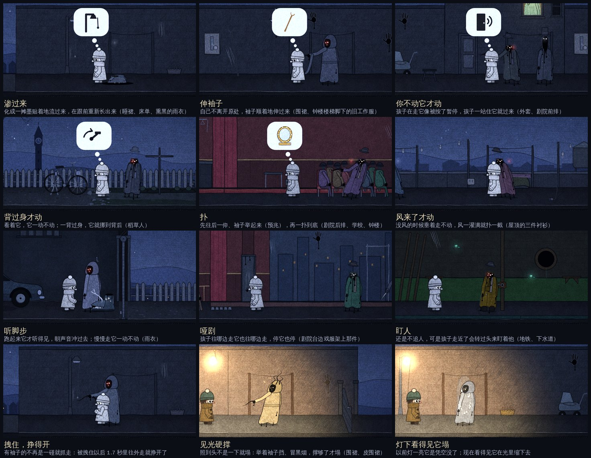
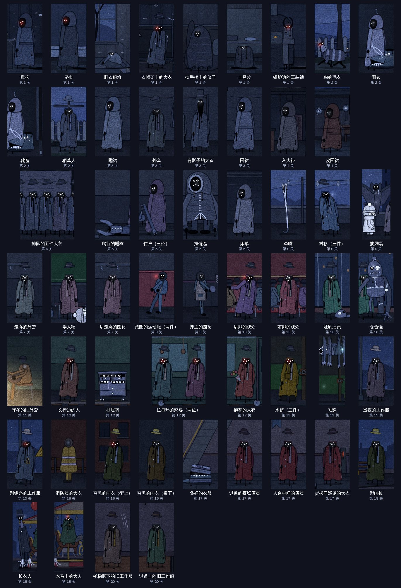

# 夜里 · 怪物名册和各自的特点

2026-11-26。主人说：“列出所有的怪物，并且设计一下这些怪物的特点，总不能都是站在原地不动，一碰就死吧”。

我的理解：①要一份**全部怪物的名单**（以前只有新做的十一只有图鉴，老的五十多件散在各关的文档里）；②现在的怪物**不动**；③“一碰就死”有两个意思，量下来两个都是真的，所以两个都做了：**孩子**一碰到怪物就完（走过去就被抓），**怪物**一碰到光就完（灯一亮它凭空没了）。

这一页是名册、设计、做进游戏的记录。**规则（`<script id="core">`）一个字没动**，`node tools/check.mjs` 的输出和改之前一字不差；改的都是页面里的事（`games/house.html` 的 `GARB` 表、`AI` 表、`garbUpdate`、走路、`drawGarb`）。

## 一句话

- **名册**：`GARB` 里一共 68 条，按“同一种”并起来是 55 种（下面的图），另有两群不在表里的（第 14 关池子里的人群、第 19 关拱门口的一街衣服），和一只只在图鉴里、还没进关卡的（墨脸，同一天另一条线上画的，见名册最后）。
- **以前为什么是“站着不动、一碰就死”**（量出来的，见下面一节）：前几关孩子停在离怪物 40 的地方，它一挪就碰上；第 7 关以后孩子被拦住的地方离怪物两三百，它的地盘够不着孩子，所以它**从来不动**；灯一亮，亮的那一层把暗处的怪物整个盖掉，它是**凭空没了**。
- **这次做的**：每一只定四样——**平时怎么动、你走近它怎么出手、碰到了会怎样、见了光怎么个怕法**；新做了八种脾气（渗过来、伸袖子、你不动它才动、背过身才动、听脚步、风来了才动、扑、哑剧），加上踱步、盯人两样小的，分给了原来“一个模子”的 30 条；另有三样是全游戏通用的（不敢靠近醒着的怪物、被拽住能挣开、灯下看得见它塌）。
- **怎么看**：`games/house.html?lv=3`（一进来往右走就是睡裙，后面是外套、围裙：三件三个脾气，最集中）；`?lv=7`（一进来走廊里那件就在来回踱步）、`?lv=6`（风里的衬衫）、`?lv=10`（往右走到观众厅，后排那件会扑）、`?lv=16`（黑街上那件化成黑烟飘过来）、`?lv=20`（楼梯脚下那件伸袖子）；第 2 关的雨衣、稻草人要先过了狗的毛衣（把它引到感应灯底下）才走得到。要看它们出手，得**摸黑走到它跟前、被吓退以后站着别走**；照最顺的解法先开灯再过去，看到的是它在光里塌下去（有三件会硬撑一两秒）。

## 名册（55 种，游戏里醒着的样子）

每一格是在游戏里摸黑站到它旁边截下来的（不是另画的效果图；图调亮了一点）。同一种的几件只放一件（排队的五件、三位住户、三件衬衫、两件运动服、两位乘客、三件水裤）。

## 量出来的：以前为什么是“站着不动、一碰就死”

1. **孩子一碰就完（第 3–7 关）**：这几关怪物的“门”（`GATEPOS`，孩子不敢越过的那一点）就钉在怪物站的地方，孩子停在离它 40 的地方，而它抓人的范围也是 40。实测第 3 关摸黑朝睡裙走过去：它只挪了 25，孩子还没走到停的地方就被抓了（2.67 秒）。玩的人看到的就是“它没怎么动，我走过去就死了”。
2. **站着不动（第 7 关以后）**：这些关孩子被拦住的地方离怪物 200–330，怪物的地盘（`terr`，孩子走进去它才追）只有它脚边一百来宽，**孩子永远走不进去，所以它永远不追**。第 10 关三件、第 15、16、17、20 关的都是这样；第 12、13 关那七件干脆速度是 0。

   | 关 | 怪物 | 孩子被拦住的地方离它多远 | 它的地盘离孩子还差多远 |
   |---|---|---|---|
   | 3 / 6 / 7 | 睡裙、外套、围裙、三件衬衫、走廊的外套 | 40 | 孩子已经在里面（一挪就碰上） |
   | 10 | 后排、前排的观众、台边的戏服 | 232 / 252 / 200 | 80 / 80 / 80 |
   | 15 | 两件巡夜的工作服 | 240 | 160 |
   | 16 | 两件熏黑的雨衣 | 230 / 320 | 150 / 240 |
   | 20 | 两件旧工作服 | 170 / 140 | 110 / 80 |
   | 12、13 | 长椅边的人、乘客、抱花的、三件水裤 | 110–300 | 速度是 0，不追 |

3. **怪物一碰到光就完**：这个游戏的画法是“暗的一层画立着的怪物，亮的一层画普通的衣服，灯光把亮的一层抠出来盖上去”。所以灯一亮，立着的怪物连同暗的那一层整个被盖掉，塌下去的 0.35 秒动画玩的人根本看不见：**它不是塌了，是没了**。
4. （没解决，记在这儿）**长得一样**：68 条里 37 条用的是“长大衣、帽子飘在空领口上面”那一种画法，10 条是带帽兜的长袍。名册图里一眼看得出来。这次改的是它们怎么动，没改它们长什么样，见最后“要主人定的”。

## 四样特点

以前每只怪物只有一样（“暗处醒着，慢慢挪过来，光照到头就塌，碰到就抓走”），现在拆成四样，每只各取一种：

| | 有哪几种（**粗体**是这次新做的） |
|---|---|
| **平时**（暗处、你没惹它） | 站着晃；睡着（是别的东西，走近才醒）；缩在窝里；跑圈、来回摆；**踱步**；忙自己的事（弹琴、拧扳手、拉吊环、排队）；**盯人**（忙自己的事，可是你走近了它转过头来盯着你） |
| **出手**（你走进它那一片、又不在光里） | 慢慢挪；一排一起挪；听见声音才追；刹不住车地冲；蹦、扑到底、贴地冲、剪、掉下来、咬、砸、飞、灯闪才近一步、不看才挪、学你反着走；**渗过来**；**伸袖子**；**你不动它才动**；**背过身才动**；**听脚步**；**风来了才动**；**扑**（往后一仰再扑）；**哑剧**（学你朝同一个方向走） |
| **碰到** | 一下抓住（回到灯底下）；**拽住**（1.7 秒里往外走 48 就挣开了，挣不开才被抓）；不抓人（只拦路、只吓人） |
| **见光** | 一照就塌（**现在灯下看得见它塌**）；**硬撑**（照够一两秒才塌，这一阵它举着袖子挡光、冒黑烟，没照够灯就灭了它会缓过来）；灯灭了又起来；嘴张开的那一下才怕；被光逼着往后退、逼到头才塌；不怕光；抱着光变成一盏灯 |

几条都守着的规矩（沿用 `docs/night-signatures.md`）：

- **出手以前有预兆，头一回长**：孩子被吓退要抖 1.25 秒，这一阵他走不了。量过每一只“从吓退算起，它最快几秒够得着孩子”（见下面的表）：这次换了脾气的里面最快的 2.4 秒，是拽住（还能挣）；一下抓住的三只“扑”都在 2.7 秒以后。（第 1 关的没改速度，睡袍是 2.0 秒；以前这一下是直接被抓，现在是拽住。）被抓回灯底下再走过去，预兆又从长的算起。
- **灯按规则亮了，它就不再出手、回原处去**：灯照得到原处，回去就塌。所以哪一种脾气都不会让它躲在灯照不到的地方一直醒着，把人卡死。
- **不出字**：哪一种都靠动作和声音让人看懂。

## 名册（一关一关）

“改了什么”一栏：**新** 是这次换了脾气；**拽** 是只把“碰到就抓走”改成了“拽住能挣开”；没写的是没动（它们本来就各有各的）。括号里是 `GARB` 里的键。

### 第 1 关 家（七件，教规则的，故意都是最老实的一种）

| 怪物 | 平时 | 出手 | 碰到 | 见光 | 改了什么 |
|---|---|---|---|---|---|
| 睡袍（gown，卧室门边） | 站着晃 | 慢慢挪（60） | 拽住 | 床头灯，一照就塌 | 拽 |
| 浴巾（towel，浴室） | 站着晃 | 慢慢挪（60） | 拽住 | 浴室的灯 | 拽 |
| 脏衣服堆（laundry，楼梯口） | 趴着 | 贴着地爬（40，最慢） | 拽住 | 浴室门里漏出来的光 | 拽 |
| 扶手椅上的毯子（chair，客厅） | 站着晃 | 慢慢挪（54） | 拽住 | 壁炉的火 | 拽 |
| 土豆袋（sack，厨房桌下） | 蹲着 | 慢慢挪（46） | 拽住 | 冰箱里的光 | 拽 |
| 锅炉边的工装裤（boiler，地下室） | 站着晃 | 慢慢挪（54） | 拽住 | 手里的萤火虫罐子、来电以后的灯 | 拽 |
| 衣帽架上的大衣（stand，门厅） | 站着晃 | 慢慢挪（62） | 拽住 | 吊灯 | 拽 |

### 第 2 关 院子

| 怪物 | 平时 | 出手 | 碰到 | 见光 | 改了什么 |
|---|---|---|---|---|---|
| 狗的毛衣（dog） | 缩在狗窝里，只露眼睛 | 孩子走出门廊的光才扑出来；跑得比孩子快（500），刹不住车 | 一下抓住 | 感应灯：它自己冲进光里塌，困在灯底下 | |
| **雨衣**（rain，卷帘门边） | 挂着晃 | **听脚步**：孩子在它跟前跑起来它才听得见，帽兜猛地转过去，朝声音冲两步、站着听 1.7 秒；慢慢走过去它一动不动 | 拽住（它不离开钩子底下那一小段：孩子被吓退以后站的地方它够不着） | 车灯，一照就塌 | **新** |
| 靴嘴（boots，雨衣后面） | 睡着是一双摆整齐的胶靴 | 蹲下蓄力，高高跳向起跳时锁定的位置，落地后歇一秒 | 只在落地时咬脚踝，起跳后走开就能躲掉 | 车灯 | |
| **稻草人**（scare，院门前） | 立在杆子上 | **背过身才动**：孩子脸朝着它，它一动不动、眼睛也不红；一背过身，它就从杆子上下来往孩子这边挪（62），一回头它又定住 | 从背后一下抓住 | 自行车灯（会自己灭，灭了它在塌下去的地方又起来） | **新** |

### 第 3 关 下山的巷子

| 怪物 | 平时 | 出手 | 碰到 | 见光 | 改了什么 |
|---|---|---|---|---|---|
| **睡裙**（nightie，巷口） | 站着晃 | **渗过来**：先盯 1.6 秒，化成一摊墨贴着地流过来，在离孩子 84 的地方重新长出来，再挪过来 | 拽住 | 路灯，一照就塌 | **新** |
| **外套**（jacket，邻居门口） | 站着晃 | **你不动它才动**：孩子在走，它像被按了暂停；孩子站住 1.3 秒，它就快步过来（118） | 拽住 | 门廊灯（敲门亮 4.2 秒，灭了它又起来） | **新** |
| 有影子的大衣（shdc，外套右边） | 一直只是一件大衣，灯下墙上的影子是个人 | 灯灭了醒，走近才醒，比外套快（90） | 墨手扣住头（一下抓住） | 门廊灯 | |
| **围裙**（apron，巷子深处） | 站着晃 | **伸袖子**：自己不离开原处，先把袖子举起来（预兆 2.4 秒），再顺着地朝孩子脚边伸（62），最长 270 | 拽住 | 高处的路灯：**硬撑 1.4 秒**才塌 | **新** |

### 第 4 关 商店街

| 怪物 | 平时 | 出手 | 碰到 | 见光 | 改了什么 |
|---|---|---|---|---|---|
| 排队的五件大衣（qu1–qu5，公交站） | 朝右排着队等车 | 一排一起朝孩子挪，各自只挪 70 | 拽住 | 霓虹照排头、橱窗灯照排尾，两盏同时亮才全塌 | 拽 |
| **灰大褂**（q4dust，五金店地下室） | **在柜台后面来回踱步** | 慢慢挪（56），不出柜台后面，隔着柜台够不着人 | 拽住 | 地下室的灯泡 | **新** |
| **皮围裙**（q4apron，钟表店二楼） | 站着晃 | 慢慢挪（40，又厚又沉，全游戏最慢的一件） | 拽住 | 台灯：**硬撑 2 秒**才塌（皮厚） | **新** |

### 第 5 关 公寓楼

| 怪物 | 平时 | 出手 | 碰到 | 见光 | 改了什么 |
|---|---|---|---|---|---|
| 三位住户（zt1–zt3） | 睡着，各站在一盏声控灯底下 | 听见声音（跺脚、拍手、丢拖鞋）以后一阵子才追 | 拽住 | 声控灯（会自己灭） | 拽 |
| 爬行的睡衣（pj，大堂地上） | 睡着是一套扔在地上的睡衣 | 声音过后翻过身，贴着地冲一段 | 扑到身上（一下抓住） | 跟着大堂那位一起塌 | |
| 拉链嘴（zip，楼道） | 睡着是挂着的羽绒服 | 声音过后拉开拉链，一扑到底，扑空愣 1.5 秒 | 整个罩住（一下抓住） | 跟着楼道那位一起塌 | |
| **床单**（zsh，地下室晾衣绳） | 搭在绳上晃 | **渗过来**（第二回：贴着地滑过来，在跟前重新鼓起来） | 拽住 | 烘干机的小窗，塌了一直塌着 | **新** |

### 第 6 关 屋顶

| 怪物 | 平时 | 出手 | 碰到 | 见光 | 改了什么 |
|---|---|---|---|---|---|
| **三件衬衫**（rt1、rt3、rt2） | 没风的时候垂着 | **风来了才动**：屋顶上 5.4 秒刮一阵风（先起风声、衣服鼓起来 0.9 秒，再刮 1.3 秒）；没风它们走不动，风一灌满就朝孩子扑一截；孩子走进它那一片以后头一阵风至少等 2.2 秒 | 拽住 | 两串灯、天窗里照上来的光 | **新** |
| 伞嘴（umb） | 睡着是一把收好的伞 | 守在原地一张一合，咬的范围很短 | 伞罩住头（一下抓住） | 光只在它张开的那一下才算 | |
| 披风蝠（cloak） | 栖在晾杆上 | 按固定路线巡逻，俯冲前悬停尖叫，地上亮起一圈标出掠过的区域 | 抓着肩膀带上天（一下抓住） | 照到兜帽就掉下来 | |

### 第 7 关 学校

| 怪物 | 平时 | 出手 | 碰到 | 见光 | 改了什么 |
|---|---|---|---|---|---|
| **走廊的外套**（sg1） | **在走廊里来回踱步**（像值日的） | 孩子走进它那一片，它掉头过来（50） | 拽住 | 走廊的日光灯 | **新** |
| 学人精（sm1，教室） | 醒着站在教室那头 | 孩子往哪边走它往反方向走（镜子一样），孩子伸手它也伸手 | 面对面撞上就抓住 | 它学着扳开关，灯亮在它自己头上 | |
| **后走廊的围裙**（sg2） | 站着晃 | **扑**：往后一仰、袖子举过头（预兆 3 秒），再一扑到底（200 远，0.34 秒），扑空了趴着愣 1.4 秒，再走回去 | 一下抓住 | 幻灯机的光 | **新** |

### 第 8、9 关 体育馆、夜市

| 怪物 | 平时 | 出手 | 碰到 | 见光 | 改了什么 |
|---|---|---|---|---|---|
| 跑圈的运动服（gr1 球场、gr2 器材室） | 一圈一圈来回跑 | 孩子进了它那一片就追（150 / 140） | 一下抓住 | 球场的大灯慢慢热起来才塌；器材室那件不靠光，靠放下闸门把它关住 | |
| 面摊摊主的围裙（nr1） | 在摊子前来回摆（扇火、招呼） | 追（130） | 一下抓住 | 雨棚底下灯笼里的火苗崽 | |
| 烤串摊摊主的围裙（nr2） | 抱着光站在炉子边 | 不追 | — | 它自己就是一盏灯（不是对手） | |

### 第 10 关 剧院

| 怪物 | 平时 | 出手 | 碰到 | 见光 | 改了什么 |
|---|---|---|---|---|---|
| **后排的观众**（ta1） | 站在座位跟前 | **扑**：往后一仰（预兆 3 秒），顺着过道一扑到底（300 远），扑空了愣 1.5 秒再走回座位 | 一下抓住 | 化妆镜的灯泡，塌了一直塌着 | **新** |
| **前排的观众**（ta2） | 站在座位跟前 | **你不动它才动**（第二回，比外套快一点：125） | 拽住 | 脚灯 | **新** |
| **哑剧演员**（ta3，台边戏服架上那件） | 站在架子底下 | **哑剧**：在台前延迟约三分之一秒模仿孩子走停、转身、伸手和向上跳 | 不抓人（够不着），只是拦着 | 追光 | **新** |
| 缝合怪（patch，戏服架后面） | 睡着是一团破布 | 一瘸一拐走过来，剪刀咔嚓两下再一合 | 剪住（一下抓住） | 跟着哑剧演员一起塌 | |
| 满场坐着的观众 | 只是坐着，灯一亮一起扭头、拍手 | 不追 | — | — | 布景，不算怪物 |

### 第 11–14 关 地下通道、旧地铁、下水道、地下最深处

| 怪物 | 平时 | 出手 | 碰到 | 见光 | 改了什么 |
|---|---|---|---|---|---|
| 弹琴的旧外套（uc1，第 11 关） | 坐在壁龛里弹琴，脚边一盏小灯 | 不追 | — | 它自己有灯（不是对手） | |
| **长椅边的人**（mp1，第 12 关） | **坐不住**：站起来走几步，又回到长椅边；孩子走近了它站住、转过来盯着他 | 不追 | — | 手摇车的灯，塌了一直塌着 | **新** |
| 抽屉嘴（cab，第 12 关） | 睡着是一只五斗柜 | 守在原处，晃、嘴越张越大，再重重一蹦 | 砸住（一下抓住） | 手摇车的灯；塌了是一座能站上去的台 | |
| **拉吊环的两位乘客**（mp2、mp3，第 12 关） | 拉着吊环，车一动跟着晃；**孩子走近了转过头来盯着他** | 不追 | — | 手摇车的灯 | **新**（盯人） |
| **抱花的大衣**（mw，第 12 关） | 一直朝车门使劲；**盯人** | 不追 | — | 信号灯 | **新**（盯人） |
| **三件水裤**（wp1–wp3，第 13 关） | 各守着一根立管拧扳手；**盯人** | 不追 | — | 蘑菇桶的光、窨井漏下来的路灯 | **新**（盯人） |
| 袖蛛（spider，第 13 关） | 用一根毛线吊在管子上 | 孩子走到底下它放线掉下来，贴着地追 2.2 秒 | 八条袖子扒住（一下抓住） | 跟着第二件水裤一起塌 | |
| 池子里的人群（第 14 关，十五件连帽大衣，不在 `GARB` 里） | 挤满池子 | 孩子走进池子，它们冲上来又退回去（只吓人） | 不抓人 | 没有光可照：站在门板上从水面漂过去 | |

### 第 15–17 关 变电站、消防站、百货大楼

| 怪物 | 平时 | 出手 | 碰到 | 见光 | 改了什么 |
|---|---|---|---|---|---|
| **巡夜的工作服**（vw1，配电盘后面） | **真的在巡夜：来回踱步** | 慢慢挪（62） | 拽住 | 路灯；灯被墨崽吃灭了它又醒 | **新** |
| **别钥匙的工作服**（vw2，铁塔前面） | 站岗；**盯人** | 慢慢挪（62） | 拽住 | 同上 | **新**（盯人） |
| 墨崽（暗精灵，第 15 关） | 从变压器里渗出来，顺着杆子爬 | 不抓人，啃灯 | — | 怕孩子走近 | 见 `docs/night-imps.md` |
| 消防员的大衣（fb1） | 站在长凳前 | 不追；把警示灯递给它，它抱着灯往最黑的地方走，给孩子带路 | — | 不是对手 | |
| **熏黑的雨衣**（fw1，黑街上） | 站着晃 | **渗过来**（第三回，黑烟的样子：贴着地飘过来，冒几缕烟，在跟前重新立起来） | 拽住 | 探照灯 | **新** |
| **熏黑的雨衣**（fw2，桥底下） | **在桥洞里来回踱步** | 慢慢挪（62） | 拽住 | 大衣手里的灯走到跟前 | **新** |
| 叠好的衣服（stk，第 17 关过道） | 睡着是一摞叠好的衣服 | 孩子不看它的时候才挪，挪到自己那一片的边上等着 | 咬小腿（一下抓住；要凑到它跟前又背过身） | 跟着夜班店员一起塌 | 修了地盘（见“顺手修的”） |
| **过道上的夜班店员**（bs1） | 站岗；**盯人** | 慢慢挪（62），够不着孩子 | 拽住 | 射灯经试衣镜反射到头上 | **新**（盯人） |
| 人台中间的店员（bs2） | 站着拦路 | 不追；把台灯递给它，它抱着灯让开 | — | 不是靠光照倒的 | |
| 货梯间巡逻的大衣（bs3） | 在货梯间来回巡逻 | 不追、不怕光 | — | 用货梯把它升到二楼 | |

### 第 18–21 关 广场、老街、钟楼

| 怪物 | 平时 | 出手 | 碰到 | 见光 | 改了什么 |
|---|---|---|---|---|---|
| 湿雨披（cm1，石渠尽头） | 拦着路 | 不追 | — | 光水冲过来它往后退，逼到头才塌 | |
| 长衣人（tall，木马这头） | 睡着是高衣帽架上的大衣 | 广场的灯闪一下，它近一步 | 两只长手套捧住头（一下抓住） | 跟着木马上的大人一起塌 | |
| 木马上的大人（cr1） | 坐在木马上跟着转 | 木马停着的时候朝孩子看，够不着 | 一下抓住（要站进木马里） | 转进光里塌，转出来又醒；要让它停在光里 | |
| 拱门口的一街衣服（第 19 关，不在 `GARB` 里） | 都朝钟楼走 | 不追，挤着拦路；栅门升起来它们走进去 | — | — | |
| **楼梯脚下的旧工作服**（hk1，第 20 关） | 站着晃 | **伸袖子**（预兆 2.4 秒，70 的速度，最长 300）：孩子在窗台边划火柴的时候，它的袖子已经举起来了；再磨蹭两三秒，袖子就顺着地伸过来 | 拽住 | 蜡烛：**硬撑 1.6 秒**才塌（烛光弱） | **新** |
| **过道上的旧工作服**（hk2，第 20 关一层） | 站着晃 | **扑**（预兆 3.4 秒，290 远） | 一下抓住 | 油灯 | **新** |

第 21 关没有会伤人的东西。第 20 关给孩子带路的敲钟人的衣服、第 21 关满街朝钟楼走的衣服不拦路、不伤人，没算进名册。

**只在图鉴里、还没进关卡的一只：墨脸**（2026-11-26，新故事骨架 `docs/night-story-d.md` 里的，`games/house.html?monsters=face`）：一张苍白的、瓷面具似的脸，瞳孔跟着孩子转，抓到的那一下嘴才裂开笑；被光照到是缩一下、手挡脸、从下往上变淡，**不塌**。它还没有行为，放进关卡的时候照这一页的四样给它定（它“见光不塌”正好是这一页“要主人定的”第 5 条说的那一种）。

## 新做的几种脾气（细节，数字都在 `GARB` 表里）

- **渗过来**（`ai: 'ooze'`，睡裙、床单、熏黑的雨衣）。墨会流：孩子在它那一片里、离得比 114 远，它先站着盯 `wait0`（1.5–1.6 秒），化成一摊（0.45 秒），贴着地流过来（140–160，流的时候不伤人，地上一摊墨、几只眼睛），流到离孩子 84 的地方重新长出来（1 秒：这就是预兆），再慢慢挪过来。孩子走了，它也是流回原处再立起来。用的是游戏里本来就有的“从一摊往上长”，没有新画怪物，只多画了地上那一滩。
- **伸袖子**（`ai: 'reach'`，围裙、钟楼楼梯脚下的旧工作服）。它不离开原处。先把袖子举起来（预兆），再从举着的那只手接着往外长出一截长袖子，中间垂到快贴地，袖口里一只张开的墨手，朝孩子脚边爬；孩子退它跟，退出它那一片它就缩回去。
- **你不动它才动**（`ai: 'still'`，外套、剧院前排的观众）。和“一二三木头人”反着：孩子在走，它定住（姿势都不变，袖子伸到一半就停在一半）；孩子站住超过 1.3 秒（吓得发抖、伸手做事也算站住），它就快步过来，孩子一动它又定住。这是 `docs/night-monsters.md`“要主人定的”第 3 条里提过的那个设想。
- **背过身才动**（`ai: 'sneak'`，稻草人）。孩子脸朝着它，它一动不动，眼睛也不红（装成稻草人）；孩子一背过身去（离它那一片 500 以内、在暗处），它就朝孩子这边挪，挪的时候稻草窸窣响。被吓退以后孩子会自己回头看来的路，所以走到它跟前、站着不走，过四五秒它就到背后了。它出不了自己那一片，孩子回到自行车那儿就够不着了；自行车灯一亮，它是在挪到的地方塌下去的。
- **听脚步**（`ai: 'hear'`，雨衣）。看不见，只听得见跑：孩子在它跟前跑起来（比 205 快，点得远、拖得远都会跑），它猛地朝声音转过去（0.55 秒），冲到声音那儿，站着听 1.7 秒，听不见了慢慢走回钩子底下。慢慢走过去它一动不动。它后面摆着靴嘴，所以它不离开钩子底下那一小段：孩子被吓退的位置、靴嘴的那几个数都没动。这也是那条设想（雨衣只在孩子跑的时候追）。
- **风来了才动**（`ai: 'gust'`，屋顶的三件衬衫）。屋顶上 5.4 秒刮一阵风：先起风声、衣服鼓起来（0.9 秒，预兆），再刮 1.3 秒。没风的时候它们垂着、走不动；风一灌满，朝孩子扑一截（一阵风大约 150）。风声只在还有醒着的衬衫的时候响。是 `docs/night-signatures.md` 里“天气”（G）的第一步。
- **扑**（`ai: 'pounce'`，学校后走廊的围裙、剧院后排的观众、钟楼一层的旧工作服）。守在原处；孩子在它那一片里：往后一仰、袖子举过头（预兆，头一回 3–3.4 秒，以后 1.6 秒），再一扑到底（又快又直，不进光里），扑空了趴着愣 1.4–1.5 秒，再走回原处。只有扑的那一下抓得到，这一下挣不开。
- **哑剧**（`ai: 'mime'`，剧院台边戏服架上那件）。孩子在台前、在暗处，它从架子底下出来学他：等约三分之一秒才学孩子走停、转身、伸手和向上跳。它够不着孩子，不抓人；孩子不在台前，它走回架子底下。是 `night-signatures.md` 里“哑剧演员学你”（E）的页面版：只做了“学”，没做“用走位把它带进追光”那个谜题（那个要动规则）。
- **踱步**（`lap`，老办法，跑圈的运动服用的就是它）：灰大褂、走廊的外套、长椅边的人、巡夜的工作服、桥底下的雨衣。踱步的那一段都在照它的灯照得到的地方里面（量过），灯一亮它走到哪儿都塌。
- **盯人**（`stare`）：地铁的四位、三件水裤、别钥匙的工作服、过道上的夜班店员。它们还是不追人，可是孩子走到四百多以内、在暗处，它们转过头来盯着他，眼睛发红；孩子走开了再转回去忙自己的。

### 从被吓退算起，它最快几秒够得着孩子（实测，孩子站着不动）

孩子被吓退要抖 1.25 秒，这一阵走不了；所以下面的数减 1.25 是留给玩的人走开的时间。连着试两回（被抓回灯底下再走过去）数字一样。

| 怪物 | 几秒 | 够着以后 |
|---|---|---|
| 睡袍（第 1 关，没改速度） | 2.0 | 拽住，还有 1.7 秒可以挣（以前这一下就是被抓） |
| 走廊的外套 | 2.4 | 拽住 |
| 剧院后排的观众 / 钟楼一层的旧工作服 / 学校后走廊的围裙（扑） | 2.7 / 2.8 / 2.8 | 一下抓住 |
| 外套 | 2.9 | 拽住 |
| 皮围裙 | 3.0 | 拽住 |
| 围裙 / 钟楼楼梯脚下的旧工作服（伸袖子） | 3.1 / 3.2 | 拽住 |
| 睡裙 / 床单 / 熏黑的雨衣（渗过来） | 3.9 / 3.9 / 4.4 | 拽住 |
| 剧院前排的观众 | 4.0 | 拽住 |
| 稻草人 | 4.9 | 从背后一下抓住 |
| 屋顶的衬衫 | 2.9–5.1（看风） | 拽住 |

## 全游戏通用的三样

1. **不敢走到醒着的怪物跟前**（`G.fear`，`fearAhead`）。门（`GATEPOS`）是钉在路上的一点，怪物现在会踱步、会扑过来、会挪到背后，所以另外量它现在站在哪儿：朝它走，走到离它 `fear`（110–130）这么远就不敢再走了，和被门拦住一样（吓得退两步，气泡里画照亮它要用的东西）。只会让孩子停得更早，不会让他越过门。第 3、7 关原来孩子停在离怪物 40 的地方（一挪就碰上），现在停在 110–120。还有一个好处：灯灭了、怪物又醒过来的时候（第 15 关），孩子从另一边走回来也会在它跟前停住，不会一头撞上去。
2. **被拽住能挣开**（`holdKid`，`HOLD`）。慢慢挪的、伸袖子的、渗过来的这些有袖子的衣服，够着孩子不再是直接抓走：袖口里的墨连到孩子身上，孩子发抖、走不快（96）；1.7 秒里往外走出 48 就挣开了（大约 0.6 秒），挣开以后它愣 1.3 秒；挣不开才是被抓住，回到灯底下。光照到它，它就松手。手上正忙着（伸手、推东西、跳）的时候挣不了。扑的、从背后来的（稻草人）、狗、跑圈的、新做的那十一只照旧是一下抓住。
3. **灯下看得见它塌**（`LITFORM`、`drawGarb`）。照到头的那一下，亮的那一层也画它立着的样子（灯下看得清：一件被墨撑着的衣服，领口里是黑的）：往后一仰、缩下去，原来的衣服同时显出来，0.5 秒（以前 0.35 秒，而且看不见）。**硬撑**的三件（围裙 1.4 秒、皮围裙 2 秒、钟楼楼梯脚下的旧工作服 1.6 秒）在光里举着袖子挡着、发抖、头顶冒几缕黑烟、溅火星，撑够了才塌；这一阵它抓不了人，孩子可以从它旁边走过去。硬撑只放在一亮就不会灭的灯上（会自己灭的灯上没放：窗口本来就短）。

## 顺手修的：第 17 关“叠好的衣服”

量基线的时候发现第 17 关自动试玩每回都被它抓一次：试衣镜是后来加的（2026-11-26），头一下推镜子孩子站在 x 57554、背对着它，正在它原来的地盘（57525 起）里，它从背后挪过来就咬到了。真人玩也一样。现在它的地盘左头收到 57604，另加了 `sense`：孩子走近、背过身的时候它照样挪过来，但只挪到自己那一片的边上（离推镜子的位置 50，够不着），张着嘴等在那儿。孩子看着它的时候它咬不到；凑到它跟前（46 以内）又背过身去才咬得到（三样都试过：背对着它在推镜子的位置站 6 秒没事；面对着它走过去被门拦住、没事；凑到跟前再背过身，被咬）。第 17 关自动试玩从被抓 1 次变成 0 次（56.9 → 51.5 秒）。

## 查过的

做的时候 `main` 上又进了别的改动（墨脸的图鉴、新故事骨架、`tools/fantasy.html`，#168–#172；`house.html` 里只动了图鉴那一段）。并进来以后**在合并后的代码上重跑了**：`check.mjs`、21 关模拟试玩、乱来 84 组、打开各页、真实时间的两关、第 1、2、8、9 关边走边画，结果和并之前一样。强行遭遇（那张秒数的表）和“27 只各 486 帧”是并之前量的、跑的。用的脚本整理成了 `tools/autoplay.cjs`（`sim` 是模拟试玩，`fuzz` 是乱来）。

- `node tools/check.mjs` 通过，输出和改之前**一字不差**（规则那一段没动）。
- **模拟试玩**（照游戏自己的“下一步”一步步点，手动走帧，和 `?auto=1` 一样的逻辑）第 1–21 关：都走得完；被抓次数除了第 6 关披风蝠那一次（原来就有，设计如此）都是 0，拽住 0 次；第 17 关原来的 1 次没了。用时和改之前比：第 5 关 42.0 → 42.6 秒（塌得慢了一点）、第 17 关 56.9 → 51.5 秒、第 20 关 32.3 → 34.1 秒（等旧工作服硬撑的那 1.6 秒），别的关一样。
- **真实时间**的 `?lv=3&auto=1`、`?lv=20&auto=1` 走完，被抓 0、拽住 0；默认页、`?lv=2`–`?lv=21`、`?monsters=1`、`?monsters=cab`、`?monsters=zip`、`?monsters=face`、`?imps=1`（桌面 1280×720，另挑六页手机竖屏 390×844）打开没有报错。
- **强行遭遇**：改过的每一只都试过“摸黑走过去、被吓退、站着不动”（上面那张表）和“被拽住以后往外走”（0.6 秒左右挣开）；外套试过“吓退以后马上走开”（没事）；雨衣试过跑过去（它冲过来）和一小段一小段走过去（它一动不动）；键盘拖着走也试过（朝睡裙走在它跟前被吓退、被拽住以后按反方向挣开）。
- **边跑边画**（模拟试玩只算不画，画法里的错要这样才查得出来）：27 只各 486 帧（走过去、站着、走开、再走过去），每一帧都画，没有报错；第 1、2、8、9 关边走边画（怪物正在灯下塌的时候每帧都画）：睡袍、浴巾、脏衣服堆、毯子、土豆袋、工装裤、大衣、狗的毛衣、雨衣、稻草人、运动服、摊主的围裙塌的那几帧都画过，没有报错。
- **乱来**：第 1–21 关各 4 组种子、每组 60 步（随机点能点的地方、带或不带东西，随机走，随机等），共 84 组 4954 步，每帧查 NaN 和“拽着孩子的怪物离孩子太远”；乱来完照“下一步”接着走：82 组走出了这一关。没走出的 2 组（第 3 关种子 4、第 18 关种子 1）拿**改之前的代码用同样的种子跑，结果一模一样**：都是孩子走回了上一关，被会自己变的门挡在那边（自行车灯灭了的稻草人、升上去的货梯），自动试玩不会回头去弄；真人照气泡再摇一次脚蹬子、再按一次按钮就过来了。不是这次引进的，记在“没做的”里。
- 截图看过：上面两张图里的每一格，加硬撑、塌下去的连续几帧。

## 没做的 / 要说的

- **没亲手玩，没在真手机上试**。预兆多长、多快、够多远都是按上面的表调的，要主人玩了再调。
- **第 1 关的七件没换脾气**：它是教规则的一关，七件长得已经各不一样，位置、灯都是主人玩了很多回调出来的，我没敢动，只把“碰到就抓走”改成了“拽住能挣开”，加了灯下看得见它塌。要不要也各给一个，主人定。
- **照最顺的解法走，还是看不到它们出手**：先开灯再过去，看到的只是它在光里塌（三件会硬撑）。看得见的是平时的那一样（踱步的五件、盯人的十件、风里的衬衫、听见你跑的雨衣）。出手是给“摸黑走到跟前”的人看的——每个玩的人头一回到一只怪物跟前都会这么走一次。
- **地铁、下水道那几位还是不追人**。它们离孩子被拦住的地方 110–300，要让它们真的出手得挪门的位置（动关卡）；这次只让它们会盯人、长椅边的人会走动。
- **见光只做到“硬撑一两秒”**。真的“要照两次 / 要两盏灯一起照 / 会躲到灯照不到的地方”要改关卡和规则（现在每只怪物只对着一盏灯），没做。已有的三种不一样的还在：伞嘴（张开才怕）、湿雨披（被光逼着退）、排队的大衣（要两盏灯）。
- **样子没改**：37 条还是同一种长大衣。哑剧演员、扑的、踱步的，站着不动的时候看上去都一样，要动起来才分得出。
- **声音**只新做了两种（起风、墨被光烧着的嘶声），别的借了已有的（窸窣、吱呀、嗖、咚）。被拽住、挣开没有专门的声音。
- **拽住的时候孩子没有专门的姿势**，只是发抖、走不快，身上连着一条墨。
- 哑剧演员不抓人；稻草人、三只扑的是一下抓住，挣不开。这几条是我定的，见下面。
- 乱来里那两组“走回上一关被挡住、提示不会带你回头”是原来就有的，这次没修。

## 要主人定的

1. **“一碰就死”我按两个意思都做了**：孩子碰到怪物（改成拽住能挣开，前几关不再走过去就死）、怪物碰到光（看得见它塌，三件会硬撑）。是不是主人说的意思？要是指的是别的（比如想要打不死、要打好几下的怪物），告诉我。
2. **第 1 关的七件**要不要也各给一个脾气？我的想法：脏衣服堆散开成几件分头爬、土豆袋滚过来、毯子从椅子上滑下来贴着地（它们的样子本来就不一样，配得上）。动第 1 关我想先问。
3. **松紧**：上面那张表里的秒数，主人玩了觉得太松、太紧，我再调。特别是三只“扑”（一下抓住，现在留了约 1.5 秒走开）。
4. **地铁、下水道那七件**要不要真的出手？要的话得把孩子被拦住的地方往前挪，或者把它们的地盘放到孩子做事的地方（像钟楼那两件：点灯的那一下有东西在逼过来）。
5. **见光**要不要做真的不一样（要照两次、躲光、要两盏灯）？这要一关一关改谜题，`check.mjs` 那一行会变。想做的话先挑一关试。
6. **样子**：要不要按脾气给它们换样子（扑的那几件弓着背、渗过来的下摆一直在滴、踱步的手里提着东西……），让它们站着不动的时候也分得出？这是画的活，不动规则。
7. 稻草人从背后来是**一下抓住**（没看见它来，挣不开），哑剧演员**不抓人**：这两条要不要反过来或者改？

## 给后面再加、再改的人

- **加一种脾气**：在 `AI` 表里加一个函数（`(k, G, m, dt, c)`，`c = { T, dt, fy, hx, hy, lit, calm, kidLit, near }`），开头用 `aiHunt(k, G, m, c)` 拿 `hunting`（已经算了“灯按规则亮了就不出手”和“隔了一阵再来预兆从长的算”）；够着孩子的时候调 `touchKid(k)`（看 `G.touch`：`'catch'` 一下抓住，不写就是拽住）；自己用到的状态记在 `m` 上，在 `monCalm` 里加上归零。
- **给一只怪物换脾气**：在 `GARB` 里写 `ai` 和它的那组数；地盘（`terr`）要放到孩子被吓退以后站的地方（门的位置 − 40 − 38，再留一二十），不然它够不着；地盘和踱步的那一段要在照它的灯照得到的地方里面（`measure` 的办法：灯亮的那一刻沿着它头那么高量 `coverage > 0.55` 的那一段）；地盘不要压到孩子摸黑做事要站的地方，除非就是要这个效果（钟楼那两件：自动试玩里孩子走进它那一片 1.1 秒点着蜡烛、0.9 秒点着油灯，而袖子要 5 秒才够得着、扑要等 3.8 秒，留的余量是量过的）。
- **`fear`**：怪物会离开原处的、门就钉在它脚下的，都要写（110–130）；它后面还摆着别的怪物、位置是量好的（雨衣和靴嘴），就不要写，免得把孩子停的地方挪了。
- **硬撑**（`brace`）只放在一亮就不灭的灯上。
- **画**：姿势用 `m.lean`（往前倾，负的往后仰）、`m.flat`（化成一摊）、`m.ext`（袖子伸出去几成）、`m.reach`、`m.hunt`，`drawGarb` 里统一处理，不用改各种衣服自己的画法。
- **查**：改完跑 `node tools/check.mjs`（应该一字不差）、每关模拟试玩、强行遭遇量“吓退以后几秒够得着”、每帧都画跑一遍、乱来（和改之前的代码对同样的种子）。
