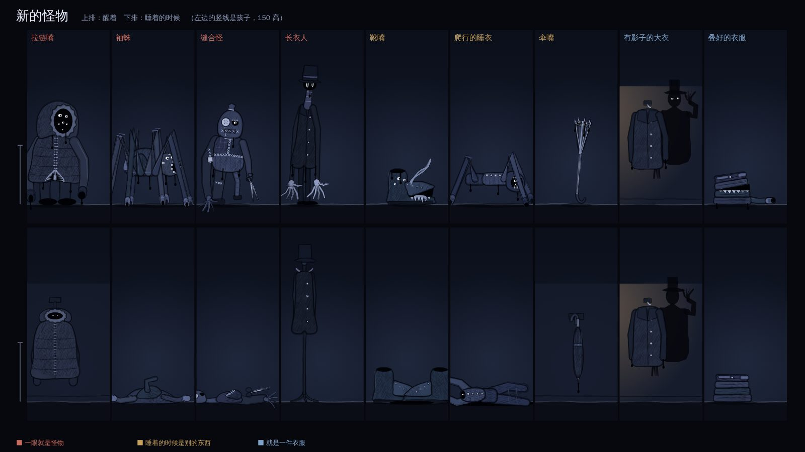
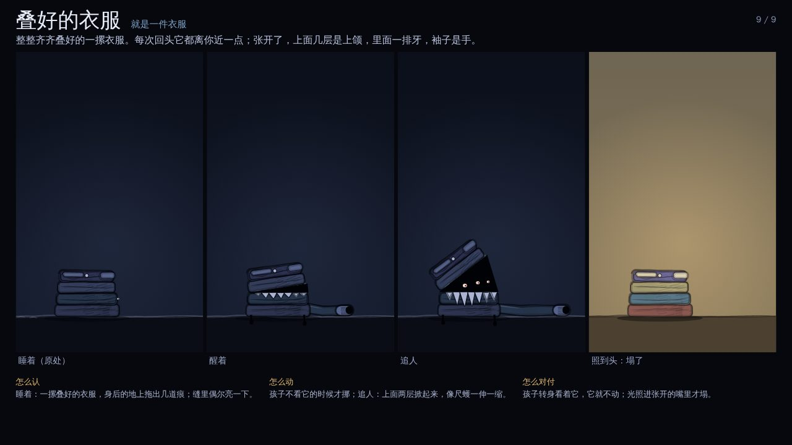
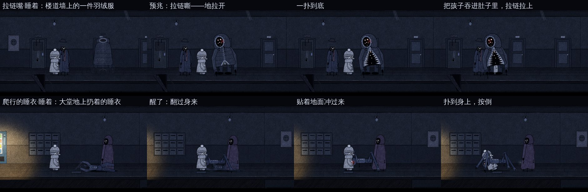
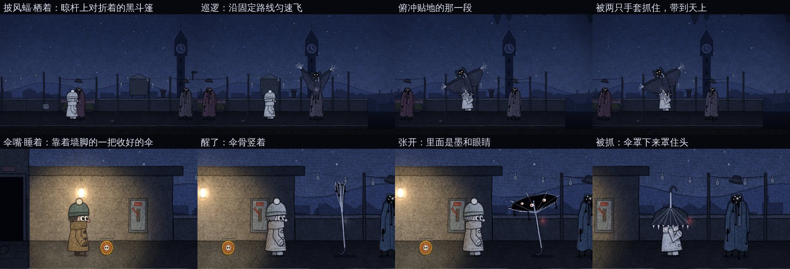
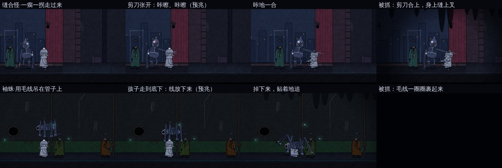
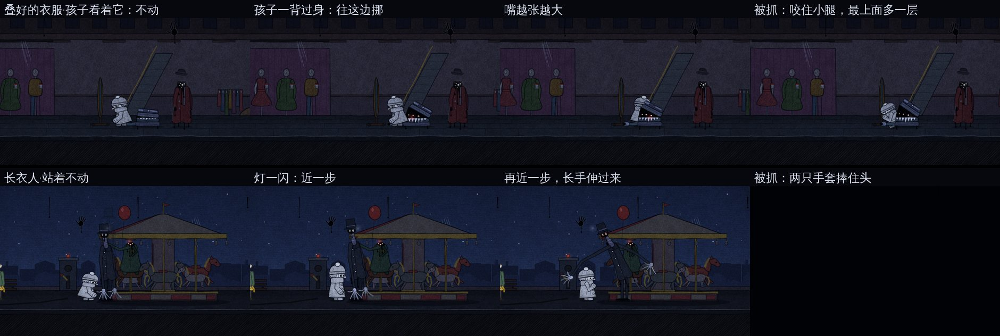
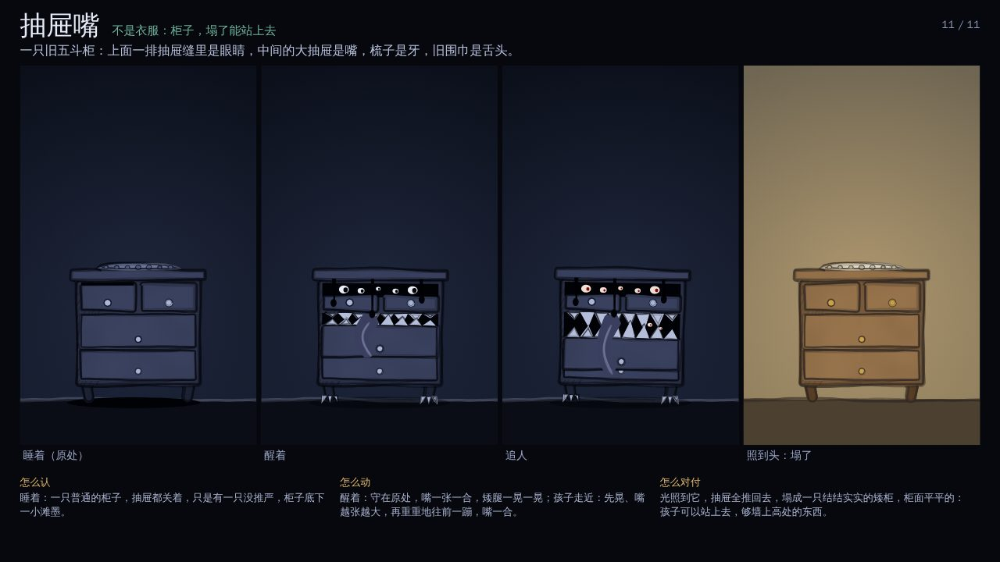
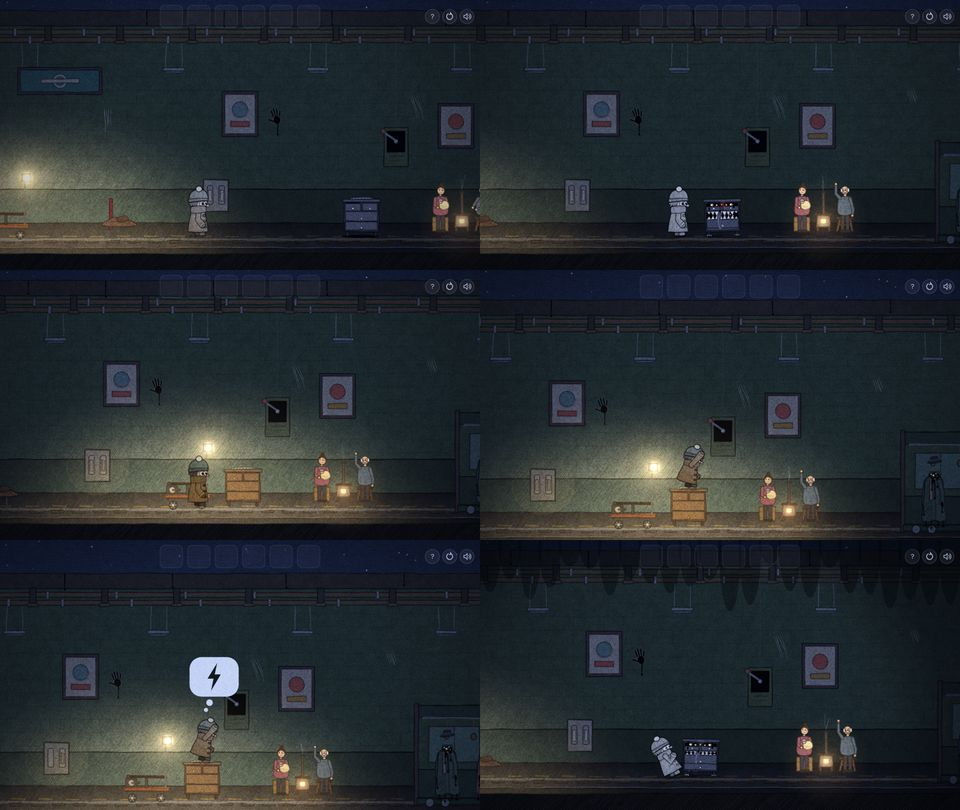

# 夜里 · 新的怪物（设计 + 图鉴）

2026-11-25。主人说：“能不能多设计几种怪物，最好有点恐怖可怕，让人一看就知道是怪物，有的怪物就是个衣服，甚至不太看得出来是怪物。”

> **2026-11-26 第十一只，不是衣服：抽屉嘴（一只旧五斗柜）**。主人说：“怪物也不一定得是衣服，还可以是柜子，可以站上去的”。我的理解：①怪物的身子可以是家具，不是只有衣服；②**塌下去以后它是一座“台”，孩子站得上去**——前十只塌下去都是一摊没用的衣服，这一只塌下去是后面要踩的东西：怪物先是拦路的，被光照倒以后成了垫脚的。做在第 12 关旧地铁的信号箱底下，见下面“第十一只：抽屉嘴”；图鉴 `games/house.html?monsters=cab`。

> **2026-11-25（再后来）十只都进游戏了**。主人又回答了三件事：①“雨衣、外套也保留当怪物，先留着，以后再设计不同的机制，而不是所有怪物都表现出一样的行为特点”；②披风蝠“建议第 6 关屋顶，来回飞的一条线最简单。好的”；③其余八只“就现在做到现在都关卡里面吧”（每放一只就做专门的被抓住的画面）。所以：**靴嘴、有影子的大衣改成多出来的一件**（第 2、3 关的雨衣、外套恢复成原来的怪物，先留着）；十只分到八关（第 2、3、5、6、10、13、17、18 关），**每只有自己的行为和自己的被抓画面**，不再都是“暗处醒着、慢慢挪过来、光照到头就塌”。规则（`<script id="core">`）一个字没动，`check.mjs` 输出和以前一字不差；新怪物都是页面里的东西，挂在每关现有的门上（见“做进游戏的十只”）。
>
> 更早（同一天）：主人回答“靴嘴、有影子的大衣都做出来”“黑夜里找光的设定不要了”“被抓住的画面要”“还想要能在空中飞的、固定路径巡逻的”（那一版里这两只是**换掉**雨衣、外套的，现在改成多出来的一件了）。

这一页是**设计、图鉴和做进游戏的记录**：十种新的怪物（九只地上的、一只会飞的），每一种都用游戏自己的画法画好了，能看、能翻页，**十只都已经在关卡里**（图鉴里是设计稿，游戏里的行为在“做进游戏的十只”）。

看图鉴：`games/house.html?monsters=1`（总览）；`?monsters=zip`、`spider`、`patch`、`tall`、`boot`、`pj`、`umb`、`shd`、`stk`、`cloak` 直接翻到那一只；电脑上左右键翻页，手机上点左右两边翻页、点中间回总览。每只四格：**睡着（原处的样子）／醒着／追人／照到头塌下去**。每一格画的就是游戏里那一层的画法（暗的一层立起来的怪物，亮的一层塌下去的普通衣服），不是另外画的效果图。

## 为什么要加

- 现在追人的衣服有 42 件（`GARB`），其中 32 件是同一个模子：一件衣服，领口一汪墨、几只眼睛、一只伸过来的袖子。画得不差，可是**看着像闹鬼的衣服，不像怪物**：没有牙，身子没有哪儿不对，眼睛一个样，动法也一个样（暗处醒着、慢慢挪过来、光照到头就塌）。
- 主人要的两头正好相反：**一头要一眼就是怪物，一头要几乎看不出来**。现在两头都没有，全挤在中间。

## 三档

| 档 | 玩的人怎么看 | 靠什么做到 | 有哪几只 |
|---|---|---|---|
| ① 一眼就是怪物 | 一看就知道，不用想 | **牙**（尽量用衣服自己带的东西做：拉链齿、别针、钉子、扣子、伞骨）、**身子不对**（太高、八条腿、拼起来的）、**眼睛不一样**（竖瞳、纽扣、一堆小眼）、**手上拿着东西**（剪刀） | 拉链嘴、袖蛛、缝合怪、长衣人 |
| ② 睡着的时候是别的东西 | 门口的靴子、挂着的伞、地上的睡衣：谁也不会多看一眼；醒了才露馅 | 睡着的样子是**原来的东西**（和塌下去以后差不多），醒了才变；破绽只有一点点 | 靴嘴、伞嘴、爬行的睡衣 |
| ③ 就是一件衣服 | 一直都只是衣服，只有一个地方不对 | **没有“怪物的样子”**：不立起来、没有眼睛，只有一个破绽（影子不对、每次回头近一点） | 有影子的大衣、叠好的衣服 |

总览图里上排是醒着的、下排是睡着的：①档上下两排差得多（睡着是一堆东西，醒了是怪物），③档上下两排几乎一样（所以才吓人）。

### 恐怖是怎么画出来的

- **牙尽量是衣服自己的东西**：拉链齿（拉链嘴的肚子）、别针（缝合怪的嘴）、锈钉子（靴嘴）、扣子（袖蛛的领口）、伞骨（伞嘴）。这样还是“衣服里灌了墨”，没有凭空长出别的东西。睡衣和叠衣的牙现在只是尖牙，可以再改成扣子。
- **身子不对**比“更黑”吓人：长衣人比门还高、脖子是一条拉长的围巾；袖蛛八条腿是八只袖子；睡衣肚子朝天、四肢反着弯；缝合怪一条腿是裤腿一条腿是袜子，一瘸一拐。
- **眼睛各有各的样**：拉链嘴一堆大小不一的眼睛；缝合怪一只是掉了线的大纽扣、一只在破洞里；长衣人是竖瞳；有影子的大衣的眼睛**长在影子里，不在衣服上**。追人的时候瞳仁缩小、发红（沿用 `inkEyes`）。
- **每一只手上都有东西**：空手套（手指太长）、剪刀、拉链头像舌头一样挂着、鞋带像两条舌头。

### “几乎看不出来”的规矩

伪装不是不讲理，**必须有破绽，而且玩的人看得见或听得见**（`docs/night-signatures.md` 的规矩 5：不出字、要有预兆，会伤人的动手以前至少 0.8 秒）：

1. 每一只伪装的有**一个**破绽，画出来了（见下面每只的“破绽”）。没有破绽的伪装是骗人，不是设计。
2. **破绽要能教**：先在不危险的地方出现一次（歇一歇的关、前半段），让玩的人学会“这个不对劲”，再放到要紧的地方。
3. **塌下去以后要说得通**：照到头它塌了，变成一件普通的衣服，玩的人回头一看，原来破绽就是它。

## 十只

下面每一只（前九只是地上的，第十只会飞）：样子、破绽、预兆、怎么动、怎么对付、建议放哪一关、代价（S 只是动画；M 这一关多一两项规则；L 动到孩子的动作或全局判定，要全部 21 关重跑，沿用 `night-signatures.md` 的说法）。

### ① 拉链嘴

- **样子**：驼背的连帽羽绒服，帽口一圈毛，里面是墨和六只大小不一的眼睛。前襟的拉链从下往上拉开，**两排拉链齿是牙**，肚子里又是一排眼睛；拉链头像舌头一样挂在牙缝上。一条长袖子垂到脚踝，追人的时候伸过来。
- **破绽**：睡着时就是挂在钩子上的羽绒服，只是帽口里黑得过头，偶尔亮一下。
- **预兆**：**拉链“嘶——”地一路拉下来**（声音）、嘴一点点张开，至少 1 秒以后才扑。
- **怎么动**：慢慢挪；追人时拉链整个拉开、往前扑。
- **怎么对付**：光照到头它塌；嘴张开的时候，光照进肚子里也算。
- **建议**：第 5 关公寓楼（那一关本来就是“听见声音才醒”，拉链声就是它自己的声音）。代价 M。

### ② 袖蛛

- **样子**：一团缠成球的旧毛衣和衬衫，**八条袖子当腿**（袖口是张着的，里面是墨；袖子颜色花纹各不一样，一看就是拼起来的）。脸在前面一个小疙瘩上：领口是嘴，一圈扣子是牙，眼睛挤在上面。
- **破绽**：睡着时地上一堆旧毛衣，一只袖口里有一点亮。
- **预兆**：追人以前**前面两条袖子先高高举起来**（约 1 秒），腿点地“嗒嗒”响。
- **怎么动**：八条腿轮着走，会贴墙、爬天花板。
- **怎么对付**：要照到身子（头在最前面、很低）；它会爬到灯够不着的高处，所以灯要往上挪。
- **建议**：第 13 关下水道（爬管子、爬拱顶）。代价 M：要多一条走在墙上和顶上的路线。

### ③ 缝合怪

- **样子**：旧衣服的碎片缝起来的人形，每一块布不一样（格子衬衫、牛仔布、条纹），**线脚粗得吓人**。头是个枕套，顶上扎着结；**左眼是一颗掉了线的大纽扣**（用一根线吊着晃），右眼在破洞里；嘴是一道缝死的线。左手是塞满了的裤腿，拖到地上，末端是一只空手套；右手是一把**大剪刀**。
- **破绽**：睡着时墙角里一团破布。
- **预兆**：**剪刀“咔嚓”两声**、嘴上的线“啪”地崩断一根，然后才动；崩开以后里面是两排针（针帽是彩色的圆珠）。
- **怎么动**：一瘸一拐（一条腿是裤腿、一条是长袜子，短一截）；追人时剪刀一开一合。
- **怎么对付**：光照到头塌；剪刀够得到的距离里不能站。
- **建议**：第 17 关百货大楼的裁缝柜台，或第 10 关剧院后台（戏服的碎片）。代价 M。

### ④ 长衣人

- **样子**：**比门还高**，细得不对：一件长大衣，一条拉长了的围巾当脖子，一顶高帽子，帽檐底下是墨和**两条竖着的眼睛**。手套是空的，**手指太长**，垂到膝盖。
- **破绽**：睡着时是挂在一根很高的衣帽架上的大衣，帽子搭在最上面的钩子上。哪儿都对，就是比门还高。
- **预兆**：**灯闪一下，它就近一步**（先闪，再走）；到最后一步以前，帽子底下“呜”地响一声。
- **怎么动**：站着不动，灯闪才动；追人时弯下腰，脖子钩过来，长手往前探。
- **怎么对付**：头太高，灯要吊到高处才照得到帽子底下；它一步顶孩子三步，所以不能让它走近。
- **建议**：第 18 关广场上的旋转木马（木马上的灯本来就一明一暗）。代价 M–L：规则里要多一种“灯闪一次近一格”。

### ⑤ 靴嘴

- **样子**：一只胶靴，**鞋头的皮掀开像一张嘴**，嘴里是锈钉子和墨；鞋带是两条会甩的舌头；靴口黑着，滴墨。
- **破绽**：睡着时门口两只胶靴摆得整整齐齐，只是**有一只的鞋头朝着另一边**，底下一小滩墨。
- **预兆**：鞋带先甩起来，鞋头“咔哒”掀开一道缝，再蹦。
- **怎么动**：一蹦一蹦，专咬脚踝；追人时嘴一张一合。
- **怎么对付**：很矮，光要照在地上；它蹦起来落地以前不能拐弯，躲在这一下。
- **建议**：**第 2 关院子**，前门外面的胶靴（先教“摆得太整齐的东西不对劲”，最早、最小、最安全）。代价 M。

### ⑥ 爬行的睡衣

- **样子**：条纹睡衣，**肚子朝天，四肢反着弯**，像蜘蛛一样横着爬；头从领口垂下来，帽兜里是墨和四只眼睛，**上下两排尖牙**（身上的扣子只是扣子）。
- **破绽**：睡着时地上扔着一套睡衣，摆成人躺着的样子（比随手一扔整齐），一只袖口朝孩子这边勾着，领口里偶尔亮一下。
- **预兆**：袖口先勾动，领口里亮起眼睛，“噗”地翻过身，再爬。
- **怎么动**：横着爬，快；追人时贴地面蹿，会钻进床底、柜子底下。
- **怎么对付**：贴着地跑，光要照在地上；钻进缝里就是躲起来了，要把缝堵上。
- **建议**：第 5 关公寓楼的楼道（和拉链嘴一起：一个站着、一个趴着）。代价 M。

### ⑦ 伞嘴

- **样子**：一把黑伞**倒着撑开，像一朵食人花**：伞骨是牙，伞面里是墨和眼睛，伞尖像一根小舌头；用手柄的钩子一跳一跳。
- **破绽**：睡着时是挂在门边钩子上的一把收好的伞，伞尖上滴着一滴墨。
- **预兆**：伞骨“啪”地撑开一半、伞尖抖。
- **怎么动**：蹦着走；追人时一张一合（咔、咔）。
- **怎么对付**：只有张开的时候才照得到里面；合着的时候要等它咬空一口。
- **建议**：第 6 关屋顶（那一关有风，伞被风吹翻了就是它的样子）。代价 M。

### ⑧ 有影子的大衣

- **样子**：就是一件挂在钩子上的大衣，一直都只是大衣。**墙上的影子是一个人**：有头、有高帽子、一只手举到下巴那儿。
- **破绽**：只有这一样：**影子和大衣对不上**。没有灯、没有影子的地方，它就真的只是一件大衣。
- **预兆**：醒着时影子的头慢慢转过来，**影子里亮起两只眼睛**（眼睛长在影子里，不在衣服上）；至少 1 秒以后，影子的手才顺着墙伸出去。
- **怎么动**：追人时影子的手沿着墙爬到地上，一直爬到孩子脚边；大衣的袖口也微微抬起来。
- **怎么对付**：关掉那盏灯，影子就没了；或者把灯挪到大衣背后，让影子投向别处。
- **建议**：第 3 关巷子：晾衣绳上挂着一排衣服，路灯把它们的影子投在墙上，**只有一件的影子是人**（这一关本来就在拉晾衣绳、把衣服滑到灯底下）。代价 M：影子的位置要算灯在哪儿。
- 暗处的限制：没有光就没有影子，所以它只能放在有灯的地方；这也是它的规则。

### ⑨ 叠好的衣服

- **样子**：整整齐齐叠好的一摞衣服，四件，颜色不一样，最上面一件的领子和一粒扣子露在外面。张开的时候，**上面两层是上颌，上下两排尖牙，肚子里是墨和三只眼睛**，最下面一层伸出一只袖子当手，袖口张着。
- **破绽**：睡着时一摞叠好的衣服；**每次回头它都离你近一点**，身后的地上拖出几道痕，叠缝里偶尔亮一下。
- **预兆**：孩子转身看它的时候，衣料“窸窣”响一下、缝里亮一下，才张开。
- **怎么动**：孩子不看它的时候才挪；追人时上面两层掀起来，像尺蠖一伸一缩。
- **怎么对付**：孩子转身看着它，它就不动；光照进张开的嘴里才塌。
- **建议**：第 17 关百货大楼（本来规划的招牌就是“木头人”：站着不动，混进人台里；柜台上叠着的衣服最合适）。代价 L：要知道孩子朝哪边看（规则现在不管孩子的朝向）。

### ⑩ 披风蝠（会飞的，固定路线巡逻）

主人说“还想要那种能在空中飞的，固定路径巡逻，这样可以设计更丰富的关卡”。这一只和上面九只不一样：**它不追人，不看孩子，只沿着一条固定的路匀速飞**；危险靠“它什么时候飞到哪儿”，不靠“它盯着你”。所以关卡可以围着它的路线来设计，玩的人看一圈就能算出什么时候过。

- **样子**：一件黑斗篷在空中飘。两条袖子是翅膀，袖口是空手套，手指弯成钩；翅膀的膜就是斗篷的布，边上破破烂烂，骨是几根衣架的铁丝；下摆两片燕尾；兜帽有两个尖角，里面是墨和三只眼睛，帽口伸出两根衣架铁丝钩当獠牙。
- **破绽**：睡着时是对折着搭在高处晾杆上的一件黑斗篷，滴着一滴墨（地上有一小摊）。醒着以前先听见布拍打的声音。
- **路线**（关卡设计要定的几个数）：
  - **路径**：一串点 `path`（折线或回环）。来回飞、绕圈、8 字、沿着一根电线飞，都是不同的点串。
  - **速度** `speed` 匀速，不加速不减速（玩的人靠节奏算）。
  - **高度**：沿路径每一段有自己的高度 `alt`。**高空段**（离地 150 以上）孩子从底下走过去是安全的；**低空段**（俯冲到贴地，离地 40 以下）撞得到孩子。这样一圈里就有“危险窗口”和“安全窗口”。
  - **拐点悬停** `hover`：到路径的拐点悬一下（翅膀合拢、帽口张开，约 0.8 秒）再转头。悬停是预兆，也是安全窗口。
  - **碰到孩子就抓住**（离它的身子不到 34）；不会拐弯去追。
- **预兆**：它每一圈在**进入低空段以前**，先在地上有一团影子划过去（影子比身子先到）、先响一声布拍打的“呼——啪”，至少 1 秒以后才俯冲。
- **怎么对付**：
  - **躲**：看它的路线（图鉴里画成虚线），在它拉起来、飞到高处以后从底下过。
  - **用光打掉**：光照到兜帽它就掉下来，摊在地上成了一件斗篷；灯灭了它再飞起来。所以把灯点在路线上，它飞过去就掉，掉着的几秒就是路。
  - **遮挡**：头顶有屋檐、水箱、桥洞的地方，它的低空段不会经过（路线设计的时候绕开）。
- **能做出来的关卡**（我的想法，要主人挑）：
  1. **来回飞的一条线**：两根晾衣绳之间来回飞，中间有一段俯冲。玩的人数一圈，找安全窗口跑过去（第 6 关屋顶）。
  2. **绕圈**：绕着一个东西飞一整圈（旋转木马、水塔、钟楼的中庭）；圈里面的东西要拿，圈外面是路，进圈要掐时间（第 18 关广场、第 20 关钟楼）。
  3. **两只相位差半圈**：一只在高空、另一只刚好在低空，窗口小得多，要用灯打掉一只（第 15 关变电站）。
  4. **沿着一条线飞**：沿电线、管子、天花板的梁飞，路线是直的，窗口靠判断“它飞到第几根杆子了”（第 13 关下水道的管子、第 15 关的电线）。
  5. **灯是开关**：关卡里一盏灯挂在它的路线上，灯一亮它飞到那一段就掉；掉着的它就是一块“踏板”，孩子要踩着它够高处的东西。
  6. **被光逼着换路线**：路线上的灯亮着的时候它改走另一条（绕开光）；玩的人靠开关灯把它赶到想要的那一边。
- **代价**：M–L。**规则里**：一圈的“窗口”在 `check.mjs` 里没法表示（它不是点出来的门），所以和狗的毛衣一样，规则里只写“这一关能走得出去”，另外要求**每一圈安全窗口不少于 3 秒、一圈不短于 6 秒**，用自动试玩查。**页面里**：要多一种“按路径飞”的衣服（`GARB` 里的 `fly`，不走 `terr`，走 `path`）、低空段的撞人判定、地上的影子、光照倒再飞起来。
- **做进游戏了（第 6 关屋顶）**：见下面“做进游戏的十只”。

## 做进游戏的十只（2026-11-25）

### 怎么接的（这一版的做法，后面再加怪物也照这个来）

主人要的是“不是所有怪物都表现出一样的行为特点”，同时规则别动。所以新怪物都是**页面里的东西，不是规则里的门**：

- **挂在这一关现有的一道门上**（`GARB.<键>.partner`）：同一盏灯（或同一个条件）照倒；页面里这道门要等它也塌下去了才算开（`GATE_ALL`）。规则里门还是原来的门，`check.mjs` 不用改。孩子被门拦住停下的位置（`GATEPOS`）也是原来的。
- **塌下去跟着那道门**（`follow`）：它的头不一定正好在灯底下，所以“它跟着门上原来那件一起塌”，不去量它自己头上的光。靴嘴、影子大衣、伞嘴自己量。
- **各有各的行为**（`GARB.<键>.ai`，一张表 `AI`，每种一个函数）：怎么醒（`sleeper`：走到跟前才醒；`listen`：声音过后才追）、怎么动、预兆多长、什么时候抓得到，都不一样。
- **各有各的被抓画面**（`CATCH` 表 + `drawCatchExtra`）：孩子被撞多远、离地多高、几秒摔、几秒被墨盖上，加上盖在孩子上面画的专门那一段。
- **统一画**：`drawDynamic` 里一个循环（`EXTRA_KEYS`），不用每关的画法函数各加一行。

### 十只在哪、各自怎么动

| 怪物 | 关 | 挂在哪 | 行为（和别的都不一样的地方） | 预兆 | 被抓住 |
|---|---|---|---|---|---|
| 雨衣（原来的） | 2 | 卷帘门边 | 暗处醒着，慢慢挪过来，光照到头塌（**先留着**，以后再设计新机制） | 立起来 | 原来的（撞倒、墨涌上来） |
| 靴嘴 | 2 | 雨衣后面（`rain` 门） | **睡着是摆整齐的靴子，走到 540 以内才醒；一蹦一蹦地追，落地以前不拐弯** | 嘴张大、往后仰，头一回 2.4 秒；咔哒声 | 咬住脚踝不松口，一抖一抖地嚼，孩子被拖倒 |
| 外套（原来的） | 3 | 邻居门口晾衣绳 | 同雨衣（**先留着**） | 立起来 | 原来的 |
| 有影子的大衣 | 3 | 外套右边（`jacket` 门） | **灯照着时墙上的影子是个人（眼睛亮着，头转向孩子），灯灭了它醒来：领口里升起那个人形的墨；睡着的，走到 300 以内才醒，比外套快（90）** | 影子先出现（灯亮的 4.2 秒里就看得见） | 墨手越过头顶扣住头，孩子被提起来，一松手摔 |
| 拉链嘴 | 5 | 楼道（`zt2` 门） | **声音过后才追；先把拉链拉开，再一扑到底（170 远，又快又直），扑完嘴张着愣 1.5 秒再慢慢退回去** | 拉链“嘶——”拉开，1 秒 | 扑过来整个罩住孩子，孩子没进肚子里，拉链拉上 |
| 爬行的睡衣 | 5 | 大堂（`zt1` 门） | **声音过后才追；躺在地上，翻过身来，贴着地面冲一段（330，最多 0.8 秒），冲不到就缩回原处躺着** | 袖口勾动、领口亮眼睛，0.75 秒；窸窣声 | 扑到身上，趴在上面，把孩子按倒 |
| 伞嘴 | 6 | 屋顶第一件衬衫那一片（`rt1` 门） | **守在原地一张一合（3.2 秒一圈）；光只在它张开的那一下才算（闭着的时候照着也不塌）；咬的范围很短（62）** | 伞骨“啪”地撑开 | 伞罩下来把头整个罩住，伞骨是牙 |
| 披风蝠 | 6 | 不挂门（`extra`），天台上空 | **会飞，按一条固定路线来回巡逻，不追人；路线上一段俯冲贴地，离地不到 95 才撞得到孩子；到拐点悬一下** | 地上的影子划过去；到拐点叫一声（悬 0.8 秒） | 飞下来，两只空手套抓住肩膀，带着孩子往天上飞，松手摔下来 |
| 缝合怪 | 10 | 台边戏服（`ta3` 门） | **一瘸一拐走过来；够到一臂远（剪刀，150）就停下；剪刀先张大、咔嚓咔嚓，再咔地一合，合的那一下前面 150 以内都抓得到** | 剪刀咔嚓两下，0.9 秒 | 大剪刀卡在腰上咔地合上，孩子倒下以后身上缝上几个叉 |
| 袖蛛 | 13 | 第二段管子（`wp2` 门） | **用一根毛线吊在管子上不动；孩子走到它底下（95 以内），线放下来，掉下来贴着地追 2.2 秒，追不到就爬回去** | 线慢慢放下，袖子垂下来晃，0.95 秒 | 扑到身上，八条袖子扒住，毛线一圈圈把孩子裹起来 |
| 叠好的衣服 | 17 | 过道（`bs1` 门） | **孩子脸朝着它，它就不动，像一摞普通的衣服；孩子一背过身，它就往孩子这边挪（慢，52）** | 嘴越张越大 | 蹦到脚边咬住小腿，孩子倒下，那摞衣服最上面多了一层（孩子的大衣、帽子上的绒球） |
| 长衣人 | 18 | 木马这头（`cs1` 门） | **站着不动；广场的灯每 4.6 秒闪一下（整个画面一黑），它趁黑近一步（60）；近到 52 以内抓住** | 灯闪、滋啦一声 | 弯下腰来，两只长手套捧住孩子的头，帽檐底下的竖瞳贴到脸跟前 |

### 靴嘴 → 第 2 关车库

- **睡着**：暗处也不立起来，是雨衣（原来的怪物，立在卷帘门边）后面摆着的一双胶靴（`BOOT_HOME_SC` 0.6，和孩子的脚差不多大），一只的鞋头朝着另一边，底下一小滩墨。第一只“暗处也不立起来”的怪物（`GARB.sleeper`）。
- **醒**：孩子走到离它 540 以内、在暗处，它就醒：胀大到 0.9、嘴张开、红眼睛、鞋带甩起来。**最顺的走法下，孩子在车边开车门它就醒了，拧车灯它们和雨衣一起当场塌下去**：一个看得见的“醒了又塌了”。
- **蹦**（`GARB.boots.hop`）：孩子进了它那一片（`terr` 6640–6850）、在暗处，它才追：先预兆（头一回 2.4 秒，以后 0.9 秒），再一蹦 100 远，落地以前不拐弯，落地歇 0.5 秒。靠近到 46 以内就是被咬住。
- **数字（实测，最后这个位置）**：照游戏自己的“点卷帘门那边、走过去”：孩子走进它那一片大约 1.1 秒预兆开始；走到停的地方（6682）、被吓退（退 38，锁住约 1.25 秒）；2.7 秒能动了，吓退以后停在 6644，**离它那一片的边只有 14，往左一步就出去**。试过两种：被吓退以后**站着不动，5.4 秒被靴子咬**（雨衣没有先抓到）；被吓退以后**马上走开，不被咬**（靴子蹦了一个空）。

### 有影子的大衣 → 第 3 关邻居门口

- **灯照着的时候（破绽）**：晾衣绳上现在**两件外套**：左边是原来的（会追人的那件），右边是有影子的大衣。**两件挂着都只是外套**，可是敲门亮灯的 4.2 秒里，**右边那件在墙上的影子是一个人**：有头、有高帽子、举着一只手、眼睛亮着、头朝孩子这边转（`mzShadowPerson`）。玩的人要看出哪一件不对。影子落在灯的另一边（敲门亮的是门廊灯，在左边，影子落在右边）。
- **灯一灭它醒过来**：领口里升起来的就是影子里的那个人：脖子、头、一顶高帽子、发白的眼睛、一只手高高举着、四根长手指（`inkShdCoat`）。睡着的（走到 300 以内才醒），追起来比外套快（90 对 64）。

## 披风蝠在第 6 关（来回飞的一条线）

- **路线**（`GARB.cloak.fly.path`）：一圈 7.45 秒，匀速，从右往左飞：右端（x 20080）悬 0.9 秒 → 向左高处飞（离地 170）→ 在 x 19950–19900 俯冲到离地 40 → 贴着地飞到 19800 → 拉起来回到高处 → 左端（19700）悬 0.8 秒 → 全程在高处飞回右端。**危险窗口**：离地不到 95 的那一段，约 1.05 秒，在 x 19800–19935；**安全窗口**：一圈里剩下约 6.4 秒（孩子从底下走过去不碰它）。
- **在哪起效**：天台上、第二串灯那一段（孩子拿第二只灯泡、插插头、拧两只灯座的地方，x 19640–19960）；孩子走到离栖着的地方（晾杆，x 20330）700 以内、在暗处，它醒来起飞。**第二串灯一亮（最后一只灯泡拧上）它的头被照到，就掉下来摊在地上**，灯一直亮着就一直躺着：所以它是这一段“趁灯没全亮之前”的时间压力。
- **试过**：模拟试玩（按游戏自己的“下一步”一步步点，不等真实时间）第 6 关：能走完，**不会看路线的孩子被抓一次**（在拧第二个灯座要穿过俯冲那一段的时候），被抓以后回到灯底下接着走完；这是设计里的“要数一圈找窗口”。

## 伞嘴在第 6 关

- **睡着**：靠着墙脚的一把收好的伞，伞尖滴着墨。**醒**：孩子走到离它 440 以内、在暗处（最顺的走法下，孩子在棚子里扳总闸之前就在这个距离）。
- **光只在它张开的那一下才算**：扳总闸（第一串灯亮）以后，它缩着不塌，3.2 秒一圈，张开的那 0.65 秒被照到才塌：所以孩子扳了闸、走过来，会看见它被光“咬空一口”、掉在地上。
- 挂在第一件衬衫那道门上：门要等它也塌下去才开。

## 第十一只：抽屉嘴（2026-11-26，不是衣服，塌了能站上去）

主人说：“怪物也不一定得是衣服，还可以是柜子，可以站上去的。”

- **样子**：一只旧五斗柜（宽 116、柜面高 121，孩子的腰那么高；底下四条矮腿，脚上三个爪尖）。**抽屉当脸**：最上面一排两只小抽屉往下落了一截，缝里是眼睛（五只，大小不一）；中间那只大抽屉往下一落是**嘴**，上颌、下颌各一排**梳齿**当牙（牙还是柜子自己带的东西，不凭空长），一条旧围巾从嘴里耷拉出来当舌头；柜面上滴着墨。
- **破绽**：睡着时是一只普通的柜子，柜面上铺一块钩花盖布，**只有一只抽屉没推严，露出一道黑缝，柜子底下一小滩墨**。
- **预兆**：孩子走近，抽屉**一格一格“咔嗒”拉开**，嘴越张越大，柜子一晃一晃（头一回 2.2 秒，以后 1.25 秒），然后才蹦。
- **怎么动**（`AI.bump`，和前十只都不一样的一点：**它守在原处不追**——因为它要留在信号箱底下；孩子走进它那一片才动）：先晃、嘴越张越大；再**重重地往前一蹦**（84 远，0.26 秒，落地以前不拐弯）；**落地“咔”地一合**，落地的那一下前面 74 以内抓得到；歇 1.7 秒（嘴合着卡住了，再慢慢张开）；一步一晃地退回原处。
- **怎么对付**：光照到它（头在柜子正中偏上）它就塌：抽屉全推回去，成了一只**平平的、结结实实的矮柜**，柜面上一块钩花盖布，不再是墨。被吓退以后站着不动，才会被咬到（蹦的落点离吓退的位置还差 15）。
- **“可以站上去”是它的用处**（和前十只最不一样的地方）：塌下去的柜子是一座 121 高的台，孩子跳上去，脚踩在柜面上，才够得着挂高了的东西。做在第 12 关：信号箱挂高了，要站上柜子才扳得到信号扳手。

### 在第 12 关旧地铁（信号箱底下）

- **位置**：轨道那一段，信号箱（x 41360）左边，柜子正中 x 41245（柜子占 41187–41303）。手摇车从它前面滑过去（柜子画在手摇车后面，`GARB.cab.back`）。**信号箱挂高了**：箱子中心 y 830 → 706（扳手在 686），柜面上的孩子伸手刚好够得着。
- **规则里多了一道门**：`mcb`（`mAt ≥ 1`：手摇车推到了轨道这一段）和一块新的地方 `m1b`（柜子右边，信号扳手在这一块）：`LINKS12` 是 m0 →（mp1）→ m1 →（**mcb**）→ **m1b** →（mp2）→ m2……；`mLever` 挪到 `m1b`。**最少还是 9 步**（`check.mjs`：第 12 关局面 14 → 13 个——扳手不能比推手摇车早了；别的关一字不差；没有死路）。页面里这道门要等柜子真的塌下去了才算开（`partner: 'mcb'`，和别的新怪物一样）。
- **怎么玩**：站台上摇柄、摇手摇车（灯亮、长椅边的人塌下去）、走进轨道段：柜子在暗处，孩子走到 480 以内它就醒；走到它前面 40（x 41110）孩子被吓退（气泡里画摇柄、灯亮了画箭头）；回去把手摇车推过来，**手摇车滑到 x 40700 左右（灯离柜子 480）就照倒它**（`coverage` 过 0.55；灯的范围大，是一片柔光扫过去，车滑到 40810 是 0.76）；塌了以后才推得了第二把（页面里 `mShove` 要等柜子塌了才点得到）；走到柜子跟前，点信号箱：孩子**跳上柜面，伸手扳扳手，再跳下来（往右，往车厢那边）**。没合保险（`mFz`）就点：照样先跳上去，伸手一扳没反应，气泡里画闪电，再跳下来（往左）。
- **塌了就一直塌着**（`keepDown`，`V.mSeenC`），手摇车再滑走、灯离开也不会站起来；保底：手摇车到了以后 4.5 秒它还没塌，也当它塌了（和第 12 关别的衣服一样；实测灯一照就塌，没有用到保底）。
- **被抓画面**（`CATCH.cab`）：柜子重重砸下来，嘴咔咔地嚼，孩子被撞倒、摔，墨盖上来；一截围巾挂在它嘴边；回到站台的灯底下。

### 查过的

- `node tools/check.mjs` 通过：第 12 关还是 9 下、没有死路（局面 14 → 13 个，岔开 1.4 → 1.3），**别的关一字不差**。
- 无头 Chromium：`?lv=12&auto=1` 约 78 秒走完（原来约 75 秒，多的是爬柜子那几秒），0 次被抓，没有报错；`?lv=11&auto=1` 从第 11 关一路走过第 12 关；`?lv=10`、`?lv=11`、`?lv=13`–`?lv=21`、默认页、`?monsters=1`、`?monsters=cab` 打开没有报错（`?lv=13` 以后回放第 12 关的解法时多认了 `m1b` 这一块）。
- 乱来：随机点第 12 关的点（带着或不带东西）、点地图上的地方、点提示，每组 90 步，每步查：没有 NaN、孩子没有在手摇车没推过来的时候越过柜子（x 41150）、柜子没有离开原处超过 120、站在柜面上的高度不是半截；乱来完照提示（`nextStep`）接着走，都走出了车门（见 README 里的组数）。
- 图鉴 `?monsters=cab`、总览 `?monsters=1`（十一只）电脑 1280×720、手机竖屏 390×844 看过。

### 没做 / 要说的

- **只做了“塌了以后站得上去”**：醒着的柜子的头顶是安全的、能被它驮着走，这一层没做（见“要主人定的”第 6 条）。
- 没亲手玩，没在真手机上试；蹦的距离（84）、抓的范围（74）、预兆的长度是按自动试玩和“强行放在跟前”调的，要主人玩了再调；声音只用了已有的（咔嗒、嘭、咔、嚓）。
- 柜子在手摇车后面画，手摇车从它前面滑过去：两样的前后关系只是画的顺序，孩子推车的时候站在车的左边，没有碰到柜子。
- 第 12 关原来没有新怪物（衣服：长椅边的人、两位乘客、抱花的大衣）。`docs/night-signatures.md` 里“墨鼹放第 12 关”还只是规划，没冲突，但这一关现在有两样新东西（柜子、一家三口）了，墨鼹要做的话放别处更好。

## 一条要说的：新怪物在最顺的走法下大多只是“醒了又塌了”

这个游戏的门拦着孩子（`GATEPOS`），照最顺的解法走，孩子几乎总是先开了灯再走过去，**所以新怪物大多在孩子经过的时候已经是塌着的**。它们的行为（蹦、扑、剪、掉下来、不看就挪、灯闪就近）**要在孩子乱走、没按顺序开灯、站着不动的时候才会看到**，被抓画面也是。我用“强行把孩子放在它跟前”的办法一只一只试过（见上面的图）。要让它们在正常走法下也有存在感，得改关卡（比如把必须做的事放在它们的地盘里），这是下一步的事，要主人定。

## 找光的设定不要了

主人 2026-11-25 说：“黑夜里找光的设定不要了”。我的理解：`docs/night-story-c.md` 和 `docs/night-story-pitches.md` 里的 C（**衣服不是怪物，是在黑里找光的人**；孩子身上有光所以它们扑过来；第 7 关转折以后规则跟着变）**作废**。追人的东西就是怪物，不再有“它们其实是人”这一层。所以：

- 上一版这页里“转折以后追你的是墨用很多件衣服拼出来的东西”那条故事建议**不用了**，十只怪物放在哪一关不受“转折前/后”的限制，哪一关都能放。
- 各关“光照到衣服的头，它就塌”的规则**没变**（主人没说要改）；2026-11-25 前面删掉的“递光”（`docs/night-give-removed.md`）、“跟着孩子的小光”（`docs/night-followers-removed.md`）和这条是一回事，已经不在游戏里了。
- 那几页故事文档（`night-story-c.md`、`night-story-pitches.md`、`night-signatures.md` 里提到转折的地方）我在页首加了一句“这一条作废”，**没有删字**；剧情主人还要再改（`night-give-removed.md`：“我感觉游戏剧情还得再修改”），改的时候再整理。
- 游戏里已经有的、和这条有关的东西没动：第 7 关的“学人精”（镜子一样走位）、第 21 关的合影结局都不依赖“衣服是找光的人”。要不要为这条改第 21 关的结局，主人定。

## 做进游戏的位置（已做）

按 `docs/night-signatures.md` 的每关招牌排，先教后用，相邻两关不用同一类（第 2 关靴嘴、第 3 关影子大衣、第 5 关拉链嘴和睡衣、第 6 关伞嘴和披风蝠、第 10 关缝合怪、第 13 关袖蛛、第 17 关叠好的衣服、第 18 关长衣人）。每一只的位置、数字都在 `games/house.html` 的 `GARB` 表末尾“新的怪物”那一段。

## 做进游戏要改什么（给后面再加怪物）

**画**：每只的画法在 `games/house.html` 的“新的怪物”那一段（`mzZip`、`mzSpider`、`mzPatch`、`mzTall`、`mzBoot`、`mzPj`、`mzUmb`、`mzShd`、`mzStk`、`mzCloak`），签名和 `inkCoat` 一样：`(b, P, lit, x, fy, f, t, m, seed)`。睡着的样子是 `mzXxxHome`，塌下去的是 `mzXxxHeap`；游戏里用到的参数（`m.air`、`m.tell`、`m.open`、`m.zip`、`m.scis`、`m.lift`、`m.alt`……）由行为函数设。配色 `mz*` 在 `LIT`、`DARK` 里。

**加一只**：在 `GARB` 末尾加一条（`kind`、`partner`、`follow`、`ai`、行为的数）；在 `AI` 表里加一个行为函数；在 `drawGarb` 的分发、`GARB_HOME`、`garbEyes` 各加一行；在 `CATCH` 表里加一项（`extra: 1` 的话在 `drawCatchExtra` 里加它盖在孩子上面画的那一段）。`partner` 要写这一关现有的门的键（规则里的 `GATES.<键>`），`follow` 要写那道门上原来那件衣服在 `GARB` 里的键（两个不一定一样：广场的门叫 `cs1`，木马上的大人叫 `cr1`）。

**位置有个规矩**：孩子在一条线上走，会被门拦住（`GATEPOS`）。新怪物**站在门的外面**（孩子被拦住的那一边的对面）才不会挡着路：靴嘴在卷帘门那头、缝合怪在门里面、叠衣在 `bs1` 前面……站在孩子必经的路中间的，要么是跟着灯一起塌的（伞嘴、袖蛛、拉链嘴/睡衣在灯亮的时候），要么是飞的（披风蝠）。长衣人第一次放在孩子干活的地方前面，孩子被抓了三次，挪到木马这头以后才没事。

**规则**：新怪物都没有改规则（`GATES`、`LINKS`、`act`、`TIMED` 一个字没动，`check.mjs` 输出和改之前一字不差）。真要改规则的不在这一版里。

**声音**：做了靴嘴的“咔哒”“嘭”“咔咔咔”、拉链“嘶”、睡衣窸窣、伞骨“啪”、披风蝠的叫声和布拍打“呼——啪”、剪刀咔嚓、灯闪“滋啦”；没做：叠衣的“窸窣”、袖蛛腿“嗒嗒嗒”、长衣人的“呜”、各自被抓的专门声音（拉链拉上、毛线缠、剪刀合上）。

## 查过的、没做的

- **查过**：
  - `node tools/check.mjs` 通过，输出和改之前**一字不差**。
  - 模拟试玩（按游戏自己的“下一步”一步步点，不等真实时间）第 4–20 关每关一遍（第 5、6、10、13、17、18 关多遍，开局错开一点）：**都走得完**；除了第 6 关披风蝠（不会看路线的孩子被抓一次，设计如此）都是 0 次被抓。真实时间的自动试玩（`?lv=2&auto=1`）从第 2 关走到第 4 关，0 次被抓。
  - “强行把孩子放在它跟前”一只一只试过：醒、预兆、攻击、被抓住、被光照倒都出现了，截图看过（上面的图）。
  - 图鉴总览和十只各打开一遍，加游戏 `?lv=2`、`?lv=3`、`?lv=5`、`?lv=6`、`?lv=10`、`?lv=13`、`?lv=17`、`?lv=18`、`?lv=21` 等页面，没有报错。
- **没做**：
  - 没亲手玩，没在真手机上试；各怪物的松紧（预兆多长、范围多大、速度多快）是按自动试玩和“强行放在跟前”调的，**要主人玩了再调**。
  - 声音只做了一部分。
  - 雨衣、外套还是原来的行为（主人说先留着）。
  - 新怪物在最顺的走法下大多只是“醒了又塌了”，要让它们在正常走法下也有存在感，得改关卡（见上面“一条要说的”）。
  - 披风蝠只放了一圈路线、一关；两只相位差半圈、绕圈、沿电线飞这几种还只是设计。

## 要主人定的

1. **“黑夜里找光的设定不要了”我理解成：C 故事（衣服是找光的人）作废，追人的就是怪物，各关“光照到头它就塌”不变。对不对？**还是连“光能让它们塌下去”这条规则也不要了？
2. **新怪物在正常走法下大多只是“醒了又塌了”**（见上面）。要不要下一步为它们各改一两处关卡，让孩子必须在它们的地盘里做事？我建议先挑一两只：披风蝠（第 6 关已经有这个味道）和长衣人（第 18 关干活的地方）。
3. **雨衣、外套“以后再设计不同的机制”**：想让它们变成什么样？我想过的：雨衣只在孩子**呼吸**（拖得快）的时候追；外套只在孩子**不动**的时候醒。要不要这样？
4. 各怪物的松紧（见上面）：主人玩了觉得太容易、太难，我再调。
5. 十只够不够，还想要什么样的？（我还想过：会爬的手套群、挂满衣服的衣架人、湿毛巾。）
   - 2026-11-26 主人回答：“怪物也不一定得是衣服，还可以是柜子，可以站上去的”：做了第十一只抽屉嘴（见上面），不是衣服。
6. **“可以站上去”我只做了塌了以后**。要不要也让它**醒着的时候**能站？我想过的：一只会巡逻的柜子（像第 17 关的大衣被货梯连着升上去，这回是孩子站上去被它驮着走）：柜面是安全的，嘴只在前面；孩子趁它走到坑边跳到柜面上，被它驮过一道缝、一个水坑；它要是被光照倒，孩子就得赶紧跳下来。这样“怪物是台子”就是玩法，不只是塌了以后的奖励。要不要做、放哪一关（下水道的水、地下最深处的池子、广场栏杆外面，都有合适的缝）？
7. **别的不是衣服的怪物**：同样的路子还有学校的储物柜（一排七个，其中一个是）、剧院后台的戏服柜（大衣柜，能钻进去）、消防站的更衣柜、百货大楼的玻璃柜台（里面的人台是手）。要不要再来一两只？要的话每只要给一个“塌了以后的用处”，不然只是换了身子。
