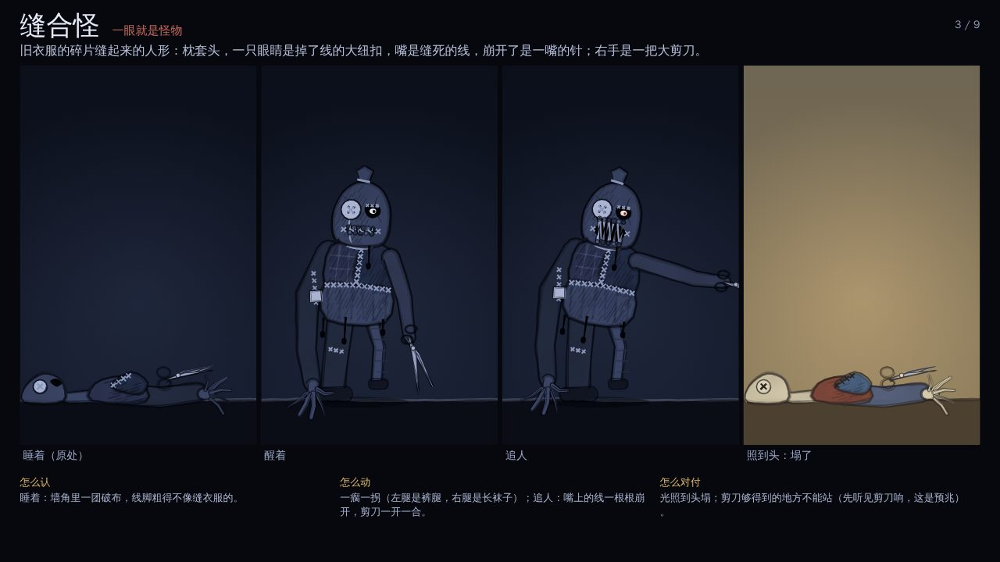
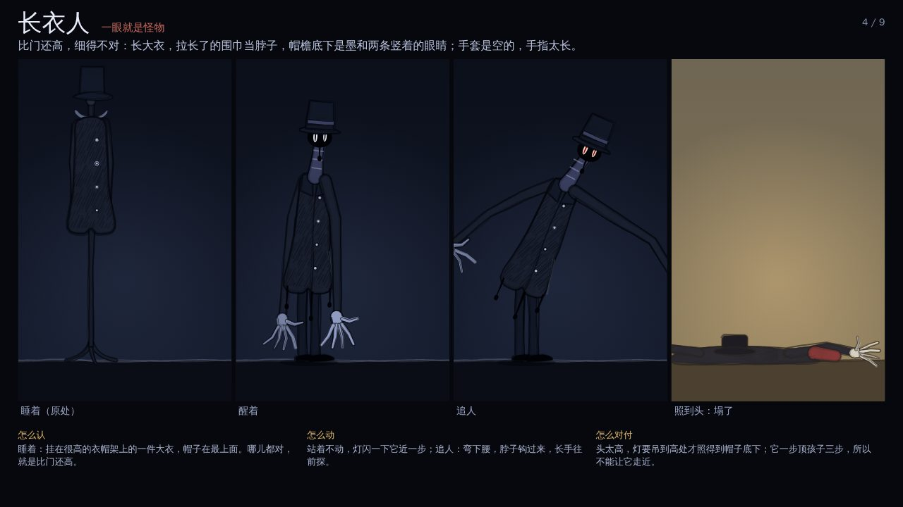
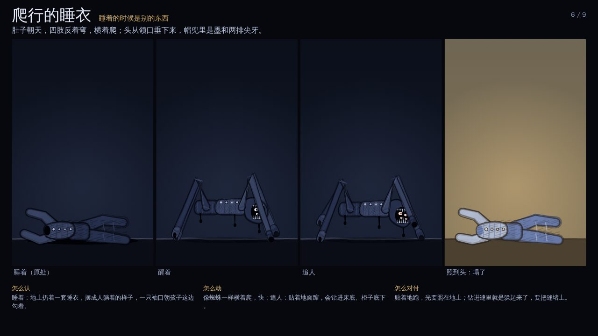

# 夜里 · 新的怪物（设计 + 图鉴）

2026-11-25。主人说：“能不能多设计几种怪物，最好有点恐怖可怕，让人一看就知道是怪物，有的怪物就是个衣服，甚至不太看得出来是怪物。”

这一页是**设计和图鉴**：九种新的怪物，每一种都用游戏自己的画法画好了，能看、能翻页；**游戏里一个字没动**（规则、`GARB`、关卡、`check.mjs` 的结果都没变）。要放进哪一关、先做哪几只，看最后“要主人定的”。

看图鉴：`games/house.html?monsters=1`（总览）；`?monsters=zip`、`spider`、`patch`、`tall`、`boot`、`pj`、`umb`、`shd`、`stk` 直接翻到那一只；电脑上左右键翻页，手机上点左右两边翻页、点中间回总览。每只四格：**睡着（原处的样子）／醒着／追人／照到头塌下去**。每一格画的就是游戏里那一层的画法（暗的一层立起来的怪物，亮的一层塌下去的普通衣服），不是另外画的效果图。

## 为什么要加

- 现在追人的衣服有 42 件（`GARB`），其中 32 件是同一个模子：一件衣服，领口一汪墨、几只眼睛、一只伸过来的袖子。画得不差，可是**看着像闹鬼的衣服，不像怪物**：没有牙，身子没有哪儿不对，眼睛一个样，动法也一个样（暗处醒着、慢慢挪过来、光照到头就塌）。
- 主人要的两头正好相反：**一头要一眼就是怪物，一头要几乎看不出来**。现在两头都没有，全挤在中间。

## 三档

| 档 | 玩的人怎么看 | 靠什么做到 | 有哪几只 |
|---|---|---|---|
| ① 一眼就是怪物 | 一看就知道，不用想 | **牙**（尽量用衣服自己带的东西做：拉链齿、别针、钉子、扣子、伞骨）、**身子不对**（太高、八条腿、拼起来的）、**眼睛不一样**（竖瞳、纽扣、一堆小眼）、**手上拿着东西**（剪刀） | 拉链嘴、袖蛛、缝合怪、长衣人 |
| ② 睡着的时候是别的东西 | 门口的靴子、挂着的伞、地上的睡衣：谁也不会多看一眼；醒了才露馅 | 睡着的样子是**原来的东西**（和塌下去以后差不多），醒了才变；破绽只有一点点 | 靴嘴、伞嘴、爬行的睡衣 |
| ③ 就是一件衣服 | 一直都只是衣服，只有一个地方不对 | **没有“怪物的样子”**：不立起来、没有眼睛，只有一个破绽（影子不对、每次回头近一点） | 有影子的大衣、叠好的衣服 |

总览图里上排是醒着的、下排是睡着的：①档上下两排差得多（睡着是一堆东西，醒了是怪物），③档上下两排几乎一样（所以才吓人）。

### 恐怖是怎么画出来的

- **牙尽量是衣服自己的东西**：拉链齿（拉链嘴的肚子）、别针（缝合怪的嘴）、锈钉子（靴嘴）、扣子（袖蛛的领口）、伞骨（伞嘴）。这样还是“衣服里灌了墨”，没有凭空长出别的东西。睡衣和叠衣的牙现在只是尖牙，可以再改成扣子。
- **身子不对**比“更黑”吓人：长衣人比门还高、脖子是一条拉长的围巾；袖蛛八条腿是八只袖子；睡衣肚子朝天、四肢反着弯；缝合怪一条腿是裤腿一条腿是袜子，一瘸一拐。
- **眼睛各有各的样**：拉链嘴一堆大小不一的眼睛；缝合怪一只是掉了线的大纽扣、一只在破洞里；长衣人是竖瞳；有影子的大衣的眼睛**长在影子里，不在衣服上**。追人的时候瞳仁缩小、发红（沿用 `inkEyes`）。
- **每一只手上都有东西**：空手套（手指太长）、剪刀、拉链头像舌头一样挂着、鞋带像两条舌头。

### “几乎看不出来”的规矩

伪装不是不讲理，**必须有破绽，而且玩的人看得见或听得见**（`docs/night-signatures.md` 的规矩 5：不出字、要有预兆，会伤人的动手以前至少 0.8 秒）：

1. 每一只伪装的有**一个**破绽，画出来了（见下面每只的“破绽”）。没有破绽的伪装是骗人，不是设计。
2. **破绽要能教**：先在不危险的地方出现一次（歇一歇的关、前半段），让玩的人学会“这个不对劲”，再放到要紧的地方。
3. **塌下去以后要说得通**：照到头它塌了，变成一件普通的衣服，玩的人回头一看，原来破绽就是它。

## 九只

下面每一只：样子、破绽、预兆、怎么动、怎么对付、建议放哪一关、代价（S 只是动画；M 这一关多一两项规则；L 动到孩子的动作或全局判定，要全部 21 关重跑，沿用 `night-signatures.md` 的说法）。

### ① 拉链嘴

- **样子**：驼背的连帽羽绒服，帽口一圈毛，里面是墨和六只大小不一的眼睛。前襟的拉链从下往上拉开，**两排拉链齿是牙**，肚子里又是一排眼睛；拉链头像舌头一样挂在牙缝上。一条长袖子垂到脚踝，追人的时候伸过来。
- **破绽**：睡着时就是挂在钩子上的羽绒服，只是帽口里黑得过头，偶尔亮一下。
- **预兆**：**拉链“嘶——”地一路拉下来**（声音）、嘴一点点张开，至少 1 秒以后才扑。
- **怎么动**：慢慢挪；追人时拉链整个拉开、往前扑。
- **怎么对付**：光照到头它塌；嘴张开的时候，光照进肚子里也算。
- **建议**：第 5 关公寓楼（那一关本来就是“听见声音才醒”，拉链声就是它自己的声音）。代价 M。

### ② 袖蛛

- **样子**：一团缠成球的旧毛衣和衬衫，**八条袖子当腿**（袖口是张着的，里面是墨；袖子颜色花纹各不一样，一看就是拼起来的）。脸在前面一个小疙瘩上：领口是嘴，一圈扣子是牙，眼睛挤在上面。
- **破绽**：睡着时地上一堆旧毛衣，一只袖口里有一点亮。
- **预兆**：追人以前**前面两条袖子先高高举起来**（约 1 秒），腿点地“嗒嗒”响。
- **怎么动**：八条腿轮着走，会贴墙、爬天花板。
- **怎么对付**：要照到身子（头在最前面、很低）；它会爬到灯够不着的高处，所以灯要往上挪。
- **建议**：第 13 关下水道（爬管子、爬拱顶）。代价 M：要多一条走在墙上和顶上的路线。

### ③ 缝合怪

- **样子**：旧衣服的碎片缝起来的人形，每一块布不一样（格子衬衫、牛仔布、条纹），**线脚粗得吓人**。头是个枕套，顶上扎着结；**左眼是一颗掉了线的大纽扣**（用一根线吊着晃），右眼在破洞里；嘴是一道缝死的线。左手是塞满了的裤腿，拖到地上，末端是一只空手套；右手是一把**大剪刀**。
- **破绽**：睡着时墙角里一团破布。
- **预兆**：**剪刀“咔嚓”两声**、嘴上的线“啪”地崩断一根，然后才动；崩开以后里面是两排针（针帽是彩色的圆珠）。
- **怎么动**：一瘸一拐（一条腿是裤腿、一条是长袜子，短一截）；追人时剪刀一开一合。
- **怎么对付**：光照到头塌；剪刀够得到的距离里不能站。
- **建议**：第 17 关百货大楼的裁缝柜台，或第 10 关剧院后台（戏服的碎片）。代价 M。

### ④ 长衣人

- **样子**：**比门还高**，细得不对：一件长大衣，一条拉长了的围巾当脖子，一顶高帽子，帽檐底下是墨和**两条竖着的眼睛**。手套是空的，**手指太长**，垂到膝盖。
- **破绽**：睡着时是挂在一根很高的衣帽架上的大衣，帽子搭在最上面的钩子上。哪儿都对，就是比门还高。
- **预兆**：**灯闪一下，它就近一步**（先闪，再走）；到最后一步以前，帽子底下“呜”地响一声。
- **怎么动**：站着不动，灯闪才动；追人时弯下腰，脖子钩过来，长手往前探。
- **怎么对付**：头太高，灯要吊到高处才照得到帽子底下；它一步顶孩子三步，所以不能让它走近。
- **建议**：第 18 关广场上的旋转木马（木马上的灯本来就一明一暗）。代价 M–L：规则里要多一种“灯闪一次近一格”。

### ⑤ 靴嘴

- **样子**：一只胶靴，**鞋头的皮掀开像一张嘴**，嘴里是锈钉子和墨；鞋带是两条会甩的舌头；靴口黑着，滴墨。
- **破绽**：睡着时门口两只胶靴摆得整整齐齐，只是**有一只的鞋头朝着另一边**，底下一小滩墨。
- **预兆**：鞋带先甩起来，鞋头“咔哒”掀开一道缝，再蹦。
- **怎么动**：一蹦一蹦，专咬脚踝；追人时嘴一张一合。
- **怎么对付**：很矮，光要照在地上；它蹦起来落地以前不能拐弯，躲在这一下。
- **建议**：**第 2 关院子**，前门外面的胶靴（先教“摆得太整齐的东西不对劲”，最早、最小、最安全）。代价 M。

### ⑥ 爬行的睡衣

- **样子**：条纹睡衣，**肚子朝天，四肢反着弯**，像蜘蛛一样横着爬；头从领口垂下来，帽兜里是墨和四只眼睛，**上下两排尖牙**（身上的扣子只是扣子）。
- **破绽**：睡着时地上扔着一套睡衣，摆成人躺着的样子（比随手一扔整齐），一只袖口朝孩子这边勾着，领口里偶尔亮一下。
- **预兆**：袖口先勾动，领口里亮起眼睛，“噗”地翻过身，再爬。
- **怎么动**：横着爬，快；追人时贴地面蹿，会钻进床底、柜子底下。
- **怎么对付**：贴着地跑，光要照在地上；钻进缝里就是躲起来了，要把缝堵上。
- **建议**：第 5 关公寓楼的楼道（和拉链嘴一起：一个站着、一个趴着）。代价 M。

### ⑦ 伞嘴

- **样子**：一把黑伞**倒着撑开，像一朵食人花**：伞骨是牙，伞面里是墨和眼睛，伞尖像一根小舌头；用手柄的钩子一跳一跳。
- **破绽**：睡着时是挂在门边钩子上的一把收好的伞，伞尖上滴着一滴墨。
- **预兆**：伞骨“啪”地撑开一半、伞尖抖。
- **怎么动**：蹦着走；追人时一张一合（咔、咔）。
- **怎么对付**：只有张开的时候才照得到里面；合着的时候要等它咬空一口。
- **建议**：第 6 关屋顶（那一关有风，伞被风吹翻了就是它的样子）。代价 M。

### ⑧ 有影子的大衣

- **样子**：就是一件挂在钩子上的大衣，一直都只是大衣。**墙上的影子是一个人**：有头、有高帽子、一只手举到下巴那儿。
- **破绽**：只有这一样：**影子和大衣对不上**。没有灯、没有影子的地方，它就真的只是一件大衣。
- **预兆**：醒着时影子的头慢慢转过来，**影子里亮起两只眼睛**（眼睛长在影子里，不在衣服上）；至少 1 秒以后，影子的手才顺着墙伸出去。
- **怎么动**：追人时影子的手沿着墙爬到地上，一直爬到孩子脚边；大衣的袖口也微微抬起来。
- **怎么对付**：关掉那盏灯，影子就没了；或者把灯挪到大衣背后，让影子投向别处。
- **建议**：第 3 关巷子：晾衣绳上挂着一排衣服，路灯把它们的影子投在墙上，**只有一件的影子是人**（这一关本来就在拉晾衣绳、把衣服滑到灯底下）。代价 M：影子的位置要算灯在哪儿。
- 暗处的限制：没有光就没有影子，所以它只能放在有灯的地方；这也是它的规则。

### ⑨ 叠好的衣服

- **样子**：整整齐齐叠好的一摞衣服，四件，颜色不一样，最上面一件的领子和一粒扣子露在外面。张开的时候，**上面两层是上颌，上下两排尖牙，肚子里是墨和三只眼睛**，最下面一层伸出一只袖子当手，袖口张着。
- **破绽**：睡着时一摞叠好的衣服；**每次回头它都离你近一点**，身后的地上拖出几道痕，叠缝里偶尔亮一下。
- **预兆**：孩子转身看它的时候，衣料“窸窣”响一下、缝里亮一下，才张开。
- **怎么动**：孩子不看它的时候才挪；追人时上面两层掀起来，像尺蠖一伸一缩。
- **怎么对付**：孩子转身看着它，它就不动；光照进张开的嘴里才塌。
- **建议**：第 17 关百货大楼（本来规划的招牌就是“木头人”：站着不动，混进人台里；柜台上叠着的衣服最合适）。代价 L：要知道孩子朝哪边看（规则现在不管孩子的朝向）。

## 放哪一关（我的建议）

按 `docs/night-signatures.md` 的每关招牌排，**先教后用**，相邻两关不用同一类：

| 关 | 放谁 | 为什么放这儿 |
|---|---|---|
| 2 院子 | 靴嘴 | 前门外的胶靴，最小最安全，先教“摆得太整齐的东西不对劲” |
| 3 巷子 | 有影子的大衣 | 一排晾着的衣服，路灯投影，一件的影子是人 |
| 5 公寓楼 | 拉链嘴、爬行的睡衣 | 本来就是“听见声音才醒”，拉链声、扣子声是它们自己的声音 |
| 6 屋顶 | 伞嘴 | 有风，伞被吹翻就是它 |
| 10 或 17 | 缝合怪 | 剧院后台（戏服的碎片）或百货大楼的裁缝柜台 |
| 13 下水道 | 袖蛛 | 爬管子、爬拱顶 |
| 17 百货大楼 | 叠好的衣服 | “木头人”：别看它 |
| 18 广场 | 长衣人 | 木马的灯一明一暗，它一闪近一步 |

**故事上的一条（要主人定）**：`docs/night-signatures.md` 说第 7 关转折以后，追人的不再是人的衣服，要让给“墨自己的东西”。顺着这个，我想了一条：**转折以前追你的是一件一件的衣服（靴子、伞、睡衣、拉链嘴、影子大衣：都是某个人的东西）；转折以后追你的是墨用很多件衣服拼出来的东西**（袖蛛是很多件毛衣、缝合怪是很多块碎布、叠衣是很多层、长衣人是几个人的大衣围巾帽子接起来的），不属于哪一个人。这样第 10 关以后出现的怪不会和“衣服是在黑里找光的人”打架。

## 做进游戏要改什么

**画**：每只的画法在 `games/house.html` 的“新的怪物”那一段（`mzZip`、`mzSpider`、`mzPatch`、`mzTall`、`mzBoot`、`mzPj`、`mzUmb`、`mzShd`、`mzStk`），签名和 `inkCoat` 那几个一样：`(b, P, lit, x, fy, f, t, m, seed)`，`m` 里用到 `hunt`（追人 0–1）、`reach`（伸手 0–1）、`ph`（走到哪一步 0–1）。睡着的样子是 `mzXxxHome`，塌下去的是 `mzXxxHeap`。配色 `mz*` 已经登记进 `LIT` 和 `DARK`（亮的一层、暗的一层各一套；暗的一层里牙、线脚、扣子要比衣服亮，不然看不清）。要放进某一关：在 `GARB` 里加一条 `kind`，在 `drawGarb` 的 `kind` 分发里加一行，在 `GARB_HOME`、`HEAP_COLS`、`garbEyes` 里各加一行。

**规则**：九只都能写成现在的那种“门”（光照到头它塌，`GATES` / `keepDown`）；伪装的再多一个“看见了没有”的页面状态（像 `V.mSeen1` 那样，规则里不管）。真要多加规则的只有：长衣人（灯闪一次近一格：`TIMED`）、叠好的衣服（孩子朝向：L 级）、有影子的大衣（灯的位置：关灯就没影子，是一道必经的门）、袖蛛（走在墙上和顶上的路线）。`check.mjs` 要求解法里每一步都非点不可，所以这些都不做“两条路二选一”。

**声音**（没做，设想）：拉链“嘶”、剪刀“咔嚓”、扣子叮当、伞骨“啪”、靴子“咔哒”、袖蛛腿“嗒嗒嗒”、叠衣“窸窣”。

## 查过的、没做的

- 查过：无头 Chrome 里总览和九只各打开一遍，页面没有报错；电脑 1280×720、1600×900、手机竖屏 390×844 截图看过；`node tools/check.mjs` 通过，输出和改之前一样（没碰 `<script id="core">`）；游戏本体 `?lv=3&auto=1`、`?lv=17` 打开没有报错，没有被暂停。
- 没做：**一个字都没进关卡**；没有声音；没有亲手玩；没在真手机上试；动的样子（袖蛛、睡衣爬、靴嘴蹦）只看了截图，没有逐帧看顺不顺；靴嘴的两条鞋带现在有点像角，可以再改；有影子的大衣的影子只画了正面的一种姿势。

## 要主人定的

1. 九只里先做哪几只？我的建议先做**靴嘴（第 2 关）**和**有影子的大衣（第 3 关）**：都是“伪装”档，规则最小，能最快看出“几乎看不出来”好不好玩。
2. 上面那条故事：“转折以后追你的是墨拼出来的东西”，能不能定？
3. 恐怖到什么程度：现在追人时有牙、红眼睛、剪刀；被抓住的画面还是原来那个（墨涌上来）。要不要为这几只专门做被抓的动画？
4. 九只够不够，还想要什么样的？（我还想过：会爬的手套群、挂满衣服的衣架人、湿毛巾。）
