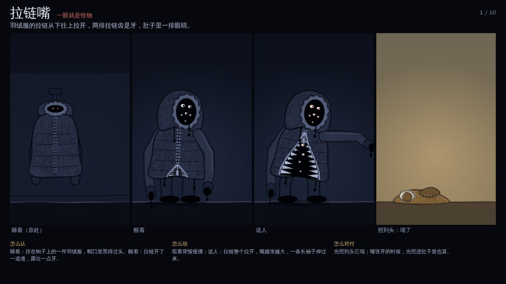
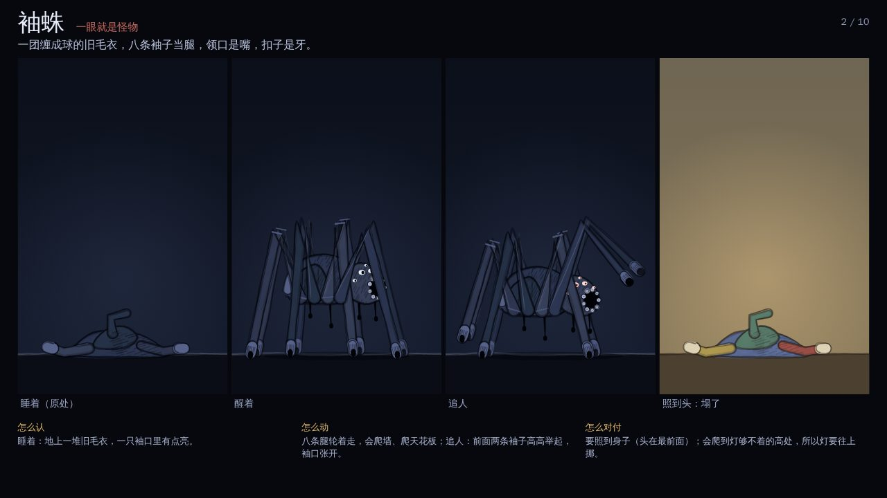
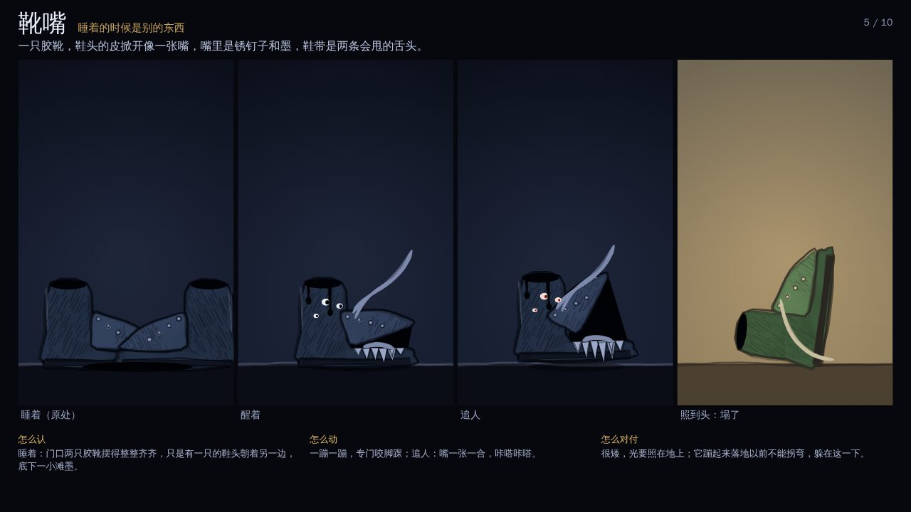
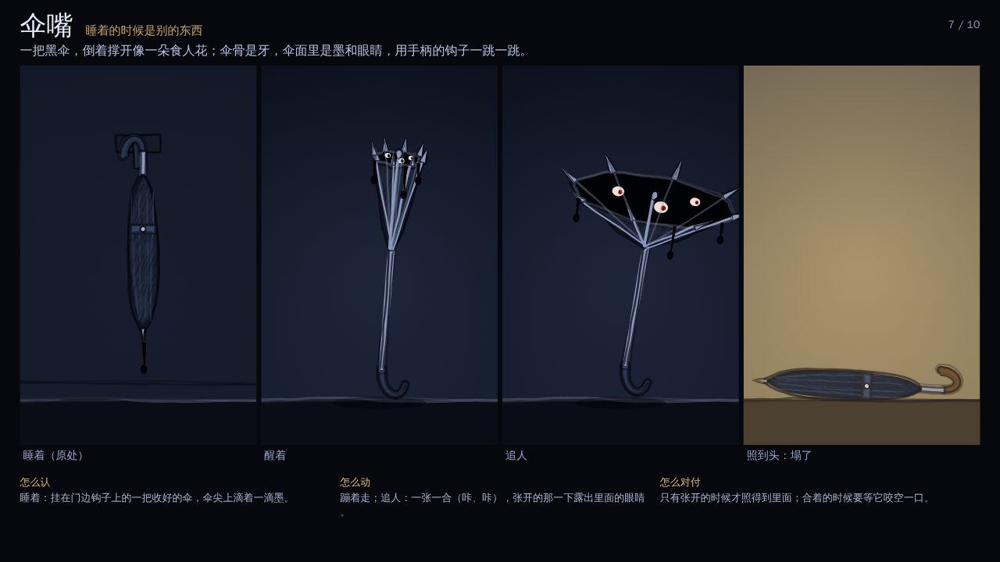
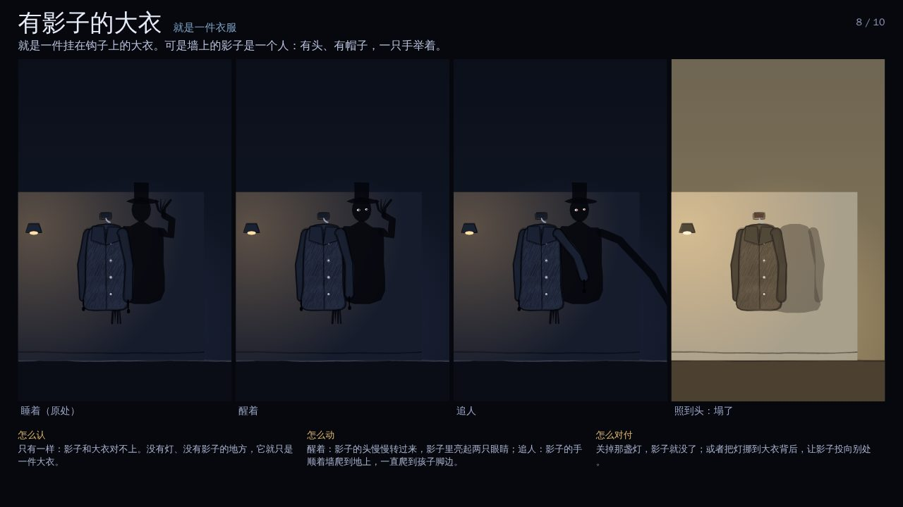
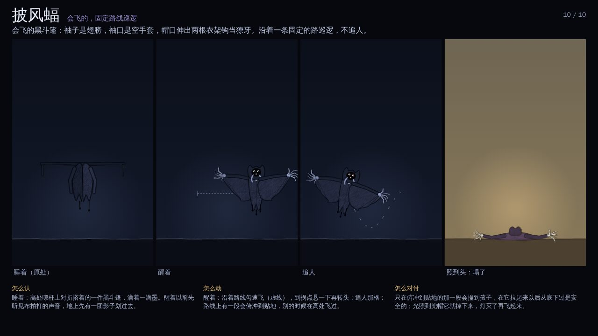
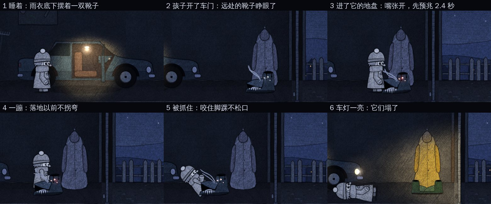
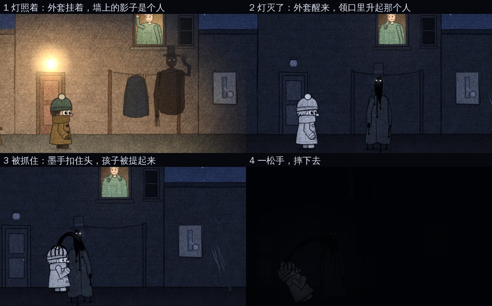

# 夜里 · 新的怪物（设计 + 图鉴）

2026-11-25。主人说：“能不能多设计几种怪物，最好有点恐怖可怕，让人一看就知道是怪物，有的怪物就是个衣服，甚至不太看得出来是怪物。”

> **2026-11-25（后来）主人回答了四件事**：靴嘴（第 2 关）和有影子的大衣（第 3 关）“都做出来”；“黑夜里找光的设定不要了”；被抓住的画面“要”专门做；还想要“能在空中飞的、固定路径巡逻的”。所以：这两只**已经做进游戏了**（见下面“做进游戏的两只”），各自有专门的被抓住的画面；多画了第十只会飞的**披风蝠**（只是设计和图鉴）；故事上的建议作废（见“找光的设定不要了”）。其余八只还只是设计和图鉴，没进关卡。

这一页是**设计和图鉴**：十种新的怪物（九只地上的、一只会飞的），每一种都用游戏自己的画法画好了，能看、能翻页。其中靴嘴、有影子的大衣已经在第 2、3 关里。

看图鉴：`games/house.html?monsters=1`（总览）；`?monsters=zip`、`spider`、`patch`、`tall`、`boot`、`pj`、`umb`、`shd`、`stk`、`cloak` 直接翻到那一只；电脑上左右键翻页，手机上点左右两边翻页、点中间回总览。每只四格：**睡着（原处的样子）／醒着／追人／照到头塌下去**。每一格画的就是游戏里那一层的画法（暗的一层立起来的怪物，亮的一层塌下去的普通衣服），不是另外画的效果图。

## 为什么要加

- 现在追人的衣服有 42 件（`GARB`），其中 32 件是同一个模子：一件衣服，领口一汪墨、几只眼睛、一只伸过来的袖子。画得不差，可是**看着像闹鬼的衣服，不像怪物**：没有牙，身子没有哪儿不对，眼睛一个样，动法也一个样（暗处醒着、慢慢挪过来、光照到头就塌）。
- 主人要的两头正好相反：**一头要一眼就是怪物，一头要几乎看不出来**。现在两头都没有，全挤在中间。

## 三档

| 档 | 玩的人怎么看 | 靠什么做到 | 有哪几只 |
|---|---|---|---|
| ① 一眼就是怪物 | 一看就知道，不用想 | **牙**（尽量用衣服自己带的东西做：拉链齿、别针、钉子、扣子、伞骨）、**身子不对**（太高、八条腿、拼起来的）、**眼睛不一样**（竖瞳、纽扣、一堆小眼）、**手上拿着东西**（剪刀） | 拉链嘴、袖蛛、缝合怪、长衣人 |
| ② 睡着的时候是别的东西 | 门口的靴子、挂着的伞、地上的睡衣：谁也不会多看一眼；醒了才露馅 | 睡着的样子是**原来的东西**（和塌下去以后差不多），醒了才变；破绽只有一点点 | 靴嘴、伞嘴、爬行的睡衣 |
| ③ 就是一件衣服 | 一直都只是衣服，只有一个地方不对 | **没有“怪物的样子”**：不立起来、没有眼睛，只有一个破绽（影子不对、每次回头近一点） | 有影子的大衣、叠好的衣服 |

总览图里上排是醒着的、下排是睡着的：①档上下两排差得多（睡着是一堆东西，醒了是怪物），③档上下两排几乎一样（所以才吓人）。

### 恐怖是怎么画出来的

- **牙尽量是衣服自己的东西**：拉链齿（拉链嘴的肚子）、别针（缝合怪的嘴）、锈钉子（靴嘴）、扣子（袖蛛的领口）、伞骨（伞嘴）。这样还是“衣服里灌了墨”，没有凭空长出别的东西。睡衣和叠衣的牙现在只是尖牙，可以再改成扣子。
- **身子不对**比“更黑”吓人：长衣人比门还高、脖子是一条拉长的围巾；袖蛛八条腿是八只袖子；睡衣肚子朝天、四肢反着弯；缝合怪一条腿是裤腿一条腿是袜子，一瘸一拐。
- **眼睛各有各的样**：拉链嘴一堆大小不一的眼睛；缝合怪一只是掉了线的大纽扣、一只在破洞里；长衣人是竖瞳；有影子的大衣的眼睛**长在影子里，不在衣服上**。追人的时候瞳仁缩小、发红（沿用 `inkEyes`）。
- **每一只手上都有东西**：空手套（手指太长）、剪刀、拉链头像舌头一样挂着、鞋带像两条舌头。

### “几乎看不出来”的规矩

伪装不是不讲理，**必须有破绽，而且玩的人看得见或听得见**（`docs/night-signatures.md` 的规矩 5：不出字、要有预兆，会伤人的动手以前至少 0.8 秒）：

1. 每一只伪装的有**一个**破绽，画出来了（见下面每只的“破绽”）。没有破绽的伪装是骗人，不是设计。
2. **破绽要能教**：先在不危险的地方出现一次（歇一歇的关、前半段），让玩的人学会“这个不对劲”，再放到要紧的地方。
3. **塌下去以后要说得通**：照到头它塌了，变成一件普通的衣服，玩的人回头一看，原来破绽就是它。

## 十只

下面每一只（前九只是地上的，第十只会飞）：样子、破绽、预兆、怎么动、怎么对付、建议放哪一关、代价（S 只是动画；M 这一关多一两项规则；L 动到孩子的动作或全局判定，要全部 21 关重跑，沿用 `night-signatures.md` 的说法）。

### ① 拉链嘴

- **样子**：驼背的连帽羽绒服，帽口一圈毛，里面是墨和六只大小不一的眼睛。前襟的拉链从下往上拉开，**两排拉链齿是牙**，肚子里又是一排眼睛；拉链头像舌头一样挂在牙缝上。一条长袖子垂到脚踝，追人的时候伸过来。
- **破绽**：睡着时就是挂在钩子上的羽绒服，只是帽口里黑得过头，偶尔亮一下。
- **预兆**：**拉链“嘶——”地一路拉下来**（声音）、嘴一点点张开，至少 1 秒以后才扑。
- **怎么动**：慢慢挪；追人时拉链整个拉开、往前扑。
- **怎么对付**：光照到头它塌；嘴张开的时候，光照进肚子里也算。
- **建议**：第 5 关公寓楼（那一关本来就是“听见声音才醒”，拉链声就是它自己的声音）。代价 M。

### ② 袖蛛

- **样子**：一团缠成球的旧毛衣和衬衫，**八条袖子当腿**（袖口是张着的，里面是墨；袖子颜色花纹各不一样，一看就是拼起来的）。脸在前面一个小疙瘩上：领口是嘴，一圈扣子是牙，眼睛挤在上面。
- **破绽**：睡着时地上一堆旧毛衣，一只袖口里有一点亮。
- **预兆**：追人以前**前面两条袖子先高高举起来**（约 1 秒），腿点地“嗒嗒”响。
- **怎么动**：八条腿轮着走，会贴墙、爬天花板。
- **怎么对付**：要照到身子（头在最前面、很低）；它会爬到灯够不着的高处，所以灯要往上挪。
- **建议**：第 13 关下水道（爬管子、爬拱顶）。代价 M：要多一条走在墙上和顶上的路线。

### ③ 缝合怪

- **样子**：旧衣服的碎片缝起来的人形，每一块布不一样（格子衬衫、牛仔布、条纹），**线脚粗得吓人**。头是个枕套，顶上扎着结；**左眼是一颗掉了线的大纽扣**（用一根线吊着晃），右眼在破洞里；嘴是一道缝死的线。左手是塞满了的裤腿，拖到地上，末端是一只空手套；右手是一把**大剪刀**。
- **破绽**：睡着时墙角里一团破布。
- **预兆**：**剪刀“咔嚓”两声**、嘴上的线“啪”地崩断一根，然后才动；崩开以后里面是两排针（针帽是彩色的圆珠）。
- **怎么动**：一瘸一拐（一条腿是裤腿、一条是长袜子，短一截）；追人时剪刀一开一合。
- **怎么对付**：光照到头塌；剪刀够得到的距离里不能站。
- **建议**：第 17 关百货大楼的裁缝柜台，或第 10 关剧院后台（戏服的碎片）。代价 M。

### ④ 长衣人

- **样子**：**比门还高**，细得不对：一件长大衣，一条拉长了的围巾当脖子，一顶高帽子，帽檐底下是墨和**两条竖着的眼睛**。手套是空的，**手指太长**，垂到膝盖。
- **破绽**：睡着时是挂在一根很高的衣帽架上的大衣，帽子搭在最上面的钩子上。哪儿都对，就是比门还高。
- **预兆**：**灯闪一下，它就近一步**（先闪，再走）；到最后一步以前，帽子底下“呜”地响一声。
- **怎么动**：站着不动，灯闪才动；追人时弯下腰，脖子钩过来，长手往前探。
- **怎么对付**：头太高，灯要吊到高处才照得到帽子底下；它一步顶孩子三步，所以不能让它走近。
- **建议**：第 18 关广场上的旋转木马（木马上的灯本来就一明一暗）。代价 M–L：规则里要多一种“灯闪一次近一格”。

### ⑤ 靴嘴

- **样子**：一只胶靴，**鞋头的皮掀开像一张嘴**，嘴里是锈钉子和墨；鞋带是两条会甩的舌头；靴口黑着，滴墨。
- **破绽**：睡着时门口两只胶靴摆得整整齐齐，只是**有一只的鞋头朝着另一边**，底下一小滩墨。
- **预兆**：鞋带先甩起来，鞋头“咔哒”掀开一道缝，再蹦。
- **怎么动**：一蹦一蹦，专咬脚踝；追人时嘴一张一合。
- **怎么对付**：很矮，光要照在地上；它蹦起来落地以前不能拐弯，躲在这一下。
- **建议**：**第 2 关院子**，前门外面的胶靴（先教“摆得太整齐的东西不对劲”，最早、最小、最安全）。代价 M。

### ⑥ 爬行的睡衣

- **样子**：条纹睡衣，**肚子朝天，四肢反着弯**，像蜘蛛一样横着爬；头从领口垂下来，帽兜里是墨和四只眼睛，**上下两排尖牙**（身上的扣子只是扣子）。
- **破绽**：睡着时地上扔着一套睡衣，摆成人躺着的样子（比随手一扔整齐），一只袖口朝孩子这边勾着，领口里偶尔亮一下。
- **预兆**：袖口先勾动，领口里亮起眼睛，“噗”地翻过身，再爬。
- **怎么动**：横着爬，快；追人时贴地面蹿，会钻进床底、柜子底下。
- **怎么对付**：贴着地跑，光要照在地上；钻进缝里就是躲起来了，要把缝堵上。
- **建议**：第 5 关公寓楼的楼道（和拉链嘴一起：一个站着、一个趴着）。代价 M。

### ⑦ 伞嘴

- **样子**：一把黑伞**倒着撑开，像一朵食人花**：伞骨是牙，伞面里是墨和眼睛，伞尖像一根小舌头；用手柄的钩子一跳一跳。
- **破绽**：睡着时是挂在门边钩子上的一把收好的伞，伞尖上滴着一滴墨。
- **预兆**：伞骨“啪”地撑开一半、伞尖抖。
- **怎么动**：蹦着走；追人时一张一合（咔、咔）。
- **怎么对付**：只有张开的时候才照得到里面；合着的时候要等它咬空一口。
- **建议**：第 6 关屋顶（那一关有风，伞被风吹翻了就是它的样子）。代价 M。

### ⑧ 有影子的大衣

- **样子**：就是一件挂在钩子上的大衣，一直都只是大衣。**墙上的影子是一个人**：有头、有高帽子、一只手举到下巴那儿。
- **破绽**：只有这一样：**影子和大衣对不上**。没有灯、没有影子的地方，它就真的只是一件大衣。
- **预兆**：醒着时影子的头慢慢转过来，**影子里亮起两只眼睛**（眼睛长在影子里，不在衣服上）；至少 1 秒以后，影子的手才顺着墙伸出去。
- **怎么动**：追人时影子的手沿着墙爬到地上，一直爬到孩子脚边；大衣的袖口也微微抬起来。
- **怎么对付**：关掉那盏灯，影子就没了；或者把灯挪到大衣背后，让影子投向别处。
- **建议**：第 3 关巷子：晾衣绳上挂着一排衣服，路灯把它们的影子投在墙上，**只有一件的影子是人**（这一关本来就在拉晾衣绳、把衣服滑到灯底下）。代价 M：影子的位置要算灯在哪儿。
- 暗处的限制：没有光就没有影子，所以它只能放在有灯的地方；这也是它的规则。

### ⑨ 叠好的衣服

- **样子**：整整齐齐叠好的一摞衣服，四件，颜色不一样，最上面一件的领子和一粒扣子露在外面。张开的时候，**上面两层是上颌，上下两排尖牙，肚子里是墨和三只眼睛**，最下面一层伸出一只袖子当手，袖口张着。
- **破绽**：睡着时一摞叠好的衣服；**每次回头它都离你近一点**，身后的地上拖出几道痕，叠缝里偶尔亮一下。
- **预兆**：孩子转身看它的时候，衣料“窸窣”响一下、缝里亮一下，才张开。
- **怎么动**：孩子不看它的时候才挪；追人时上面两层掀起来，像尺蠖一伸一缩。
- **怎么对付**：孩子转身看着它，它就不动；光照进张开的嘴里才塌。
- **建议**：第 17 关百货大楼（本来规划的招牌就是“木头人”：站着不动，混进人台里；柜台上叠着的衣服最合适）。代价 L：要知道孩子朝哪边看（规则现在不管孩子的朝向）。

### ⑩ 披风蝠（会飞的，固定路线巡逻）

主人说“还想要那种能在空中飞的，固定路径巡逻，这样可以设计更丰富的关卡”。这一只和上面九只不一样：**它不追人，不看孩子，只沿着一条固定的路匀速飞**；危险靠“它什么时候飞到哪儿”，不靠“它盯着你”。所以关卡可以围着它的路线来设计，玩的人看一圈就能算出什么时候过。

- **样子**：一件黑斗篷在空中飘。两条袖子是翅膀，袖口是空手套，手指弯成钩；翅膀的膜就是斗篷的布，边上破破烂烂，骨是几根衣架的铁丝；下摆两片燕尾；兜帽有两个尖角，里面是墨和三只眼睛，帽口伸出两根衣架铁丝钩当獠牙。
- **破绽**：睡着时是对折着搭在高处晾杆上的一件黑斗篷，滴着一滴墨（地上有一小摊）。醒着以前先听见布拍打的声音。
- **路线**（关卡设计要定的几个数）：
  - **路径**：一串点 `path`（折线或回环）。来回飞、绕圈、8 字、沿着一根电线飞，都是不同的点串。
  - **速度** `speed` 匀速，不加速不减速（玩的人靠节奏算）。
  - **高度**：沿路径每一段有自己的高度 `alt`。**高空段**（离地 150 以上）孩子从底下走过去是安全的；**低空段**（俯冲到贴地，离地 40 以下）撞得到孩子。这样一圈里就有“危险窗口”和“安全窗口”。
  - **拐点悬停** `hover`：到路径的拐点悬一下（翅膀合拢、帽口张开，约 0.8 秒）再转头。悬停是预兆，也是安全窗口。
  - **碰到孩子就抓住**（离它的身子不到 34）；不会拐弯去追。
- **预兆**：它每一圈在**进入低空段以前**，先在地上有一团影子划过去（影子比身子先到）、先响一声布拍打的“呼——啪”，至少 1 秒以后才俯冲。
- **怎么对付**：
  - **躲**：看它的路线（图鉴里画成虚线），在它拉起来、飞到高处以后从底下过。
  - **用光打掉**：光照到兜帽它就掉下来，摊在地上成了一件斗篷；灯灭了它再飞起来。所以把灯点在路线上，它飞过去就掉，掉着的几秒就是路。
  - **遮挡**：头顶有屋檐、水箱、桥洞的地方，它的低空段不会经过（路线设计的时候绕开）。
- **能做出来的关卡**（我的想法，要主人挑）：
  1. **来回飞的一条线**：两根晾衣绳之间来回飞，中间有一段俯冲。玩的人数一圈，找安全窗口跑过去（第 6 关屋顶）。
  2. **绕圈**：绕着一个东西飞一整圈（旋转木马、水塔、钟楼的中庭）；圈里面的东西要拿，圈外面是路，进圈要掐时间（第 18 关广场、第 20 关钟楼）。
  3. **两只相位差半圈**：一只在高空、另一只刚好在低空，窗口小得多，要用灯打掉一只（第 15 关变电站）。
  4. **沿着一条线飞**：沿电线、管子、天花板的梁飞，路线是直的，窗口靠判断“它飞到第几根杆子了”（第 13 关下水道的管子、第 15 关的电线）。
  5. **灯是开关**：关卡里一盏灯挂在它的路线上，灯一亮它飞到那一段就掉；掉着的它就是一块“踏板”，孩子要踩着它够高处的东西。
  6. **被光逼着换路线**：路线上的灯亮着的时候它改走另一条（绕开光）；玩的人靠开关灯把它赶到想要的那一边。
- **代价**：M–L。**规则里**：一圈的“窗口”在 `check.mjs` 里没法表示（它不是点出来的门），所以和狗的毛衣一样，规则里只写“这一关能走得出去”，另外要求**每一圈安全窗口不少于 3 秒、一圈不短于 6 秒**，用自动试玩查。**页面里**：要多一种“按路径飞”的衣服（`GARB` 里的 `fly`，不走 `terr`，走 `path`）、低空段的撞人判定、地上的影子、光照倒再飞起来。
- **没做的**：只画了图鉴（栖着 / 巡逻 / 俯冲 / 塌了），**没进任何一关**，被抓住的画面也还没做（建议是：低空段扑下来，两只手套扣住孩子的肩膀，把孩子一起带到空中再松手）。

## 做进游戏的两只（2026-11-25）

主人说“都做出来”：靴嘴放第 2 关，有影子的大衣放第 3 关。**规则一个字没动**（`GATES2`、`GATES3`、`LINKS`、`GATEPOS`、气泡里的提示都没变），`node tools/check.mjs` 的输出和改之前一模一样；改的是页面：衣服的数据、醒着和睡着的逻辑、画法、被抓住的画面。

### 靴嘴 → 第 2 关车库

- **换掉了谁**：车库卷帘门边那件会追人的**雨衣**。`GARB.rain`（钥匙还叫 `rain`，规则里的门、`gateHint`、`GATEPOS` 都不用动）从“长袍”换成 `kind: 'boot'`。雨衣**还挂在钩子上**（`drawRainHung` 一直画），只是不动了；怪物是钩子底下的那双靴子。
- **睡着**：暗处它**也不立起来**，是雨衣底下整整齐齐的一双胶靴（比醒着的小：`BOOT_HOME_SC` 0.6，和孩子的脚差不多大），一只的鞋头朝着另一边，底下一小滩墨。这是第一只“暗处也不立起来”的衣服（`GARB.sleeper`：孩子走到跟前才醒）。
- **醒**：孩子走到离它 540 以内（`sleeper`）、在暗处，它就醒：胀大到 0.9、嘴张开、红眼睛、鞋带甩起来、咔哒一声。**最顺的走法下，孩子在车边开车门（x≈6244，离它 512）它就醒了**；下一步拧车灯，它们当场塌下去：一个看得见的“醒了又塌了”。孩子走远（两倍多）它又睡回去。
- **蹦**（`GARB.rain.hop`）：孩子进了它那一片（`terr` 6640–6850）、在暗处，它才追：**先预兆**（嘴张大、往后仰、往下蹲、咔哒响）——头一回 2.4 秒，以后 0.9 秒——再**一蹦 100 远，落地以前不拐弯**，落地歇 0.5 秒。孩子走出它那一片，它蹦回原处。靠近到 46 以内就是被咬住。
- **数字是怎么来的（实测）**：照游戏自己的“点卷帘门那边、走过去”：孩子走进它那一片（6640）大约 1.1 秒，预兆开始（头一回 2.4 秒）；1.8 秒走到停的地方（`GATEPOS.rain` 6722，停在 6682），被吓退（退 38、发抖，锁住约 1.25 秒）；**2.7 秒孩子能动了，离它蹦起来的 3.5 秒还有约 0.8 秒**；吓退以后停在 6644，**离它那一片的边只有 14**，往左一步就出去了（出去了它就不蹦）。试过两种：被吓退以后站着不动，**3.8 秒被咬**；被吓退以后马上走开，**没被咬**（靴子蹦了一个空）。
- **车灯照着**：车灯一亮它的头（离地 56）照得到（`coverage` 6600 处 0.47，6700 处 0.92，6756 处 1），塌下去；塌在原处是那双整整齐齐的靴子（亮的那一层），蹦到别处塌下去是一只往后倒了、鞋头朝天的靴子。
- **被抓住的专门画面**（`drawCatchExtra`）：靴子蹦到孩子脚上，**嘴咬住脚踝不松口**，一下一下地嚼、一抖一抖，孩子被拖倒，墨盖上来（`snd.chomp`）。
- **查过的**：`?lv=2&auto=1` 从第 2 关一路自动玩到第 3 关，0 次被抓，靴子在孩子开车门的时候醒、车灯亮的时候塌（日志：24.0 秒醒，25.0 秒塌）；上面那两种试法；被咬以后回到车顶灯底下。

### 有影子的大衣 → 第 3 关邻居门口的外套

- **换掉了谁**：邻居门口晾着的那件**外套**（`GARB.jacket`，门廊灯、敲门、小窗那一套规则都没动）。`kind` 从 `coat` 换成 `shdcoat`，走法、`terr`、速度不变。
- **灯照着的时候（破绽）**：外套**挂在绳子上，就是一件外套**。可是**墙上的影子是一个人**：有头、有一顶高帽子、一只手举到下巴那儿，眼睛亮着，头慢慢朝孩子这边转（`mzShadowPerson`，图鉴里的那个人）。影子落在灯的另一边（敲门亮的是门廊灯，在外套左边，影子就落在右边；小窗的灯、路灯二在右边，影子就落到左边）。**敲门亮 4.2 秒，这 4.2 秒里玩的人就能看见：影子和外套对不上。**
- **灯一灭它醒过来**：领口里升起来的就是影子里的那个人：脖子、头、一顶高帽子、发白的眼睛、一只手高高举着、四根长手指（`inkShdCoat`）。追人时手伸过来。**影子里的人和醒过来的人是同一个**，所以玩的人懂得这个预兆。
- **被抓住的专门画面**：外套的墨手从肩膀上伸出来，越过孩子的头顶，五根手指**扣住头**，孩子被提起来一点（离地 30），一松手摔下去，墨盖上来。比别的怪物多 0.2 秒（1.3 秒）。
- **查过的**：`?lv=3&auto=1` 自动玩过第 3 关，0 次被抓；敲门灯亮、灯灭、追人、抓住的画面截图看过。

## 找光的设定不要了

主人 2026-11-25 说：“黑夜里找光的设定不要了”。我的理解：`docs/night-story-c.md` 和 `docs/night-story-pitches.md` 里的 C（**衣服不是怪物，是在黑里找光的人**；孩子身上有光所以它们扑过来；第 7 关转折以后规则跟着变）**作废**。追人的东西就是怪物，不再有“它们其实是人”这一层。所以：

- 上一版这页里“转折以后追你的是墨用很多件衣服拼出来的东西”那条故事建议**不用了**，十只怪物放在哪一关不受“转折前/后”的限制，哪一关都能放。
- 各关“光照到衣服的头，它就塌”的规则**没变**（主人没说要改）；2026-11-25 前面删掉的“递光”（`docs/night-give-removed.md`）、“跟着孩子的小光”（`docs/night-followers-removed.md`）和这条是一回事，已经不在游戏里了。
- 那几页故事文档（`night-story-c.md`、`night-story-pitches.md`、`night-signatures.md` 里提到转折的地方）我在页首加了一句“这一条作废”，**没有删字**；剧情主人还要再改（`night-give-removed.md`：“我感觉游戏剧情还得再修改”），改的时候再整理。
- 游戏里已经有的、和这条有关的东西没动：第 7 关的“学人精”（镜子一样走位）、第 21 关的合影结局都不依赖“衣服是找光的人”。要不要为这条改第 21 关的结局，主人定。

## 放哪一关（我的建议）

**先教后用**，相邻两关不用同一类：

| 关 | 放谁 | 为什么放这儿 | 状态 |
|---|---|---|---|
| 2 院子 | 靴嘴 | 雨衣底下的胶靴，最小最安全，先教“摆得太整齐的东西不对劲” | **已做** |
| 3 巷子 | 有影子的大衣 | 一排晾着的衣服，路灯投影，一件的影子是人 | **已做**（只改了外套那一件） |
| 5 公寓楼 | 拉链嘴、爬行的睡衣 | 本来就是“听见声音才醒”，拉链声、扣子声是它们自己的声音 | 设计 |
| 6 屋顶 | 伞嘴；披风蝠（来回飞的一条线） | 有风，伞被吹翻就是它；晾衣绳之间飞 | 设计 |
| 10 或 17 | 缝合怪 | 剧院后台（戏服的碎片）或百货大楼的裁缝柜台 | 设计 |
| 13 下水道 | 袖蛛；披风蝠（沿着管子飞） | 爬管子、爬拱顶 | 设计 |
| 15 变电站 | 披风蝠（两只相位差半圈，沿电线） | 灯在路线上 | 设计 |
| 17 百货大楼 | 叠好的衣服 | “木头人”：别看它 | 设计 |
| 18 广场 | 长衣人；披风蝠（绕木马飞圈） | 木马的灯一明一暗，它一闪近一步 | 设计 |

## 做进游戏要改什么（给后面几只）

**画**：每只的画法在 `games/house.html` 的“新的怪物”那一段（`mzZip`、`mzSpider`、`mzPatch`、`mzTall`、`mzBoot`、`mzPj`、`mzUmb`、`mzShd`、`mzStk`、`mzCloak`），签名和 `inkCoat` 一样：`(b, P, lit, x, fy, f, t, m, seed)`，`m` 里用到 `hunt`、`reach`、`ph`（靴嘴在游戏里用 `air`、`tell`）。睡着的样子是 `mzXxxHome`，塌下去的是 `mzXxxHeap`。配色 `mz*` 登记进了 `LIT` 和 `DARK`。放进某一关：在 `GARB` 里加一条 `kind`，在 `drawGarb` 的分发里加一行，在 `GARB_HOME`、`garbEyes` 里各加一行（靴嘴和外套就是这么接的，看 `drawGarb`、`garbUpdate`）。

**新的引擎件**（靴嘴做的时候加的，后面几只能用）：`GARB.sleeper`（暗处也不立起来，走到跟前才醒）；`GARB.hop`（先预兆再一蹦的追法）；`drawCatchExtra`（被抓住的时候盖在孩子上面画的东西：靴子咬脚踝、墨手扣头）；孩子被抓住时 `kid.lift`、`fall` 的时间可以按谁抓的改（外套提起来 0.6 秒再摔）。

**规则**：每只都能写成现在的那种“门”（光照到头它塌，`GATES` / `keepDown`）；伪装的再多一个“看见了没有”的页面状态（像 `V.mSeen1` 那样，规则里不管）。真要多加规则的只有：长衣人（灯闪一次近一格：`TIMED`）、叠好的衣服（孩子朝向：L 级）、袖蛛（走在墙上和顶上的路线）、披风蝠（见 ⑩，规则里只写走得出去，窗口另外查）。`check.mjs` 要求解法里每一步都非点不可，所以这些都不做“两条路二选一”。

**声音**：做了靴嘴的“咔哒”（嘴一张一合）、“嘭”（蹦起来）、咬住脚踝的“咔、咔、咔”；其余的（拉链“嘶”、剪刀“咔嚓”、扣子叮当、伞骨“啪”、袖蛛腿“嗒嗒嗒”、叠衣“窸窣”、披风蝠的布拍打“呼——啪”）没做。

## 查过的、没做的

- 查过：无头 Chrome 里图鉴总览和十只各打开一遍，加游戏本体 `?lv=2`、`?lv=3`、`?lv=17`、`?lv=21`，共 16 个页面，没有报错；`node tools/check.mjs` 通过，输出和改之前**一字不差**（规则没动）；`?lv=2&auto=1` 照最短的解法从第 2 关自动玩到第 3 关、第 4 关，0 次被抓；靴嘴的醒、预兆、蹦、咬、被车灯照倒，外套的影子、醒、抓，每个状态都截过图看过（上面两张拼图）。
- 没做：**其余八只和披风蝠都没进关卡**；没有亲手玩，没在真手机上试；靴嘴被咬的那几步（2.4 秒预兆、蹦 100 远、咬住的距离 46）是按数字推的加上站着不动试过，**没有真手玩过松紧**，预兆够不够长要主人玩了再调（`GARB.rain.hop`、`sleeper`）；声音大部分没做；披风蝠的被抓画面没做；有影子的大衣的影子只画了正面一种姿势，也没做“追人时影子的手顺着墙爬到地上”（做进游戏的版本里追人的是醒过来的外套，影子只在灯亮的时候出现）。

## 要主人定的

1. **“黑夜里找光的设定不要了”我理解成：C 故事（衣服是找光的人）作废，追人的就是怪物，各关“光照到头它就塌”不变。对不对？**还是连“光能让它们塌下去”这条规则也不要了？
2. 靴嘴**换掉了**第 2 关车库里会追人的雨衣（雨衣还挂在钩子上，不动了）；有影子的大衣换掉了第 3 关的外套。这样换可以吗？还是想让雨衣、外套也留着当怪物，靴子、影子大衣是**多出来的一件**？（多一件要多一个 `GARB` 键、多一道 `GATEPOS`，规则要多写一道门，`check.mjs` 要重新查。）
3. 靴嘴被咬的松紧（头一回预兆 2.4 秒、一蹦 100 远、被咬 46）：主人玩了觉得太容易、太难再调。
4. 被抓住的专门画面：现在只有这两只有。其余八只要不要也做？（我建议做一只放进关卡就做一只。）
5. 披风蝠：先放哪一关？我的建议第 6 关屋顶（来回飞的一条线，最简单），再到第 15 关（两只相位差半圈）。要不要做？
6. 十只够不够，还想要什么样的？（我还想过：会爬的手套群、挂满衣服的衣架人、湿毛巾。）
