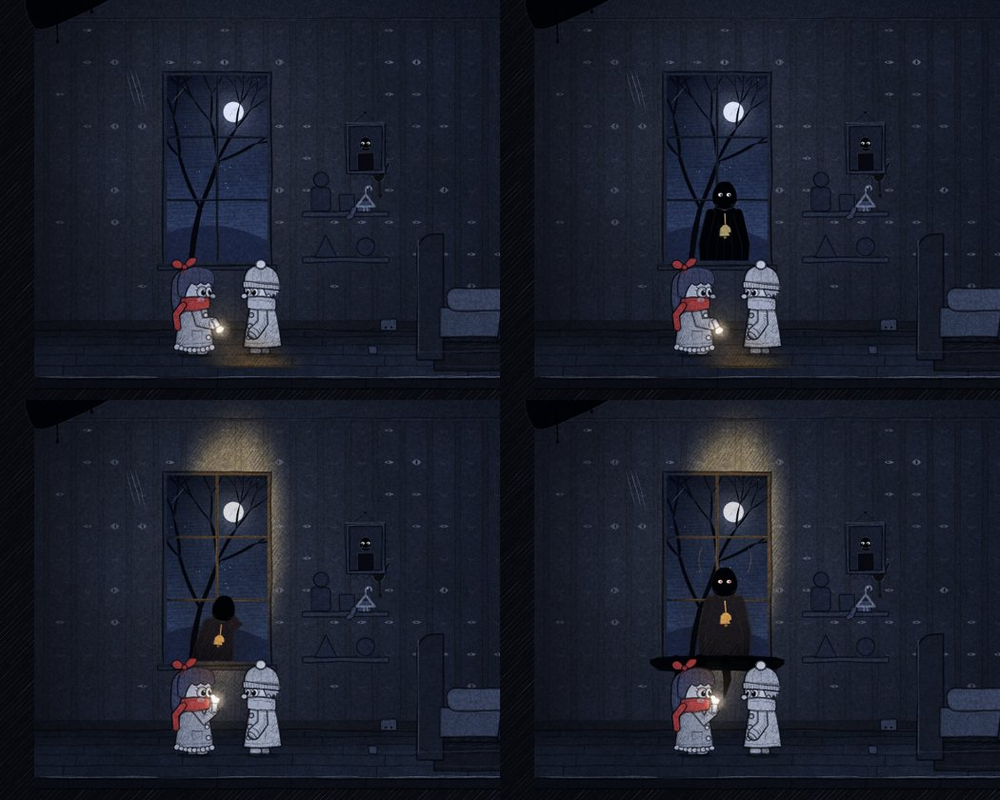

# 夜里 · 开场：她被黑长衣从窗口拖走（2026-11-27）

主人定了：故事是“她被抓走，主角去把她带回来”，救到她就是结局，不做两个人一起行动的关卡；说“开始做开场吧”。这一页写做成的样子。剧情稿是 `docs/night-story-chase.md`。

## 和剧情稿不一样的一处：在卧室，不在门厅

稿子写的是两个人摸到门厅、怪物站在前门外。可游戏是从**楼上卧室**开始的（规则的起点是 `bed`，前门要到这一关最后拿到钥匙才开），在门厅演完还得把孩子挪回楼上。所以挪到了卧室的窗口：孩子开局本来就站在窗下，演完他还站在原地，规则一个字不用动。稿子里的几拍都留着：

| 稿子 | 做成的 |
|---|---|
| 她举着手灯 | 她站在孩子左边，手灯照着脚前的地板 |
| 铃一长一短 | 1.4 秒响（听不见声音的时候，窗边也有几道短弧） |
| 灯扫过黑长衣，它往后缩一步 | 窗外升起一个影子；3.6 秒她举灯照窗，它抬袖子挡脸、往后缩 |
| 窗外又响一次铃 | 5.0 秒 |
| 影子拉上门，灯光被截断 | 墨从窗框爬进来往下淌，手灯闪几下灭了 |
| 把她拖走 | 两只墨袖子伸进来，把她拖上去、拖出窗 |
| 围巾钩住，扯下一截红布 | 红布留在窗台左边，从这儿起一直在 |
| 玩家拿回控制 | 9.4 秒；孩子缩着发抖，然后能动了 |

要不要改回门厅，主人看了再说。

## 她

和孩子同一副身子（`drawKid`，`kid.girl`）：灰蓝的大衣、下摆一圈奶白的花边、红围巾（垂下来一截）、手里一盏小手灯。不戴帽子：齐刘海，头发披到肩膀，头顶偏后一只红蝴蝶结；眼角有睫毛，脸上一点腮红。暗处衣服照旧变冷变灰，**围巾和蝴蝶结留着一点红**（`GIRLD.collar`），靠它认她。颜色在 `GIRLC`、`GIRLD`。

2026-11-27（后来）：第一版只有红围巾和一根细辫子，主人说“能不能设计得更女性化一点”“头发那样感觉有点秃”，改成了现在这样。左边是暗处，右边是灯下：

## 黑长衣

`bellCoat`：三角下摆的黑长衣，领口上面一团墨、两只眼睛（要抓人的时候发红），胸前一根短链子挂着缺了一个角的铜铃，铃会摆。被光照到：一只袖子抬起来挡脸，身子往后仰。第 21 关钟楼顶原来那个临时画的黑影换成了同一只（位置、机关都没动）。铃声是新加的 `snd.bell`（长 / 短 / 远）。

## 怎么接进游戏的

- 只在**从头开始**的时候演：没有存档的第一次打开、点“重来”、通关后“再来一遍”。读存档、`?lv=N` 不演。地址后面加 `?nointro=1` 不演。
- 演的时候点一下屏幕**跳过**（开头 0.4 秒除外），红布直接在窗台上。
- 手灯是一盏真的灯（`LIGHTS` 里的 `glamp`），只照得到卧室左半边，够不着门边那件睡袍，不算“安全的灯”。
- 规则、`check.mjs` 没动。

## 验证

- `node tools/check.mjs`：和改之前一字不差。
- `node tools/autoplay.cjs sim 1-21`：21 关都走得完（第 1 关多了开场的 9 秒）。
- 无头 Chrome：开场逐段截图看过（上面两张）；点一下能跳过；`?nointro=1`、`?lv=21` 不演；第 21 关黑长衣的新样子看过；手机竖屏（390×844）看过一帧，没有报错。
- **没验证的**：没有真人玩过；铃声没有听过（无头浏览器不出声）；浏览器第一次打开、还没点过屏幕的时候多半不出声，开场会是哑的；她在灯光里（亮的一层）的样子开场里用不到，只摆了一盏灯看过一张（上面那张的右半边）。

## 还没做

三次碰面（屋顶、闸桥、广场）、决战里她撑反光板、结局两个人回家，都还没做；第 21 关现在的结局是临时的（`docs/night-photo-removed.md`）。
