# 夜里 · 开场：她来敲门，后山的树屋，天一下子黑了，回家路上她被扛着跑过屋顶（2026-11-28）

主人 2026-11-27 定了：故事是“她被抓走，主角去把她带回来”，救到她就是结局，不做两个人一起行动的关卡。第一版开场（下面“第一版”）是一开场就在卧室的窗口被拖走。2026-11-28 主人说：

> 第一幕，女主角被劫走之后，应该有一个往右边劫走的过程，这样主角才有往右边跑的原因，而且我觉得开场得要有一个前置剧情，比如两个人一起去哪，路上被劫持了，而不是这样第一幕就劫持了，而且一开场要有一段走路，跳跃，上下梯子的基本操作的剧情，才能开始现在解密的环节，否则一上来就这样，太难了

这一页写照这三条做成的样子。剧情稿是 `docs/night-story-chase.md`。

2026-11-28 后来主人又说：

> I think you should create a new level that is at the beginning of it. the female protagonist lived a happy life with the male protagonist
>
> and the level is simple move, climb the ladders and jump over a gap something like that

所以树屋前面又加了一关“那天下午”（下面第二节）。

2026-11-28 再后来，主人问：

> I want the game to start with the girl knock the protagonist's door, invite him to have a picnic or hiking, and then the sky become dark suddently, someone takes her away, he goes to save her, do you think it's a good idea?

我答：主线（一起玩 → 她被抓走 → 他去救）游戏里已经是这样了，新的是两处——一开头她来敲门、天一下子黑而不是太阳落山——两处都好；敲门那一拍别让他从家门口往左走去草地（全游戏是往右走的），用一下黑接过去；天一下子黑可以让黑从钟楼那儿来。主人说“do them both and let me see the results”，就是下面第一节和第二节最后那一段。

现在从头开始的顺序是：有人敲门（晴天下午，他在家里的门厅，她提着野餐篮子来叫他）→ 那天下午（两个人在后山上玩）→ 树屋上天一下子黑了（黑从钟楼那儿漫开来）→ 原来的开场（她闪两下灯，回家路上被抓走）→ 钻进卧室，第 1 关。

## 最前面一拍：有人敲门（2026-11-28 再后来）

晴天的下午，孩子在自己家的门厅里（第 1 关最后要开的那扇前门）。不用字，没有怪物，不存档。

| 一步 | 玩家做什么 | 她做什么 / 发生什么 |
|---|---|---|
| 门厅里 | —（从黑里亮起来，0.8 秒） | 他站在桌子边上朝着座钟；门外的门廊上站着她，提着野餐的篮子（和草地上那一只一样，小一号，篮子口垂下来一角格子布） |
| 有人敲门 | — | 1.2 秒起她敲门：近的那只袖子伸到门上，咚咚咚三下（`snd.thump`），门里面一下一道短短的弧往屋里散开（没有声音也看得出）；头一下他回过头来看门。门不开她隔 3.6 秒再敲一回 |
| 去开门 | **左右拖**走路（往左走不过桌子） | 走到门前就停，自己伸手拉开门（和够东西一样的一下）；门开了，门外的光铺进门厅 |
| 门开了 | — | 她把篮子举到胸前给他看，原地蹦两下；2 秒后转身往外跑到门廊的柱子边，回头等他，一阵一阵蹦两下、朝他招手。他走不到她前头去 |
| 跟她出门 | **往右拖**走出门 | 走到门外 170 就黑下去（0.6 秒），她接着往外跑；黑着接上“那天下午”的草地（她点他的鼻子就跑），再亮起来 |

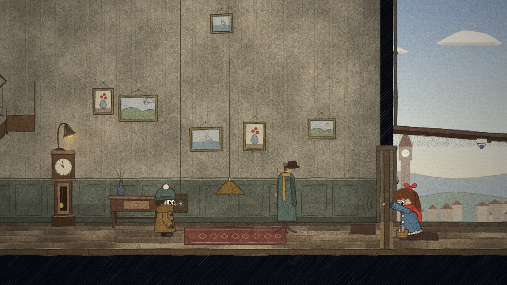

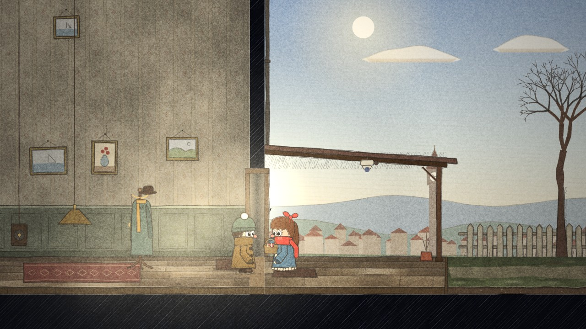

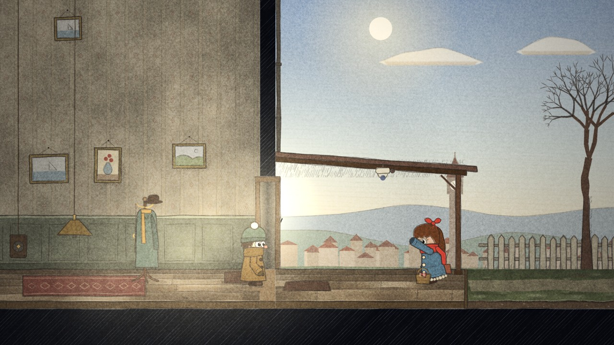

气泡（他站着不动 5 秒，再画隔 8 秒）：门没开的时候、门开了她在外面等的时候，都画往右的箭头。点 ? 圈出门、门外等着的她。

### 怎么接进游戏的

- 地方就是房子的门厅（`hall`）和门外的门廊、前院（`porch`），不新画屋子。白天是同一盏“太阳”（`LIGHTS` 的 `sun`：`V.knock` 的时候照门厅和门廊、前院这一块），门外的天在 `drawSky` 里接着画白天那一张（`daySky`，不给 `o`）。门开了的光是 `drawKnockGlow`（结局推开前门那一下的画法）。
- 状态在 `V.knock`（演完就是 null）：`knockStart`、`knockUpdate`、`knockGirl`、`knockTips`；她是 `V.girl`（和“那天下午”同一副身子），篮子是 `knockBasket`，敲门的弧在 `drawKnock` 里。门的开合用自己的 `V.knock.dO`（`V.door` 跟着它），规则里的 `S.door` 不动；前门的 `STOPS` 在 `dO > 0.6` 以后放行。
- 不碰第 1 关的局面：
  - 门厅里的东西都点不了（`spots` 在 `V.knock` 的时候只给门 `kDoor`、门外的她 `kOut`，先返回）。
  - 往左走不过 `KNOCK.x0`（3720，桌子右边）：座钟顶上的灯崽（离孩子 190 以内会被吓出来）离得远；楼梯、客厅也去不了（`walkTo`、`driveBlock`）。
  - 衣帽架那道影子（`stand` 的门）白天不挡路（`walkTo` 不找 `firstClosedGate`，`driveBlock` 不看 `GATEPOS`）。
  - 衣服让太阳照着是塌着的样子：`knockStart` 把太阳照得到的几件（这一回是 `laundry`、`stand`、`dog`）一开始就摆成塌着的（不然头一帧“噗”一下塌下去、还响一声），`knockEnd` 原样立回去；中间不追人（`garbUpdate` 的 `calm0` 认 `V.knock`）。
  - 门开了、走出去都不存档（`writeSave` 认 `V.knock`），站着的小动作不做（`idleOK`），卡住的闪光不闪。
- 只在从头开始的时候演（`introStart` → `knockStart`）：没有存档的第一次打开、点“重来”、通关后“再来一遍”。`?intro=day` 跳过这一拍直接从草地开始，`?intro=pre` 照旧从树屋上天黑那一下开始；`?nointro=1`、读档、`?lv=N` 照旧不演。黑下去、亮起来是 `V.iFade`（和抓走以后黑一下画在同一处）。
- 自动试玩照“下一步”也走得过（`knockNext`：开门、跟她出门）。规则、`check.mjs` 没动。

### 验证（敲门、天一下子黑了；2026-11-28 再后来，本机 Browser pane，窗口藏着，从画布上取的图）

- `node tools/check.mjs`：和改之前一字不差。
- 照“下一步”从头走到第 1 关走出前门（和 `tools/autoplay.cjs sim` 同一个走法，在页面里跑，新旧两版各一遍）：新版 有人敲门 9.0 秒、2 下 → 那天下午 28.0 秒、4 下 → 原来的开场 37.8 秒、10 下 → 屋里 105.8 秒、24 下，被抓 0 次；旧版 那天下午 28.8 秒、4 下 → 原来的开场 37.6 秒、10 下 → 屋里 105.8 秒、24 下，被抓 0 次。屋里那一段一模一样；那天下午短了 0.8 秒（天黑那一段 6.6 → 5.8 秒），原来的开场差 0.2 秒是自动点的 0.6 秒节拍错开了。
- 第 2–22 关用 `?lv=N` 各走一遍，新旧两版一模一样（几秒、点了几下、被抓几次；第 2、17 关这个简单的走法走不完、两版都停在 300 秒，第 6 关两版都被抓 1 次）。没有报错。
- 敲门这一拍用方向键走过：往左停在 3720（座钟顶的灯崽一直在灯里没被吓出来）；往右走到门前停住、自己伸手开门；门开了跟在她后面走不到她前头；跟出门黑下去接上草地。走完以后门厅里的三件衣服（`stand`、`laundry`、`dog`）是 want 1、rise 1（和没演以前一样），`S.door` 是 0。点着走（`tap('kDoor')`、`tap('kOut')`）也走得过。`?intro=day` 从草地开始、`?intro=pre` 从树屋上开始、`?nointro=1` 和 `?lv=1` 在卧室、不带参数从门厅开始。
- 画面：上面七张（1280×720）；手机竖屏（375×812）看过敲门那一帧（门、她、孩子都在画面里，孩子站得离门近一点）。
- **没验证的**：没有真人用手指玩过；声音没听过（敲门用的是已有的 `thump`，铃、风、开门是已有的 `bell`、`gust`、`latch`、`creak`）；只看了截图，没看连着动起来的样子（墨的边一鼓一鼓、指头一伸一缩是按时间动的）；平板、超宽屏没看过；`tools/autoplay.cjs` 本机没装 playwright，没跑。

## 前面加的一关：那天下午（2026-11-28 后来）

树屋再往左，晴天的下午。两个人在山脚的草地上野餐；她点一下他的鼻子就跑（捉人），他追着她。只教三样操作——走路、爬梯子、跳过一道缝，每一样她先做一遍。不用字，没有怪物，不存档。

| 一步 | 玩家做什么 | 她做什么 / 发生什么 |
|---|---|---|
| 草地上 | —（开头 0.6 秒站着不动） | 格子布上一只篮子、保温壶、两只杯子、一个苹果；旁边一棵树挂着秋千。她伸手点一下他的鼻子（捉人），他吓一跳原地蹦一下；她转身就跑 |
| 追她 | **左右拖**走路 | 他追近了她就跑开，落下了她就站住、回过头来朝他原地蹦两下、朝前伸着手招他（他半天不动也招）。走不到她前头去 |
| 左边的树屋 | 在梯子跟前**往上拖**（↑）爬上去 | 她先爬上去（背影），在上面接着跑。她在梯子上的时候他走不到梯子跟前 |
| 两个树屋当中的缝 | 走到缝边就停；**往上拖**马上跳过去，或者**接着朝缝那边拖** 0.3 秒也跳 | 她站在缝边等他上了树屋、走近一点，跳给他看，在那边回头等他跳过来。缝底下是池塘 |
| 右边的树屋 | 在梯子口**往下拖**（↓）爬下去（拖着往右走到梯子口也会接着往下爬） | 她先下去，在下面等 |
| 树屋 | 走到树屋的梯子跟前，**往上拖**爬上去 | 她先爬上去，走到她平常坐的地方等他。地上走到树屋的梯子为止，再往右不走了 |
| 天一下子黑了（演的，点一下屏幕、按 Esc 或回车跳过；2026-11-28 再后来换的，见下面） | — | 孩子往里走一步站好；她指着山下的镇子、钟楼蹦一下；远处钟楼的铃一长一短，钟面黑了，黑从钟楼那儿像一团墨漫开来，1.6 秒盖满整片天，太阳给吞掉，地上跟着暗下去，两个人吓得缩一下；她拿出手灯打开。5.8 秒以后接着就是原来的开场（她闪两下灯：快回去），两个人、镜头都不跳 |

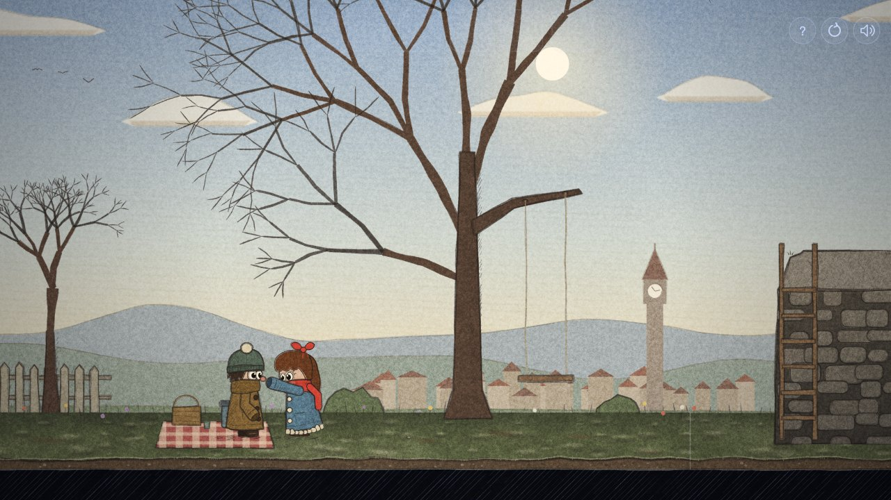

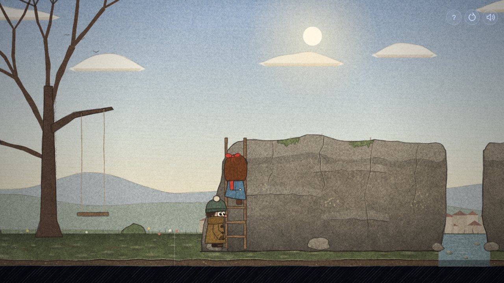

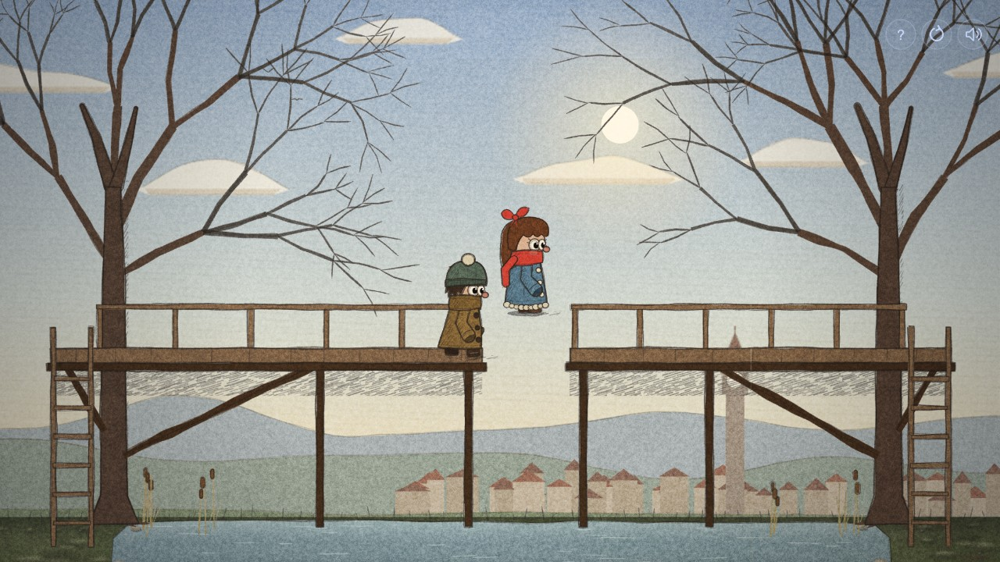

**天一下子黑了（2026-11-28 再后来，主人：“the sky become dark suddenly”）**：原来两个人在树屋上看太阳落山，天慢慢变红、变黑（6.6 秒，下面两张旧图）。现在天是一下子黑的，黑从钟楼来（抓走她的就是钟楼来的那件黑长衣，铃也是它那只铃），所以还没被抓走，玩家先看见了游戏最后要去的地方。一共 5.8 秒（`dayEndUpdate`）：
- 0.6 秒她指着山下的镇子、钟楼蹦一下（和原来指太阳一样的一下）；
- 2.2 秒远处钟楼的铃一长、2.9 秒一短（`snd.bell` 远处那一种），钟楼两边几道弧；2.45 秒钟面黑了（白天那张远景里钟面是亮的）；
- 2.7 秒起黑从钟面那儿漫开来（`dayInk`：钟楼不在画面里就从画面右边进来；先慢后快，1.6 秒盖满）：漫到的地方不画白天的天，露出底下夜里的天（月亮、星星、黑着的钟楼）；边上一圈墨最黑、往里淡下去，前面伸出去十几根墨的指头（`dayInkBlob`、`dayInkFront`），边一鼓一鼓地动。起一阵风（`snd.gust`），天上的鸟淡掉；
- 3.1 秒起太阳光 1 秒里暗到 0（地上跟着黑下来）；3.0–4.4 秒两个人吓得缩一下；
- 4.3 秒她拿出手灯，4.8 秒打开（闪两下才亮稳）；5.8 秒接上原来的开场。

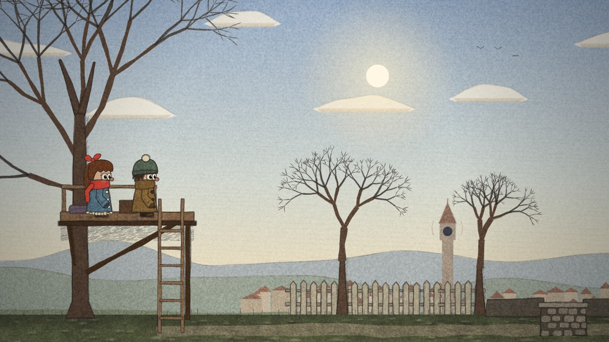

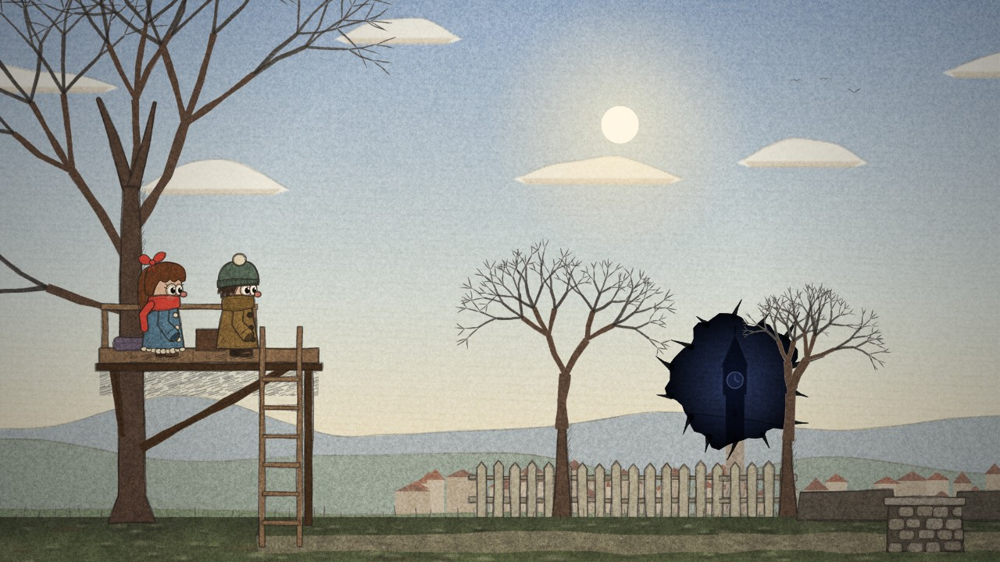

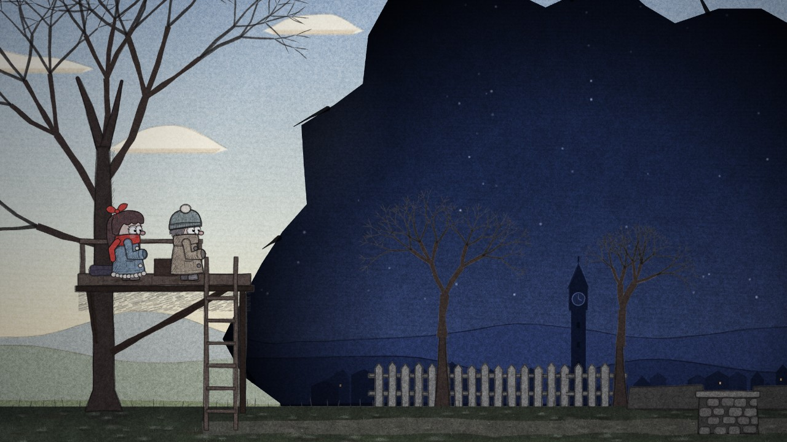

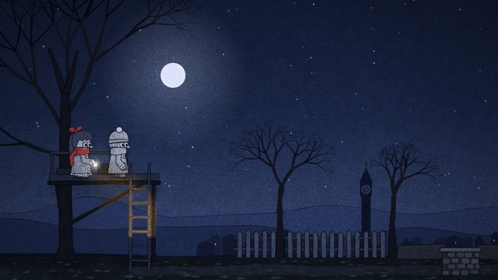

换掉的旧样子（看太阳落山）：

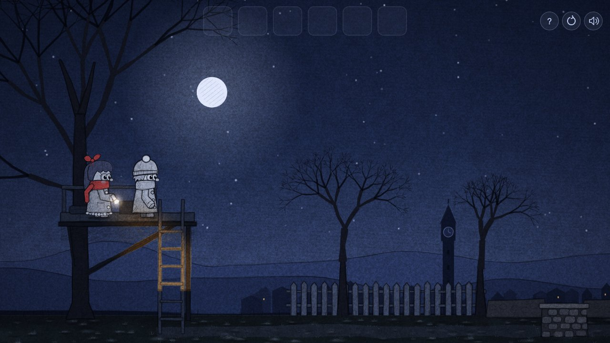

**两棵树上的树屋（2026-11-28 最后）**：主人先说“make the rocks look more like natural boulders”，砖垒的方石台换成了两块天然的大石头；又说两块大石头靠着梯子不合理，接着说最大的问题是野地里不该有两块那么大的石头，挑了“Treehouse on trees”。现在是池塘两边各一棵老树（`dayTreeHouse`），树上搭着一块木板平台，和后山的树屋一样的搭法：后沿一道栏杆（梯子那儿留着口），底下两根斜撑从树干撑出去，伸到水上的那一截底下再立两根柱子，柱子脚泡在水里；外头那一头一架木梯下到地上（`dayLadder`）。两块平台都伸到池塘上面，当中隔着一道缝，左边那块缝边的栏杆上插着一面小红旗。两棵树当中是一片池塘（`dayPond`：两头圆的岸，后沿映着天，几道水纹，岸边几块石头、几丛枯了的香蒲），所以地上的路走到梯子脚为止、再往里是水，要从树上走。树和后山的树屋那棵一样是光秃秃的枝子。脚踩的高度、缝、梯子的位置都没动（`DAY.rk0`、`gap0` 这些名字是大石头留下来的），只是画；提示气泡里的缝（`hopGap`）也从两块石头换成了两块平台。

**她跳过缝（2026-11-28 再后来，主人说“make the girl's jump over the gap look more natural”）**：原来是站着直直地飘过去（横着先慢后快再慢、一道正弦弧，身子不动，影子跟着脚一起升上去）。现在分三段，一共 1.1 秒（`dayGirl` 里的 `G.jump`）：
- 蓄力 0.24 秒：站在原地蹲下去、身子往前倾、两只袖子往后摆；
- 空中 0.56 秒：一蹬出去，横着匀速、竖着一道抛物线（最高 62）；腿一前一后跨开、往上收一点，身子只往前倾一点，两只袖子在胸前朝前伸（举高了会挡住脸）；脚底下是空的，影子淡掉（`drawKid` 多认一个 `kid.shK`，影子留几成，不给就是原来的样子）；
- 落地 0.3 秒：蹲一下缓冲、往前滑一小步，再站起来。起跳、落地的时候脚底下蹭起一点灰（`drawDay` 里的 `D.dust`）。

改了以后孩子可能在她刚落地、还站在那边缝边的时候就跟着跳过去，跑到她前头、和她挤在同一架梯子上；点着走的时候还会先上了树屋，她在下面等他下来、他在上面等她上去，卡住。所以：她还在跳、或者刚落地还没走开，孩子在缝边等一下再跳（`dayJump`）；他跑到她前头去了，她不管在哪一层都赶上去（`dayGirl` 的 `lead`）。

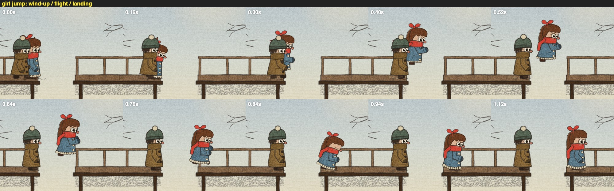

气泡（他站着不动 5 秒，再画隔 8 秒）：草地上、右边树屋下来以后画往右的箭头，梯子跟前画梯子和朝上 / 朝下的箭头，平台上缝边画两块平台当中一道缝和跳过去的弧线（`hopGap`）；走到缝边停住、手松开了 0.9 秒也画一次。点 ? 圈出该去的梯子、缝。

### 怎么接进游戏的

- 地方：`DAY`（树屋再往左，x 从 -7400 到 -3600），三间室外的屋子 `dayA`（草地、秋千、野餐）、`dayB`、`dayC`（池塘两边两棵树上的树屋和当中的缝，右边那棵树到后山树屋的草地），都画在 `paintDay`（每一间把整片画一遍，只留自己那一截；最右一间画到 -3660，再往右是树屋那一间自己的地）。两个树屋平台上脚踩的高度和后山树屋的平台一样（700）。
- 路：`NODES` 后面多了五个点、`EDGES` 后面多了五段（`DN` 起）：草地 → 左边树屋的梯子 → 两块平台上一整段（`DE_GAP`，当中那道缝 `driveBlock` 不让走过去，要跳：`dayGapInput`、`dayJump`；点着走跨过缝的时候走到缝边跳过去再接着走：`dayGapCut`）→ 右边的梯子 → 地上，接到树屋左边的路头（`PN + 4`）。孩子跳缝用的是跳上脏衣篓那一套（`hopTo`），多了 `dur`、`arc`（跳多久、多高；不给就是原来的 0.42 秒、30）。
- 白天：一盏“太阳”（`LIGHTS` 里的 `sun`）整片照亮，亮的一层照常抠出来，所以白天的样子就是灯底下的样子；不画灯芯、光晕，不算安全的灯。天一下子黑的时候它 1 秒里降到 0，露出暗的一层。天另画一张（`daySky`：渐变、横排线和云、太阳，远处的山和镇子用夜里那张同样的种子、换成白天的颜色，钟面是亮的），画在夜里的天上面（`drawPreSky` 里，把 `V.day` 当 `o` 给它）；黑漫过来的时候按 `o.ink` 挖掉一个一鼓一鼓的圆（`clip('evenodd')`），露出夜里的天、星星、镇上的灯，`o.clock` 把钟面涂黑，`o.ring` 画铃响的弧。（原来是 `o.sky` 从 1 慢慢降到 0、越盖越少：看太阳落山。`sky` 这个值还在，现在一直是 1。）天上飞过去三只鸟（`drawDay`，黑漫过来就淡掉）。
- 她（`V.girl`）照着自己的一步步走（`dayGirl`）；状态都在 `V.day`（演完就是 null）。她的手灯就是原来开场那盏 `glamp`（天黑才打开）。天一下子黑的那一段演完调 `preStart()`，两个人站的地方、她手里亮着的灯和原来开场开头一模一样，镜头这时候已经挪到原来开场的样子。
- 只在**从头开始**的时候演（没有存档的第一次打开、点“重来”、通关后“再来一遍”）：`introStart()` 先演“有人敲门”，跟她出门以后接这一关（`knockEnd` → `dayStart`）。`?intro=day` 直接从这一关的草地开始；`?intro=pre` 直接从原来的开场（树屋上天黑那一下）开始；`?nointro=1`、读档、`?lv=N` 照旧不演。不存档、站着的小动作不做（`writeSave`、`idleOK` 认 `V.day`）。天黑以后（原来的开场里）草地、两个树屋那几段走不进去（`chooseAt`、`walkTo` 认 `DAY_E`），左边走到树屋的路头就停，和原来一样。
- 自动试玩照“下一步”也走得过（`dayNext`：爬上左边的树屋、跳过缝、爬下右边的树屋、爬上后山的树屋）。规则、`check.mjs` 没动。

### 验证（2026-11-28，本机 Browser pane，窗口藏着，从画布上取的图）

- `node tools/check.mjs`：和改之前一字不差。
- 照“下一步”一关一关走（和 `tools/autoplay.cjs sim` 同一个走法，在页面里跑，新旧两版各一遍）：第 1 关新版 169.4 秒、38 下、被抓 0 次——那天下午 27.6 秒、4 下；原来的开场 37.6 秒（和改之前一样；点了 10 下，改之前 9 下，是自动点的 0.6 秒节拍错开了一点）；屋里那一段 104.2 秒、24 下（和改之前一样）。`?intro=pre` 的第 1 关和改之前一模一样（141.8 秒、33 下、被抓 0 次）。第 2–22 关两版一模一样（几秒、点了几下、被抓几次）。没有报错。
- 用方向键（拖着走）从头走到天黑接上原来的开场：她点鼻子、跑开、等他、先爬、先跳；他在缝边接着往右拖自己跳过去；接上原来的开场以后孩子还站在原地，镜头没跳，她闪两下灯、下梯子，照旧。点着走（`?ctl=tap`）一下点到右边的大石头（爬上去、走到缝边、跳过去、接着走）、一下点到树屋。看太阳落山的时候按 Esc 跳过；“重来”又从草地开始；天黑以后往左走、往左点，停在树屋左边的路头。
- 画面：上面五张（1280×720）；手机竖屏（375×812）看过草地那一帧（挂秋千那棵树的树梢原来被画布顶上切掉一截，把 `dayA` 的画布往上加高了）。
- **没验证的**：没有真人用手指玩过；声音没听过（点鼻子、跳、打开手灯用的是已有的 `tap`、`hop`、`click`）；只看了截图，没看连着动起来的样子；平板、超宽屏没看过。`tools/autoplay.cjs` 本机没装 playwright，没跑（换成了在页面里跑的同一套走法）。

## 做成的：房子左边的后山

两个孩子从他卧室的侧窗溜出去，到后山的树屋上看山下的镇子（远处看得见钟楼）。回家的路就是教操作的那一段；走到房子后面，她被抓走了。

| 一步 | 玩家做什么 | 她做什么 / 发生什么 |
|---|---|---|
| 树屋上 | 在梯子跟前**往下拖**（↓）爬下梯子 | 手灯闪两下（两个人说好的暗号：该回去了），她先下梯子，在下面回头等 |
| 山坡上的小路 | **左右拖**走路 | 她提着手灯在前面走；他跟得紧就快走，落下了就站住回头等 |
| 矮石墙 | 走到墙边停住；在墙边**往上拖**（↑）跳上墙顶，再**往右拖**跳下去 | 她先跳上去、跳过去，在墙那边等。和第 1 关跳上脏衣篓是同一个操作 |
| 房子后面 | 走到她身边 | 屋里的灯还亮着（从后山看过去屋里是暖的） |
| 被抓走（演的，点一下屏幕跳过） | — | 屋里的灯闪几下全灭了（停电）；铃一长一短，墙角的影子里立起黑长衣；她拿手灯照它，它抬袖子挡脸；铃又响，墨顺着地爬过来掐灭了手灯；它扑过来抓住她，**扛着她跳上树、跳上屋顶，沿着屋脊往右跑，从房子那头跳下去，越飞越小，落到山下钟楼的顶上**（镜头一路跟着它）；黑一下，回到孩子这儿 |
| 一个人 | 在树跟前**往上拖**爬树（树干上钉着一级级木条），走到粗树枝头上 | 侧窗开着，窗台上挂着她被扛过去的时候扯下来的那截红布 |
| 钻进侧窗 | — | 弯腰钻进卧室，第 1 关从这儿开始（屋里黑了，门边的睡袍立起来了）；它往哪儿去了刚刚看见了：往右，过了房子，往钟楼 |

不用字（主人 2026-11-18 说过没必要的字不要写、手指的操作不要画出来）：她先做一遍给他看；他站着不动久了，头上的气泡里画该怎么动——一架梯子和朝下 / 朝上的箭头、一道矮墙和跳上去的弧线（每一步头一回 5 秒，一个人的时候 2.5 秒；再画隔 8 秒）；走到石墙跟前停住的那一下也画一次。点 ? 照旧：圈出梯子、石墙、她、那棵树，气泡里画同样的图。

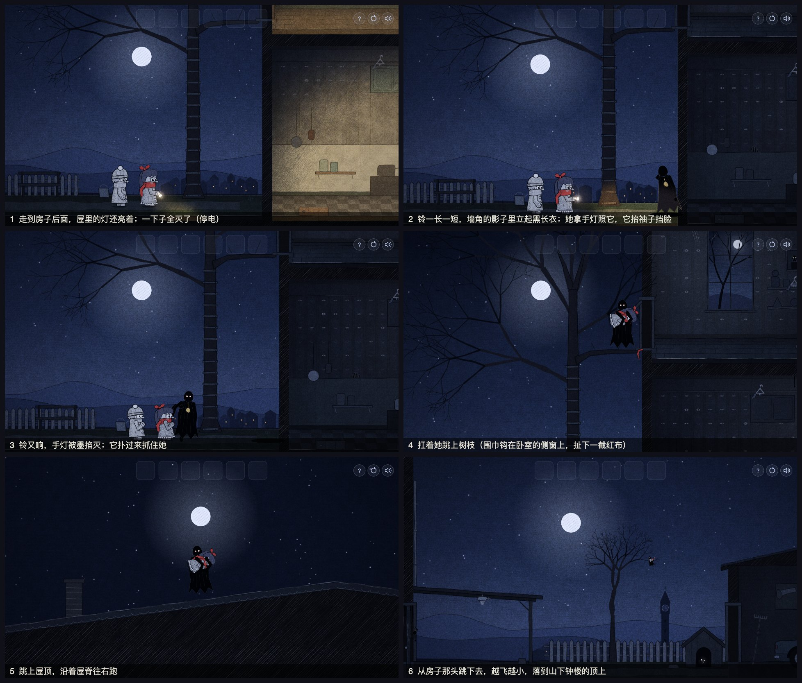

## 怎么接进游戏的

- 地方：`PRE`（房子左边，x 是负的），三间室外的屋子 `preA`（树屋）、`preB`（小路和矮石墙）、`preC`（房子后面、那棵树、卧室的侧窗），画在 `paintPreA/B/C`。天是院子那张天（`skyLayer`，从 `drawSky` 里拆出来的，院子的天一个像素没变），在后山跟着镜头走；它跑过屋顶的时候屋顶上面也露出天（`drawPreSky`），屋顶是 `HROOF`（平常镜头看不到那么高）。
- 路：`NODES` 后面多了九个点、`EDGES` 后面多了八段（`PN` 起），**和房子的路不连着**：孩子走到树枝头上，演一下钻进侧窗（`preEnter`），再摆到卧室里（x = 80）。原来的路、门、影子的编号一个没动。
- 矮石墙：走到墙边就停（`driveBlock`），在旁边往上拖跳上去、往左右拖跳下来，用的是脏衣篓那一套（`onBox = 'pwall'`、`hopTo`、`hopOffBox`）。点着走（`?ctl=tap`）的时候，路要穿过墙就走到墙边、跳上去、跳过去再接着走（`preWallCut`）。
- 她（`V.girl`）照着自己的一步步走（`preGirl`）。她在前面带路的时候孩子走不到她前头去；她被抓走以前，房子后面那棵树爬不上去。
- 她的手灯是一盏真的灯（`glamp`），停电以前屋里四间屋子各有一盏只在开场亮的灯（`pHb`、`pHk`、`pHa`、`pHl`），都不算“安全的灯”（被抓住不会回到这儿）。
- 只在**从头开始**的时候演：没有存档的第一次打开、点“重来”、通关后“再来一遍”。读存档、`?lv=N`、`?nointro=1` 不演。演的时候不存档；钻进卧室那一下存一次档，再打开就在卧室窗下的月光里，不再演。被抓走那一段点一下屏幕（或按 Esc、回车）跳过。
- 自动试玩（`?auto=1`、`tools/autoplay.cjs`）照“下一步”也走得过开场：下一步依次是下梯子、跳过石墙、走到她身边、爬树（`preNext`）。
- 规则、`check.mjs` 没动。

## 她、黑长衣

她和孩子同一副身子（`drawKid`，`kid.girl`）：灰蓝的大衣、下摆一圈奶白的花边、红围巾（垂下来一截）、手里一盏小手灯；齐刘海，头发披到肩膀，头顶偏后一只红蝴蝶结。暗处衣服照旧变冷变灰，围巾和蝴蝶结留着一点红（`GIRLD.collar`）。2026-11-28 加了爬梯子的背影（`drawKidBack`：头发、蝴蝶结、背后垂下来的一截围巾，手灯挂在大衣上）。

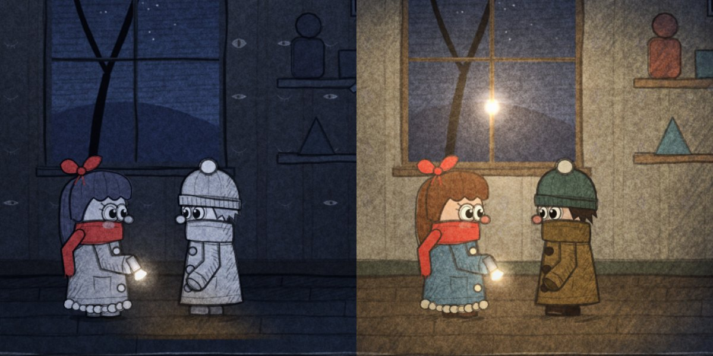

黑长衣是 `bellCoat`：三角下摆的黑长衣，领口上面一团墨、两只眼睛（要抓人的时候发红），胸前一根短链子挂着缺了一个角的铜铃。被光照到：一只袖子抬起来挡脸，身子往后仰。第 21 关钟楼顶的也是它。铃声 `snd.bell`。

## 验证（2026-11-28，本机 Browser pane）

- `node tools/check.mjs`：和改之前一字不差。
- 21 关照“下一步”一关一关走（和 `tools/autoplay.cjs sim` 同一个走法，在页面里跑，新旧两版各一遍）：第 2–21 关两版一模一样（几秒、点了几下、被抓几次都一样）；第 1 关新版多了开场，143.0 秒、33 下、被抓 0 次（旧版 114.2 秒、24 下，里面有 9 秒多的旧开场）；`?nointro=1` 的第 1 关两版一样（105.2 秒、24 下）。没有报错。合进 main 以前又和当时的 main（`cfbadda` 多了地面起伏、道具页；`98f3239` 主角站着不动的小动作用上了）各比了一遍，结果一样。站着的小动作开场里不做（`idleOK` 原来认的是 `V.intro`，改成认 `V.pre`）：在树屋上站 40 秒、走完整个开场都没有动过，钻进卧室以后照常有。
- 用方向键走完一遍开场：下梯子、走、在墙边停住、↑ 跳上墙、→ 跳下来、走到她身边、被抓走、↑ 爬树、走到树枝头、钻进卧室；拖着走和点着走都试过；点一下（pointer）、Esc 能跳过；“重来”又从树屋开始；钻进卧室以后存了档，再打开在卧室里、不演开场。
- 画面：上面三张（1280×720）；手机竖屏（375×812）看过树屋和屋顶那两帧。
- **没验证的**：没有真人用手指玩过；声音没听过（铃、停电的咔哒、爬梯子的声音）；平板、超宽屏没看过。`tools/autoplay.cjs` 本机没装 playwright，没跑（换成了上面在页面里跑的同一套走法）。

## 第一版（2026-11-27，已经换掉）

一开场就在卧室：她举着手灯和孩子站在窗下，铃一长一短，窗外升起黑长衣，她拿灯照它、它往后缩，铃又响，墨爬进来掐灭了灯，两只墨袖子把她拖出窗，窗台上留下一截红布，9.4 秒以后孩子能动。2026-11-28 照主人上面那段话换成了现在这样（那扇窗现在只是窗；红布挪到了侧窗的窗台上）。

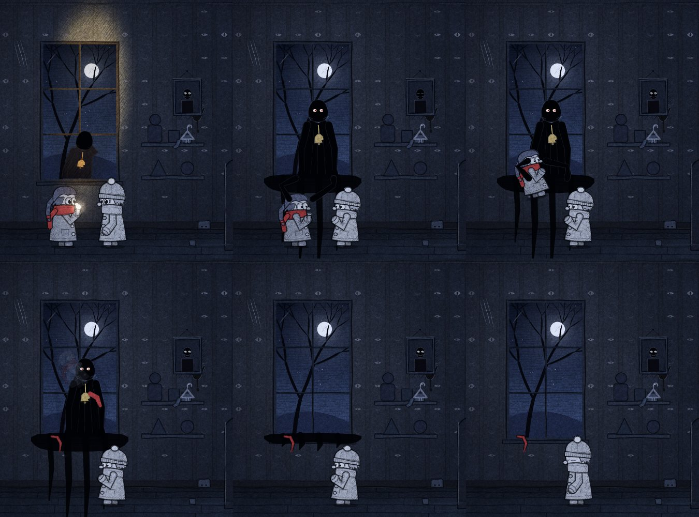

## 还没做

三次碰面（屋顶、闸桥、广场）、决战里她撑反光板、结局两个人回家，都还没做；第 21 关现在的结局是临时的（`docs/night-photo-removed.md`）。
