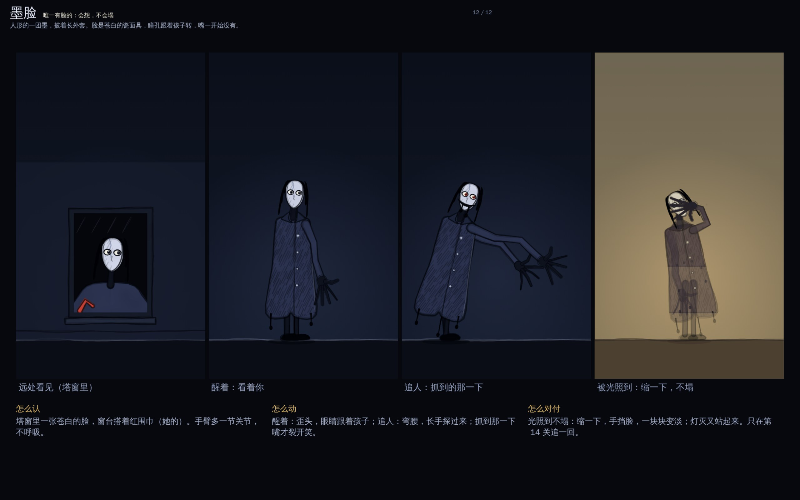

# 夜里 · 新故事骨架（D：有脸的墨，一个人，一座墨水厂）

2026-11-26。主人 11-25 说“黑夜里找光的设定不要了”，`docs/night-story-c.md` 作废，剧情还要再改。这一页是改的骨架，**只是文档，游戏没动**。

## 这一页是怎么来的

1. 主人让我对照《机械迷城》想剧情怎么设计。我指出三个洞：**孩子为什么要去钟楼、灯为什么灭、追人的黑到底是什么**（C 把它们全押在“衣服其实是人”上，这个反转删了，三个洞就空了）。
2. 我问墨要不要有脸。主人答：**“有脸更恐怖，辨识度高，大家会觉得它有自主思考能力，而不是一个不知道是什么东西。就用有脸的。”**
3. 第一版（PR #168，在 git 历史里）把目标写成“家人被带去钟楼”。主人看了说：**“一开始就知道被带去哪边，我倾向这样。或者不要弄家人了，家人是好多人，就简单一点，一个目标，女朋友之类的。墨水为什么来，可以在游戏里慢慢揭晓，比如遇到一个工厂在生产墨水，一滴一滴的。”**
4. 这是第二版：目标换成**一个人**；墨的来历做成**一座墨水厂，分几次露出来**。

## 主人定了的（2026-11-26）

- **她**：隔壁的同龄小伙伴。
- **第 1 关五样家人的东西**（梳子、耳机、毛线、扳手、怀表）：先留着，不解释。
- **工厂的主人**：不讲，只讲“墨是哪来的”；**但可以露一格**：墙上挂一张墨脸穿工作服的画（放哪见“墨是哪来的”那一节）。

## 一句话

一只有脸的墨吹灭了镇上的灯。孩子在窗口亲眼看见它把一个人拖进了钟楼。他要穿过整个镇子、找到那座在把光变成墨的工厂、爬上钟楼，把她带回来。

和机械迷城对上的地方：

| 机械迷城 | 夜里 |
|---|---|
| 约瑟夫被黑帽子扔掉，一开始就知道对头是谁 | 孩子在窗口看见墨脸把她拖进塔 |
| 贝尔塔被关在塔里 | 她被关在钟楼顶 |
| 黑帽子要炸塔，倒计时 | 月亮落下去、天亮前（只是背景，不计时） |
| 一路上机器人、机关、回忆气泡 | 一路上怪物、机关、衣服旁边掉的东西 |
| 结局：两个人并肩看日落 | 结局：两个人（和狗）拍一张合影 |

## 她（暂称，名字、身份主人定）

- **同龄的小伙伴，住在隔壁**（我的倾向；备选见最后“要主人定的事”）。两家窗对着窗，窗和窗之间拉一根线，两头各一只纸杯（纸杯电话）。
- **一条红围巾**。她永远围着，全游戏只有它是红的，远远就认得出。远处钟楼窗口里一点红 = 她在那儿。（红在暗的一层还看不看得见，要试，做不到就改成“暗处也不褪色的一点颜色”。）
- **为什么是她、她为什么还在**：不解释。机械迷城也不解释贝尔塔为什么被抓。

## 开场（第 1 关补一格画面，规则不动）

- 孩子在卧室窗口。窗外隔着院子，是她家的窗，黑的；纸杯电话的线垂着，晃。
- 远处钟楼钟面亮着，闪几下，灭了。**闪的那一下，塔窗里是一个苍白的脸，拖着一个小小的、围红围巾的身影进了塔。** 镇上的窗一扇扇跟着黑下去。
- 孩子抓起大衣出门。座钟里的灯崽领路的写法保留：理由从“跟着灯崽”变成“灯崽知道她在哪”。
- 这样**一开始就知道目标、知道对头、知道去哪儿**，悬念留给“怎么走到、那是什么”。

## 这只墨（暂称“墨脸”，名字主人定）

**样子**
- 人形的一团墨，披着一件从镇上拿的衣服（每次不一样），走起来像人，又不太对（关节多一节、停下来不呼吸）。
- 脸是**苍白的、平的，像瓷面具**，全是黑的画面里最亮的一块。**眼睛是人的比例、有瞳孔，瞳孔跟着孩子转**；嘴一开始没有，**孩子失败的时候才裂开一条笑**。
- 全游戏**唯一一个脸像人的东西**，所以认得出：灯崽、火苗崽、墨崽是毛球加大白眼睛，十一只怪物是衣服加墨加一堆小眼，都和它不一样。

**怎么看出它在想（不出字，靠它做的事）**
1. 它看着你：远处窗里、镜子里、屋顶上，瞳孔跟着转。
2. 它记得你做过什么：孩子点亮一盏灯，过一会儿那盏灯被墨崽吃了（第 15 关已有）；孩子躲过一次，它下一次站在孩子躲的地方等。
3. 它在学：第 7 关的学人精、第 17 关人台里多出一个有脸的，是它在练“像人”。
4. 它会得意，也会失手：孩子失败它才笑；被光照到它缩一下，不是塌下去。
5. 它不说话，但会做动作：歪头、抬手、吹灯的手势。

## 墨是哪来的：一座墨水厂，一滴一滴露出来

主人的意思：不一开始讲，在游戏里慢慢揭晓。我的做法：**答案只有一句**——镇上老墨水厂的机器没停，它在把镇上的光抽走、变成墨；**揭晓分五次，每次只多一点**。全是画面，不出字，规则一个字不动。

| 次 | 关 | 玩家看到什么 | 玩家能猜到什么 |
|---|---|---|---|
| ① | 1 | 墙角或天花板一滴墨，“嗒”一声，在地上摊开一小圈 | 墨在滴，没人知道从哪儿来 |
| ② | 3–6 | 路灯灭的时候，光**顺着灯杆往下流进地里**，杆脚渗出一滴墨 | 光去了地下，变成了墨 |
| ③ | 11–12 | 地下通道、旧地铁的墙里一捆电线和水管，**全朝同一个方向往下走**；管子口挂着一滴一滴的墨 | 有一个地方在收光、出墨 |
| ④ | 13–14 | 管子汇成一根粗的，通到一座**老墨水厂**：机器、传送带、一排排瓶子，瓶子里是一小团一小团被抽进来的光，传送带那头变成墨，一滴一滴滴进大池。**这里是墨脸第一次近，它从池里升上来。** | 墨是这儿造的；它是这儿出来的 |
| ⑤ | 15 | 地面变电站，合闸以后灯全亮了，**粗电缆往地下通，就是刚才那条**。灯越亮，工厂吃得越多：假的“好了”是它放的，墨崽爬上去啃灯 | 它故意让你开灯，好吃更多的光 |

- **墨崽就是从厂里滴出来的那一滴**（毛球加大白眼睛，不抓人，只啃灯），不是另一种东西。
- 不加新关：把现有的第 13 关（下水道）、第 14 关（地下最深处）当成工厂外面和里面，第 15 关当成工厂的电源。第 14 关现在是“最低的地方，光全没了”，正好做成工厂车间。
- **“这厂是谁开的、为什么造墨”不讲**（主人 11-26 定）。**只露一格**：第 14 关工厂的办公室（车间边上一间小屋）墙上挂一张旧画，画着一个穿工作服的人，站在机器前，**脸是苍白的、平的，就是墨脸的脸**。不用字，不指给玩家看，走过去的人自己会停一下。它回答不了“为什么”，只让人想：它是这儿的人？还是这儿造出来的？画要旧，边角发黄，和第 21 关那两张全家福（旧的、新的）一样用铅笔线的画法；挂在孩子必经的一面墙上，但不挡路、不用点。
  - 位置我先放第 14 关，因为它第一次从池里升上来就在这一关，前后两三分钟就能对上。第 13 关下水道只放“管子”，不放画。
  - 要不要让第 17 关人台里那个有脸的，穿的也是一件工作服？先不加，看了第 14 关的画再说。

## 墨脸的图鉴（2026-11-26 画好了，没进任何一关）

看：`games/house.html?monsters=face`（总览的最后一列，第 12 页）。四格：**远处看见**（塔窗里一张苍白的脸，窗台搭着一截红围巾）、**醒着**（站着，歪头，瞳孔跟着孩子转，没有嘴）、**追人：抓到的那一下**（弯着腰，长手探过来，瞳孔缩小发红，**嘴这时候才裂开一道笑**，越过脸的边）、**被光照到**（亮的一层：缩一下，手挡住脸，从下往上一块一块变淡，往上飘墨点；它不塌）。

- 画法和别的怪物一样（`games/house.html` 的“墨脸”那一段：`mzMask`、`mzMaskFace`、`mzMaskHome`、`mzMaskFlinch`，签名 `(b, P, lit, x, fy, f, t, m, seed)`），配色 `mzMask*` 登记进了 `LIT`、`DARK`。
- 脸全游戏只有它像人：苍白的瓷面具，一道裂纹从额头往下，一半脸在阴影里；人的比例的眼睛，**瞳孔用 `m.look`（-1 朝左、1 朝右）跟着转**，以后放进关卡，把它设成孩子在左边还是右边就行；头发是几缕湿的墨垂在脸两边。
- 手臂比人多一节关节（肩、肘、多出来的一节、腕），腿细，尖头鞋；站着不起伏（不呼吸）。
- 嘴：`m.grin`（0–1）。图鉴里 `hunt = 1` 那一格就是“抓到的那一下”，所以 `grin` 默认跟着 `hunt` 走；**以后放进关卡，追人的时候要显式传 `grin: 0`，抓到的那一下再传 1**。
- 红围巾那一截只画在“远处看见”那一格，这一格就是第 1、3、6 关窗里的样子（窗里的画法是 `mzMaskHome`，游戏里用的时候传 `m.game` 就不画墙）。
- **规则、关卡、`GARB`、`check.mjs` 一个字没动**（`node tools/check.mjs` 输出和以前一字不差）。看过的：电脑（1280×800）、手机竖屏（390×844）、总览（1600×800）截图，无头 Chrome 里没有报错。

没验证的：红在暗的一层里看不看得见（现在是 `#cf4438`，在窗里看得见，放进关卡要在真的黑暗里再看）；瞳孔在手机竖屏上能不能看出来在转（图鉴里一格只有 180 像素宽，脸 40 像素高，瞳孔跟着转的幅度只有两三个像素，放进关卡要放大或者夸张一点）。

## 一路上怎么出现（只加画面，不改规则；大多只是看见）

“看见”要少、要晚、一次比一次近，别让它变成每关都有的熟人。

| 关 | 它在哪儿 | 做什么 | 动规则吗 |
|---|---|---|---|
| 1 | 开场窗外，塔窗 | 脸，拖着红围巾进塔 | 不动 |
| 3 | 下山拐角，远处一扇窗 | 脸转过来跟着孩子，孩子走远了才缩回去 | 不动 |
| 6 | 屋顶，对面钟楼顶 | 抬手，镇子里最后几盏灯一起灭；塔窗里一点红 | 不动 |
| 7 | 学校，教室黑板 | 黑板上原来空着，现在有一张粉笔画的脸，笑着；孩子走开再回头，它多画了一笔。转折的意思：从这一关起，怕的是被**盯着** | 不动 |
| 10 | 剧院，化妆镜 | 孩子站在镜前，镜子里他背后站着它，眨一下就没了 | 不动 |
| 14 | 墨水厂车间，大池 | **第一次近、第一次追**：脸从墨池里升上来，追孩子，孩子往上跑出排水口 | **一处追逐**，被抓 = 回最近一盏灯（和其他怪物一样，不加新惩罚） |
| 15 | 变电站，合闸以后 | 灯全亮的那一下，它在铁塔顶上笑，然后墨崽爬上去啃灯 | 不动（墨崽啃灯已有） |
| 17 | 百货大楼，人台 | 一排没脸的人台，其中一个有脸，孩子走过时脸转了半圈 | 不动 |
| 19 | 钟楼门口，老街 | 站在门口，让一街的衣服朝孩子走过来，它自己不动；孩子绕开它上去 | 看第 19 关再定 |
| 20 | 钟楼里面，楼梯上面 | 只露脚，一层比一层近；塔窗里的红越来越近 | 不动 |
| 21 | 钟楼顶，大灯前 | 站在灯前面，挡着；灯点亮的那一下，光把它整个照穿（见下） | 动画，不动规则 |

被抓到、回灯下的规矩不变（`night-rules.md`）：墨脸不加死亡、不加倒计时。

## 结局

- **她在钟楼顶那座矮角楼里**（第 21 关现有的角楼，加一扇有铁条的小窗，红围巾从窗里露出来）。
- 第 21 关主体不改：拿发条钥匙、上弦、挂铁坨、拉脱扣杆，大灯点亮，光一圈一圈扫出去，天亮，家里的窗一扇一扇亮起来。
- **加两处**：
  1. **光顺着第②③④次露出来的那些线反着流回去**：路灯一盏一盏亮成一串，电缆、水管里的光往地下灌，最后一个镜头是墨水厂的池子见了底，最后一滴墨往上飞回管子里。（用画面把“墨是哪来的”收住。）
  2. **墨脸的收尾**：光扫过它，它不塌（衣服才塌），像被擦掉一样一块一块变淡，**最后一块是脸，眼睛看着孩子，没有笑，像第一次看清他**。然后角楼的门开了。
- 她走出来，围着红围巾。两个人（和那只狗）下钟楼、坐末班车、上坡回家，在门厅座钟前**拍一张合影**。开场挂在门厅的旧照片、结局的新照片前后呼应的设计原样留着（`night-story-c.md` 的“门厅的全家福”），只是**人从六个变成孩子、她、狗**，要对一对哪几处“一样、哪几处不一样”，等做到那一关再改（现在八处：穿的、手、谁是糊的、孩子、钟顶的小灯、光、狗、头顶，大概会剩五六处）。
- 机械迷城的结局是两个人看日落，这里是两个人拍一张照片。

## 现有东西怎么处理

| 东西 | 处理 |
|---|---|
| 十一只怪物 | 留。设定改成“墨脸的衣服、看门狗”，不再有“它们其实是人”。 |
| 墨崽 | 留，设定改成“墨水厂滴出来的那一滴”；第 15 关啃灯就是它。 |
| 第 1 关五件家里人的衣服和五样东西（梳子、耳机、毛线、扳手、怀表） | **先留着、不解释**：它们只是“这家人的东西掉在这儿”。孩子不为他们去钟楼，家人不再是目标。要不要改成别的，或者删掉，主人看了第 1 关再定。 |
| 第 21 关六人全家福、结局六人合影 | 改成孩子、她、狗（见上）。 |
| 第 7 关的“转折” | 原来是“把光递给小孩衣服”，已经删了；改成上表那一格（黑板上的脸）。 |
| 第 14 关 | 留，加上“工厂车间、墨的源头、第一次追逐”。 |
| 第 15 关“假的好了” | 留，加上“是它放的、电缆通向工厂”。 |
| 活人（`night-people.md`） | 照旧：它为什么不碰他们，不解释；可以加一格“它看着长椅老人，老人没看它”。 |
| `night-story-c.md`、`night-story-pitches.md` | 页首已写“作废”，不删字。 |

## 风险

- **有脸的东西容易变成“每关追着你”的熟人**，恐怖会磨平。所以只在第 14 关追一次，别的都是看见。
- **“一路上露出来”的五次要克制**：每次只加一个小画面，别出现“解说式”的一整面墙。工厂那一关（14）可以放一整屏，其他都是一滴一杆线。
- **第 14 关现在是“全游戏最低、光几乎没有”**，改成工厂车间以后要保证还黑、还窄，别变成一个明亮的大厂房。
- **第 21 关现在是解谜加动画、没有对手**：墨脸站在灯前，要有一个“为什么它不直接扑过来”的道理（灯罩铁片没打开以前它够不着，一开光就照穿它）。具体等做到那一关再写。
- **脸要画得对**：全游戏是铅笔线，脸要用同样的画法，苍白但别像卡通。先画一张图鉴（像 `?monsters=1` 那样），看了再定。
- **瞳孔跟着转**要在手机竖屏上试，瞳孔太小就看不出来。

## 要主人定的事

已定的见上面“主人定了的”。还没定的，我都给了倾向，不同意再说：

1. **名字**：她、墨脸、墨水厂都还没有名字。我倾向不给她起名字（不出字，名字用不上），墨脸就叫墨脸。图鉴和文档里需要叫的时候再说。
2. **工厂放哪**：不加新关，用第 13、14 关当工厂外面和里面。
3. **脸是谁的**：谁的都不是，留着结局那一眼。
4. **追逐几处**：只放第 14 关一处。
5. **先做什么**：墨脸的图鉴已经画好了（上面）。下一步我建议补第 1 关窗里那一格（脸拖着红围巾进塔，用 `mzMaskHome`，只是画面，规则不动）。
